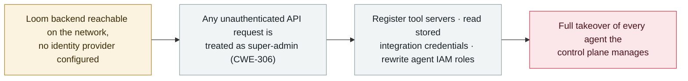

# Loom for AWS: missing authentication hands any client super-admin over the agent control plane (CVE-2026-103956)

      

## Summary

**AWS disclosed CVE-2026-103956 (CVSS 10.0, critical) on 2 October 2026 (Security Bulletin 2026-124-AWS): Loom for AWS — an AWS Labs open-source platform for orchestrating AI agents on Amazon Bedrock AgentCore Runtime — grants super-admin over the agent control plane to any unauthenticated network request when no identity provider is configured.** The flaw (CWE-306, missing authentication for a critical function) lets a remote client register tool servers, read stored integration credentials, and rewrite the IAM role policies attached to managed agent roles — i.e. full takeover of the agents the platform manages. AWS fixed it in Loom 1.6.1 (released 4 August 2026) and the advisory recommends configuring an Amazon Cognito user pool or an external IdP (and never setting `LOOM_ALLOW_UNAUTHENTICATED_LOCAL_DEV` outside dev) before exposing the backend beyond loopback. The same bulletin also covers CVE-2026-103957 / -103958 (SSRF in Loom, fixed in 1.7.0) and CVE-2026-104019 (command injection in SageMaker Unified Studio). **No confirmed in-the-wild exploitation** (not in CISA KEV; a public-PoC claim is unverified). Recorded `vulnerability` / `INFRA` + `CRED` / `high` / `real_harm: false` — a CVSS-10 agent-orchestration-platform flaw with no known exploitation.

## Attack chain

## Details

**The flaw.** On 2 October 2026 AWS published Security Bulletin 2026-124-AWS covering **Loom for AWS**, an AWS Labs open-source project for orchestrating AI agents on **Amazon Bedrock AgentCore Runtime**. **CVE-2026-103956** (CVSS **10.0**, CWE-306 — missing authentication for a critical function) is the headline issue: when a Loom deployment runs **without an identity provider configured**, the backend treats *any* request to its application API as a fully-privileged one. A remote, unauthenticated client therefore gains **super-admin over the agent control plane** — it can **register tool servers, read stored integration credentials, and rewrite the IAM role policies** attached to the managed agent roles. Because what is exposed is the keys and the role policies, a successful request is enough to take over every agent the platform manages.

**Fix and mitigations.** AWS addressed CVE-2026-103956 in **Loom 1.6.1**, released **4 August 2026** (the public advisory followed on 2 October). Until upgrading, AWS recommends configuring an **Amazon Cognito user pool or an active external IdP before exposing the Loom backend beyond loopback**, and ensuring `LOOM_ALLOW_UNAUTHENTICATED_LOCAL_DEV` is not set in any non-development deployment. Because the flaw allowed credential reading and IAM-policy changes, defenders should also rotate OAuth2 client secrets and any platform-managed IAM session credentials. The same bulletin batch covers **CVE-2026-103957** and **CVE-2026-103958** (SSRF in Loom's OAuth2 discovery and MCP/A2A connection handling, fully fixed in **1.7.0**) and **CVE-2026-104019** (OS command injection in the SageMaker Unified Studio startup script) — tracked here only as context.

**How it is graded.** Recorded `vulnerability` — a disclosed flaw, not a used-in-anger incident. `INFRA` (Loom is an **agent orchestration platform** — the agent's runtime infrastructure) and `CRED` (the loss is the **keys**: stored integration credentials and IAM role control, not data leaving a boundary, which is why this is `CRED` rather than `EXFIL`). `real_harm: false`: AWS reports no exploitation, it is **not in CISA KEV**, and a public-PoC claim from a secondary aggregator is unverified. Severity `high` rather than `critical` despite the CVSS 10.0 — this archive's severity reflects **what has already happened**, and a severe flaw with no known exploitation is `high` here (the same basis as [GitLab Duo](2026-10-02-gitlab-duo-ai-gateway-rce.md), CVSS 9.9, and [EchoLeak](../2025-06/2025-06-11-echoleak.md), CVSS 9.3). It is also configuration-dependent — only deployments with **no IdP** are exposed. Confidence `A`: AWS Labs' own GitHub Security Advisory (GHSA-vgmj-998f-r8mp), the AWS Security Bulletin and the NVD record, with independent reporting. Dated to the public advisory (2 October 2026); the fix (1.6.1) predated it (4 August).

## Sources

| # | Source | Link |
|---|---|---|
| 1 | AWS Labs — Loom security advisory (GHSA-vgmj-998f-r8mp) | <https://github.com/awslabs/loom/security/advisories/GHSA-vgmj-998f-r8mp> |
| 2 | AWS Security Bulletin 2026-124-AWS | <https://aws.amazon.com/security/security-bulletins/2026-124-aws/> |
| 3 | NVD — CVE-2026-103956 | <https://nvd.nist.gov/vuln/detail/CVE-2026-103956> |
| 4 | Cyber Security News | <https://gbhackers.com/aws-fixes-ai-agent-flaws/> |
| 5 | Security Online | <https://securityonline.info/loom-for-aws-sagemaker-flaws/> |

## Metadata

| Field | Value |
|---|---|
| Date | `2026-10-02` (raw: 2026-10-02 AWS Security Bulletin 2026-124-AWS / NVD; fix in Loom 1.6.1 released 2026-08-04, precision `day`) |
| Kind | Vulnerability disclosure `vulnerability` |
| Type | [`INFRA`](../../taxonomy/types.md#infra) [`CRED`](../../taxonomy/types.md#cred) |
| Severity | **High** `high` |
| Confidence | **A** — AWS Labs GHSA + AWS Security Bulletin + NVD, with independent reporting |
| Real harm | No — no known in-the-wild exploitation; not in CISA KEV; fix shipped before disclosure |
| AI involvement | Confirmed `confirmed` |
| Region | [Global](../../regions/global.md) |
| Archive ID | `2026-10-02-loom-aws-agent-control-plane-cve-2026-103956` |

**Why this classification:** A disclosed flaw in Loom for AWS, an AI-agent orchestration platform for Amazon Bedrock AgentCore (`INFRA` — agent runtime infrastructure; `CRED` — what is lost is the keys, stored integration credentials and IAM role control, not exfiltrated data). `vulnerability`, not an incident. `real_harm: false` — no known exploitation, not in CISA KEV, fix shipped before disclosure. `high` not `critical`: severity records what has happened, and a CVSS-10 flaw with no in-the-wild use that is also config-dependent (only no-IdP deployments) is `high` here (as with GitLab Duo and EchoLeak). Dated to the AWS advisory (2 October 2026). Grading criteria: [severity.md](../../taxonomy/severity.md) and [confidence.md](../../taxonomy/confidence.md).

## Related

**Topic:** [Agent infrastructure exposure (INFRA)](../../topics/agent-infra.md)

**Related records:**

- `2026-10-08` [AgentCorruption — one prompt takes over an AWS Bedrock AgentCore account](2026-10-08-agentcorruption-aws-bedrock-agentcore.md)   The same AWS agent stack, reached via IMDS instead of missing auth
- `2026-10-02` [GitLab Duo AI Gateway prompt-template sandbox escape (CVE-2026-90970)](2026-10-02-gitlab-duo-ai-gateway-rce.md)   Another agent-infrastructure flaw disclosed the same day
- `2026-09-14` [Bifrost AI gateway (CVE-2026-90898)](../2026-09/2026-09-14-bifrost-ai-gateway-cve-2026-90898.md)   Another AI-gateway infrastructure weakness

---

[← 2026-10 index](README.md) · [← All records](../../README.md) · [Chinese](../i18n/zh/2026-10/2026-10-02-loom-aws-agent-control-plane-cve-2026-103956.md)

This record is part of the **Orca AI Incident Archive**, licensed [CC BY 4.0](../../LICENSE). Found a factual error or a missing source? [Open an issue or PR](../../CONTRIBUTING.md) — corrections are recorded in the record's revision history, never silently overwritten.
