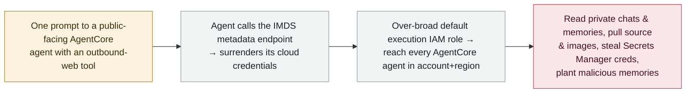

# AgentCorruption: one prompt turns an AWS Bedrock AgentCore agent into an account-wide takeover

      

## Summary

**Zenity Labs disclosed AgentCorruption on 8 October 2026 (at SecTor 2026, Toronto): a single natural-language prompt to a public-facing Amazon Bedrock AgentCore agent — one equipped with a common outbound-web tool — makes it call the IMDS metadata endpoint and hand over its own cloud credentials, which, because the default AgentCore execution IAM role is far broader than any one agent, reach every AgentCore agent in the same AWS account and region.** With those credentials Zenity's researchers could read other agents' private conversations and long-term memories, pull their source code and container images, retrieve credentials stored in Secrets Manager, and plant malicious "memories" that silently redirect an agent's future conversations to an attacker-controlled destination. The root cause is the combination of an agent's ability to make HTTP requests, IMDS-reachable metadata credentials, and an over-privileged default execution role. **No CVE was assigned.** AWS characterises the behaviour as documented and expected (and points to customer-side permission scoping), but has since made IMDSv2 the default for newly-deployed agents and narrowed the default execution role. Research demonstration, no in-the-wild exploitation. Recorded `vulnerability` / `INFRA` + `EXFIL` / `high` / `real_harm: false`.

## Attack chain

## Details

**The technique.** Zenity Labs presented AgentCorruption at SecTor 2026 (Toronto) and published it on 8 October 2026 as a multi-part research series. The chain starts when an attacker sends a plain-language prompt to a **public-facing Amazon Bedrock AgentCore agent** that has a commonly-used tool capable of making outbound HTTP requests. The prompt instructs the agent to reach the **AWS Instance Metadata Service (IMDS)**, which returns the credentials of the agent's execution role. Because AgentCore's **default execution IAM role is scoped to far more than one agent**, those credentials give access to **every AgentCore agent in the same account and region** — not just the one that was prompted.

**What the credentials unlock.** With the harvested role, Zenity's researchers could read other agents' **private conversations and long-term memories**, copy their **source code and container images**, and retrieve **secrets held in AWS Secrets Manager**. They also **implanted malicious long-term "memories"** into agents they were not authorised to use, so that an agent's *future* conversations would be steered toward an attacker-controlled destination — a persistent, stealthy foothold rather than a one-shot read.

**Disclosure and AWS's position.** Zenity reported the underlying IMDS-access issue to AWS on **25 December 2025**; AWS responded and closed that report as *informative*, taking the position that the behaviour is **documented and expected** and that customers should grant execution roles only the permissions their agents need. The public disclosure (AgentCorruption) followed on **8 October 2026**. AWS has since **made IMDSv2 the default** for newly-deployed AgentCore agents and **reduced the default execution role's permissions** (removing the ability to invoke other agents, read private conversations and reach Secrets Manager, and narrowing others).

**How it is graded.** Recorded `vulnerability` — a disclosed flaw chain demonstrated by researchers, not a used-in-anger incident. `INFRA` (the agent runtime/cloud platform, AgentCore, and its IAM/IMDS posture) and `EXFIL` (private conversations, source code, container images and Secrets Manager credentials leave the victim agents). `real_harm: false`: a controlled research demonstration with no known in-the-wild exploitation and vendor mitigations already shipped. Severity `high` rather than `critical`: account-wide reach is severe, but it is partly configuration-dependent (a public-facing agent with an outbound tool and the broad default role) and there is no confirmed victim. It is **not** marked `disputed`: AWS and Zenity disagree only on whether the behaviour counts as a *product vulnerability* versus *expected behaviour*, not on whether the attack works. Confidence `A`: Zenity's detailed first-party disclosure plus independent reporting (Dark Reading, The Next Web).

## Sources

| # | Source | Link |
|---|---|---|
| 1 | Zenity Labs — AgentCorruption (discoverer) | <https://zenity.io/press-release/zenity-labs-discloses-agentcorruption-a-chain-of-aws-agentcore-flaws> |
| 2 | Dark Reading | <https://darkreading.com/cloud-security/agentcorruption-aws-environments-at-risk-single-prompt> |
| 3 | The Next Web | <https://thenextweb.com/news/aws-agentcore-zenity-agentcorruption-one-prompt-agents> |

## Metadata

| Field | Value |
|---|---|
| Date | `2026-10-08` (raw: 2026-10-08 Zenity Labs / SecTor 2026 disclosure; underlying IMDS issue reported to AWS 2025-12-25, precision `day`) |
| Kind | Vulnerability disclosure `vulnerability` |
| Type | [`INFRA`](../../taxonomy/types.md#infra) [`EXFIL`](../../taxonomy/types.md#exfil) |
| Severity | **High** `high` |
| Confidence | **A** — Zenity Labs disclosure (discoverer) + independent reporting |
| Real harm | No — research demonstration; no known in-the-wild exploitation; AWS mitigations shipped |
| AI involvement | Confirmed `confirmed` |
| Region | [Global](../../regions/global.md) |
| Archive ID | `2026-10-08-agentcorruption-aws-bedrock-agentcore` |

**Why this classification:** A researcher-disclosed flaw chain in Amazon Bedrock AgentCore (`INFRA` — agent runtime/cloud platform and its IAM/IMDS posture; `EXFIL` — conversations, source, images and secrets leave the victim agents). `vulnerability`, not an incident. `real_harm: false` — controlled demonstration, no known exploitation, AWS mitigations shipped. `high` not `critical`: account-wide reach is severe but partly configuration-dependent and with no confirmed victim. Not `disputed` — AWS and Zenity disagree on labelling (product vulnerability vs expected behaviour), not on whether the attack works. Dated to the Zenity/SecTor disclosure (8 October 2026). Grading criteria: [severity.md](../../taxonomy/severity.md) and [confidence.md](../../taxonomy/confidence.md).

## Related

**Topic:** [Agent infrastructure exposure (INFRA)](../../topics/agent-infra.md)

**Related records:**

- `2026-10-02` [GitLab Duo AI Gateway prompt-template sandbox escape (CVE-2026-90970)](2026-10-02-gitlab-duo-ai-gateway-rce.md)   Another agent-infrastructure flaw disclosed the same month
- `2026-09-09` [Noma: workflow-identity hijacking in agent platforms](../2026-09/2026-09-09-noma-workflow-identity-hijacking.md)   Over-broad agent identities turned into lateral movement
- `2026-09-14` [Bifrost AI gateway (CVE-2026-90898)](../2026-09/2026-09-14-bifrost-ai-gateway-cve-2026-90898.md)   Another AI-gateway infrastructure weakness

---

[← 2026-10 index](README.md) · [← All records](../../README.md) · [Chinese](../i18n/zh/2026-10/2026-10-08-agentcorruption-aws-bedrock-agentcore.md)

This record is part of the **Orca AI Incident Archive**, licensed [CC BY 4.0](../../LICENSE). Found a factual error or a missing source? [Open an issue or PR](../../CONTRIBUTING.md) — corrections are recorded in the record's revision history, never silently overwritten.
