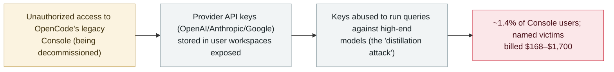

# OpenCode Console breach exposes users' stored AI-provider API keys

      

## Summary

**OpenCode — an open-source AI coding agent — disclosed on 17 October 2026 that an unauthorized party reached a legacy Console system it was decommissioning and exposed the third-party AI-provider API keys (OpenAI, Anthropic, Google) that the Console had stored in users' workspaces.** OpenCode called it a *"large-scale distillation attack"* and said it affected about **1.4% of Console users** — the subset who had external providers linked. The stolen keys were **actively abused**: named users reported unauthorized charges, including **$281 (OpenAI) + $168 (Anthropic)**, **over $700**, and **$1,700**, as attackers ran queries against high-end models on the victims' accounts. OpenCode notified affected users by email, said it is working with all three providers, and urged users to **revoke and rotate** their keys. The company has not published a total loss figure or a post-mortem. Recorded `incident` / `CRED` + `INFRA` / `high` / `real_harm: true` — a credential breach of an agent platform with confirmed financial harm.

## Attack chain

## Details

**What happened.** On **17 October 2026** OpenCode — an open-source AI coding agent whose cloud Console lets users link external model providers — disclosed (via its X account and an email to affected users) that an unauthorized party had gained access to a **legacy Console system that was in the process of being decommissioned**. The intrusion happened overnight from **16 to 17 October**. The provider **API keys stored in users' workspaces** — covering OpenAI, Anthropic and Google — were exposed. OpenCode characterised the event as a *"large-scale distillation attack."*

**Scope and harm.** OpenCode said about **1.4% of Console users** were affected — specifically those who had external providers linked — and that it notified each by email (users who were not emailed were not affected). The stolen keys were **used**: individual users publicly reported unauthorized charges on their provider bills, including **$281 on OpenAI plus $168 on Anthropic** (Colin Parsons), **over $700** of OpenAI usage (Francisco Giancarelli), and **$1,700** (Preston Zeller). The pattern — running many queries against expensive frontier models on someone else's key — is the "distillation" framing. OpenCode has **not** published a total number of affected accounts beyond the percentage, a total loss figure, an indicator list, or a post-mortem; it says it is working with OpenAI, Anthropic and Google on remediation.

**How it is graded.** Recorded `incident` — a real breach, not a disclosed-but-unused flaw. `CRED` (what is lost is the **keys** — users' stored provider API credentials) and `INFRA` (the compromised asset is the agent platform's own Console service). `real_harm: true`: unlike a demo, this exposed live keys that were abused for real, with named users reporting real financial charges. Severity `high` rather than `critical`: there is confirmed harm but the scope is bounded (≈1.4% of one product's Console users; billing abuse rather than deeper system compromise), and no provider-account takeover beyond API billing is reported. Confidence `A`: the disclosure is OpenCode's own (X post + customer email), corroborated by multiple independent outlets and by named victims posting their charges — though note no tier-1 security outlet had covered it at the time of recording and OpenCode has not released a full post-mortem.

## Sources

| # | Source | Link |
|---|---|---|
| 1 | Dealroom (quotes OpenCode's X post + customer email) | <https://dealroom.co/news/163473-opencode-breach-drains-users-ai-keys-as-platforms-holding-customer-crede/> |
| 2 | Crypto Briefing | <https://cryptobriefing.com/opencode-distillation-attack-api-key-breach/> |
| 3 | Startup Fortune | <https://startupfortune.com/opencode-breach-exposes-stored-openai-and-anthropic-keys-prompts-urgent-key-rotation/> |

## Metadata

| Field | Value |
|---|---|
| Date | `2026-10-17` (raw: 2026-10-17 OpenCode disclosure; intrusion overnight 2026-10-16 to 2026-10-17, precision `day`) |
| Kind | Real incident `incident` |
| Type | [`CRED`](../../taxonomy/types.md#cred) [`INFRA`](../../taxonomy/types.md#infra) |
| Severity | **High** `high` |
| Confidence | **A** — OpenCode's own disclosure (X + customer email) + independent reporting + named victims |
| Real harm | Yes — provider API keys exposed and abused; named users reported $168–$1,700 in unauthorized charges |
| AI involvement | Confirmed `confirmed` |
| Region | [Global](../../regions/global.md) |
| Archive ID | `2026-10-17-opencode-console-breach-api-keys` |

**Why this classification:** A breach of the OpenCode coding-agent Console that exposed users' stored AI-provider API keys (`CRED` — the loss is the keys; `INFRA` — the agent platform's own Console was the compromised asset). `incident` with `real_harm: true` because the keys were abused and named users reported real charges. `high` not `critical`: confirmed harm but bounded scope (≈1.4% of Console users, billing abuse). Confidence `A` on OpenCode's own disclosure plus independent reporting and named victims. Grading criteria: [severity.md](../../taxonomy/severity.md) and [confidence.md](../../taxonomy/confidence.md).

## Related

**Topic:** [Agent infrastructure exposure (INFRA)](../../topics/agent-infra.md)

**Related records:**

- `2026-10-08` [AgentCorruption — one prompt takes over an AWS Bedrock AgentCore account](2026-10-08-agentcorruption-aws-bedrock-agentcore.md)   Another agent-platform compromise exposing stored credentials
- `2026-10-08` [Tensorlake npm SDK compromise harvests agent config and credentials](2026-10-08-tensorlake-npm-sdk-compromise.md)   Same week — stealing agent provider keys and config
- `2026-10-02` [Loom for AWS agent-control-plane auth bypass (CVE-2026-103956)](2026-10-02-loom-aws-agent-control-plane-cve-2026-103956.md)   Another agent platform exposing stored integration credentials

---

[← 2026-10 index](README.md) · [← All records](../../README.md) · [Chinese](../i18n/zh/2026-10/2026-10-17-opencode-console-breach-api-keys.md)

This record is part of the **Orca AI Incident Archive**, licensed [CC BY 4.0](../../LICENSE). Found a factual error or a missing source? [Open an issue or PR](../../CONTRIBUTING.md) — corrections are recorded in the record's revision history, never silently overwritten.
