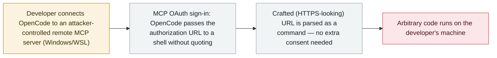

# OpenCode: a malicious MCP server runs code on the developer's machine during OAuth sign-in

     

## Summary

**On 19 October 2026 Pillar Security disclosed a critical remote code execution flaw in the OpenCode coding agent: an attacker-controlled MCP server can run arbitrary code on the developer's machine during the MCP OAuth sign-in, with no extra user interaction or consent.** The bug is in the Windows/WSL browser-launch path — OpenCode passed the OAuth URL through a shell without proper quoting, so a crafted (even HTTPS-looking) authorization URL becomes a command (macOS/Linux launch the browser without a shell and are not affected). It affects OpenCode 1.0.137–1.18.32 and was silently fixed in 1.18.33 (shipped 28 September) — Pillar reported it on 29 August, and the maintainer (Anomaly) initially considered a malicious MCP server outside its threat model. Crucially there is no CVE and no security advisory, so scanners and dependency alerts will not flag affected installs. Pillar rates it CVSS 9.8 and reports no in-the-wild exploitation. This is separate from the [OpenCode Console key breach](2026-10-17-opencode-console-breach-api-keys.md) disclosed the same week. Recorded `vulnerability` / `INFRA` / `high` / `real_harm: false`.

## Attack chain

## Details

**The flaw.** On **19 October 2026**, Pillar Security (researcher Eilon Cohen) published *"Open and Shut: Remote Code Execution in opencode via MCP OAuth."* When a developer connects the **OpenCode** coding agent to a remote **MCP server**, the OAuth sign-in flow opens an authorization URL in the browser. On **Windows and WSL**, OpenCode passed that URL **through a shell without proper quoting**, so an attacker-controlled MCP server can return a **crafted authorization URL — even one that looks like a legitimate HTTPS link — that is parsed as a command**, achieving **arbitrary code execution on the developer's machine during the sign-in, with no additional user interaction or consent**. macOS and Linux open the browser without a shell and are not affected.

**Scope, fix and the CVE gap.** It affects **OpenCode 1.0.137–1.18.32** and was fixed in **1.18.33**, which Anomaly shipped on **28 September** — but **silently, as a refactor, with no CVE and no security advisory**. Pillar reported the issue privately on **29 August**; per Pillar, the maintainer initially treated a malicious MCP server as outside its threat model. Because there is no CVE, vulnerability scanners and dependency alerts will not flag affected installs, so defenders must check the OpenCode version directly and upgrade to **1.18.33 or later**. Pillar also notes that URL-scheme checks alone are insufficient; the real fix is quoting the URL correctly (or using argument-based process execution). Pillar proposes a severity of **CVSS 9.8** and reports no sign of in-the-wild exploitation.

**How it is graded.** `vulnerability` — a disclosed flaw, not a used-in-anger incident. `INFRA` (the agent's own runtime/client and its MCP handling is the attack surface). `real_harm: false`: no known exploitation; it was patched before public disclosure. Severity `high` rather than `critical` despite the proposed CVSS 9.8 — this archive's severity reflects **what has happened**, and a severe flaw with no in-the-wild use is `high` here (the same basis as other patched-no-exploitation RCEs); the no-CVE "silent" patch is a notable visibility risk but does not by itself change the realized-harm grade. Confidence `A`: Pillar's own technical write-up plus independent reporting (The Hacker News, Infosecurity Magazine). This is a **different** issue from the OpenCode Console credential breach recorded separately.

## Sources

| # | Source | Link |
|---|---|---|
| 1 | Pillar Security (discoverer) | <https://www.pillar.security/blog/open-and-shut-remote-code-execution-in-opencode-via-mcp-oauth> |
| 2 | The Hacker News | <https://thehackernews.com/2026/10/opencode-flaw-lets-malicious-mcp.html> |
| 3 | Infosecurity Magazine | <https://www.infosecurity-magazine.com/news/opencode-quietly-patched-critical/> |

## Metadata

| Field | Value |
|---|---|
| Date | `2026-10-19` (raw: 2026-10-19 Pillar Security disclosure; fixed in 1.18.33 on 2026-09-28; reported to vendor 2026-08-29, precision `day`) |
| Kind | Vulnerability disclosure `vulnerability` |
| Type | [`INFRA`](../../taxonomy/types.md#infra) |
| Severity | **High** `high` |
| Confidence | **A** — Pillar Security write-up + The Hacker News + Infosecurity Magazine |
| Real harm | No — patched before disclosure; no known in-the-wild exploitation |
| AI involvement | Confirmed `confirmed` |
| Region | [Global](../../regions/global.md) |
| Archive ID | `2026-10-19-opencode-mcp-oauth-rce` |

**Why this classification:** A disclosed RCE in the OpenCode coding agent — a malicious MCP server reaches code execution on the developer's host during OAuth sign-in (`INFRA` — the agent's runtime/client and MCP handling). `vulnerability`, not an incident. `real_harm: false` — patched before disclosure, no known exploitation. `high` not `critical`: severity records what has happened, and a severe flaw with no in-the-wild use is `high`; the no-CVE silent patch is a visibility concern, not realized harm. Separate from the OpenCode Console key breach. Grading criteria: [severity.md](../../taxonomy/severity.md) and [confidence.md](../../taxonomy/confidence.md).

## Related

**Topic:** [Agent infrastructure exposure (INFRA)](../../topics/agent-infra.md)

**Related records:**

- `2026-10-17` [OpenCode Console breach exposes users' stored AI-provider API keys](2026-10-17-opencode-console-breach-api-keys.md)   A separate OpenCode issue disclosed the same week — the hosted Console, not the client
- `2026-10-02` [Loom for AWS agent-control-plane auth bypass (CVE-2026-103956)](2026-10-02-loom-aws-agent-control-plane-cve-2026-103956.md)   Another agent-platform/MCP infrastructure flaw
- `2026-07-31` [Exposed-by-design: MCP servers reachable on the network](../2026-07/2026-07-31-exposed-by-design-mcp-servers.md)   The broader pattern of MCP as an agent attack surface

---

[← 2026-10 index](README.md) · [← All records](../../README.md) · [Chinese](../i18n/zh/2026-10/2026-10-19-opencode-mcp-oauth-rce.md)

This record is part of the **Orca AI Incident Archive**, licensed [CC BY 4.0](../../LICENSE). Found a factual error or a missing source? [Open an issue or PR](../../CONTRIBUTING.md) — corrections are recorded in the record's revision history, never silently overwritten.
