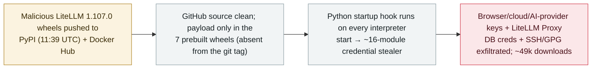

# LiteLLM 1.107.0 compromised: malicious PyPI/Docker build ships a credential stealer

      

## Summary

**On 21 October 2026 a malicious build of LiteLLM 1.107.0 — the widely-used open-source LLM gateway/proxy that fronts models for many AI agents — was pushed to PyPI (11:39 UTC) and Docker Hub, carrying a credential stealer; it was quarantined on PyPI by 13:20 UTC after roughly 49,000 downloads.** The GitHub source was clean, but all seven prebuilt wheels carried the payload: a `.pth`/`sitecustomize` Python startup hook that runs on every interpreter start (even if an app never imports litellm), harvesting across ~16 modules — browser credentials/cookies, AWS/GCP/Azure credentials, AI-provider API keys (OpenAI, Anthropic, Cohere), the LLM-provider credentials stored in a LiteLLM Proxy's PostgreSQL database, and SSH/GPG keys and shell history — then encrypting and exfiltrating them to an attacker domain. A dormant second-stage remote-code loader was present but not observed active. LiteLLM quarantined the release and pulled the Docker tags; the initial attack vector is still unknown. This is a second LiteLLM package compromise (after the [March 2026 backdoored release](../2026-03/2026-03-24-litellm-backdoored-release.md)). Recorded `incident` / `SUPPLY` + `CRED` / `high` / `real_harm: true` — a live malicious release of agent infrastructure with ~49k downloads.

## Attack chain

## Details

**What happened.** On **21 October 2026**, a malicious version **1.107.0** of **LiteLLM** — the widely-used open-source LLM gateway/proxy that many AI agents and apps use to route to model providers — was published to **PyPI at 11:39 UTC** and to **Docker Hub**. Multiple security vendors (Wiz, JFrog, Mend, OX Security, Datadog, Chainguard, Endor, plus SafeDep/Socket/StepSecurity/Upwind via The Hacker News) analysed it. PyPI **quarantined** the release by **13:20 UTC**; ClickPy data indicates roughly **49,000 downloads** before removal.

**The payload.** The **GitHub source was clean**, but all **seven prebuilt wheels** (and the Docker images) carried the malware — the payload traces to a commit absent from the v1.107.0 git tag. A `.pth` file plus a `sitecustomize.py` install a **Python startup hook that executes on every interpreter start**, so the stealer runs **even if an application never imports `litellm`**. Across ~16 modules it harvests browser credentials and cookies (Chrome/Firefox/Edge/Safari), **AWS/GCP/Azure** credentials and tokens, **AI-provider API keys (OpenAI, Anthropic, Cohere)**, the **LLM-provider credentials stored in a LiteLLM Proxy's PostgreSQL database**, and SSH/GPG keys and shell history, then **encrypts and exfiltrates** them to an attacker-controlled domain. A **second-stage remote-code loader was present but dormant** — Wiz did not observe it fetching/running remote code — so this is scoped as a credential stealer with a latent loader, not an actively-running RAT.

**Why `real_harm: true`.** Unlike a PoC or a quickly-caught upload with no installs, this was a **live malicious release that was actually distributed** (~49,000 downloads) with a stealer that runs on import-less Python startup; the consistent vendor guidance is to **assume exposure and rotate every credential** the host could reach. No single named victim's loss is published, but real credential exposure at scale is the expected effect. (LiteLLM's March 2026 compromise is recorded separately; this is the second.)

**How it is graded.** `incident` — a real malicious distribution, not a disclosed-but-unused flaw. `SUPPLY` (poisoned PyPI/Docker build of agent infrastructure) + `CRED` (what is stolen is keys — cloud, AI-provider and proxy-stored LLM credentials). `real_harm: true` (live, downloaded ~49k times, active stealer). Severity `high`: wide distribution and credential theft, but caught and quarantined within ~1.6 hours and the second stage stayed dormant. Confidence `A`: concurrent first-party analyses from many security vendors (Wiz, JFrog, Mend, OX, Datadog, Chainguard, Endor) and The Hacker News.

## Sources

| # | Source | Link |
|---|---|---|
| 1 | Wiz | <https://www.wiz.io/blog/litellm-compromised-steals-credentials> |
| 2 | JFrog Security Research | <https://research.jfrog.com/post/litellm-hijacked-again/> |
| 3 | The Hacker News | <https://thehackernews.com/2026/10/litellm-compromised-in-supply-chain.html> |

## Metadata

| Field | Value |
|---|---|
| Date | `2026-10-21` (raw: malicious 1.107.0 uploaded 11:39 UTC, quarantined on PyPI 13:20 UTC, precision `day`) |
| Kind | Real incident `incident` |
| Type | [`SUPPLY`](../../taxonomy/types.md#supply) [`CRED`](../../taxonomy/types.md#cred) |
| Severity | **High** `high` |
| Confidence | **A** — concurrent analyses from Wiz, JFrog, Mend, OX, Datadog, Chainguard, Endor + The Hacker News |
| Real harm | Yes — live malicious release, ~49k downloads, credential stealer running on Python startup |
| AI involvement | Confirmed `confirmed` |
| Region | [Global](../../regions/global.md) |
| Archive ID | `2026-10-21-litellm-1-107-supply-chain-compromise` |

**Why this classification:** A poisoned PyPI/Docker build of LiteLLM, the LLM gateway fronting many agents (`SUPPLY`), carrying a credential stealer that targets cloud, AI-provider and proxy-stored LLM keys (`CRED`). `incident` with `real_harm: true` because it was a live, widely-downloaded release with an active stealer (vendors advise assuming credential exposure). `high` not `critical`: broad reach but quarantined within ~1.6 hours and the remote-code loader stayed dormant. Second LiteLLM compromise, recorded separately from the March 2026 one. Grading criteria: [severity.md](../../taxonomy/severity.md) and [confidence.md](../../taxonomy/confidence.md).

## Related

**Topic:** [Agent supply chain](../../topics/agent-supply-chain.md)

**Related records:**

- `2026-03-24` [LiteLLM ships a backdoored release](../2026-03/2026-03-24-litellm-backdoored-release.md)   The first LiteLLM package compromise — this is the second
- `2026-10-08` [Tensorlake npm SDK compromise harvests agent config and credentials](2026-10-08-tensorlake-npm-sdk-compromise.md)   Same month — supply-chain theft of AI-agent provider keys
- `2026-08-04` [ChainDrop npm supply-chain wave](../2026-08/2026-08-04-chaindrop-npm-ru-chong.md)   Another agent-targeting package-registry compromise

---

[← 2026-10 index](README.md) · [← All records](../../README.md) · [Chinese](../i18n/zh/2026-10/2026-10-21-litellm-1-107-supply-chain-compromise.md)

This record is part of the **Orca AI Incident Archive**, licensed [CC BY 4.0](../../LICENSE). Found a factual error or a missing source? [Open an issue or PR](../../CONTRIBUTING.md) — corrections are recorded in the record's revision history, never silently overwritten.
