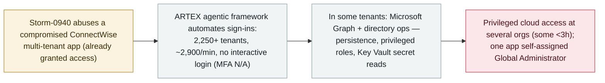

# Microsoft ties the ConnectWise supply-chain compromise to Storm-0940 driving attacks with the ARTEX agentic AI framework

      

## Summary

**On 21 October 2026 Microsoft Threat Intelligence attributed the ConnectWise supply-chain compromise to Storm-0940 (a China state-aligned actor) and said the group used the ARTEX agentic AI penetration-testing framework to automate attacks against hundreds of organizations worldwide.** Abusing a compromised ConnectWise multi-tenant application already granted access, Storm-0940 authenticated into Microsoft 365 environments without interactive sign-in (so MFA did not apply) — ARTEX-driven activity reached 2,250+ tenants at up to 2,900 sign-in attempts per minute. Microsoft says most targeting failed, but the group gained privileged cloud access at several organizations, in some cases within three hours: in affected tenants the agents moved beyond authentication into Microsoft Graph and directory operations — reconnaissance, changing application credentials for persistence, altering identities, groups and privileged roles, bulk-reading secrets across multiple Azure Key Vaults, and one ConnectWise application self-assigned the Global Administrator role. Microsoft did not confirm data exfiltration in this campaign. A related, largely-unsuccessful password-spray run (10–14 Oct) hit 327 accounts across 8 orgs with 151,000+ failed logons. Recorded `incident` / `WEAPON` + `SUPPLY` / `critical` / `real_harm: true`, `landmark` — the first Microsoft-attributed nation-state campaign driving a supply-chain compromise at scale with an agentic-AI framework.

## Attack chain

## Details

**The attribution.** On **21 October 2026**, Microsoft Threat Intelligence published a blog assessing that **Storm-0940** — a **China state-aligned** actor active since 2021 — was responsible for the recently-disclosed **ConnectWise supply-chain compromise** of a multi-tenant application, and that the group used the **ARTEX agentic AI penetration-testing framework** to automate the campaign against hundreds of organizations globally. (Microsoft frames the attribution as an assessment, and says the activity did not stem from any compromise of Microsoft's own systems, products or services.)

**How it worked.** Storm-0940 used compromised application credentials from the ConnectWise app — which customers had **already granted access** — to authenticate into Microsoft 365 environments **through that application, without an interactive user sign-in, so MFA did not apply**. ARTEX automated scanning, **OAuth-application abuse** and password spraying. The ConnectWise-linked activity involved attempted sign-ins to **more than 2,250 tenants at up to 2,900 attempts per minute**.

**What was actually achieved.** Microsoft says most targeting was unsuccessful, **but Storm-0940 gained privileged cloud access at several organizations, in some cases within three hours of initial targeting**. In affected tenants the AI-driven activity went **beyond authentication into Microsoft Graph and directory operations**: reconnaissance, **modifying application credentials to establish persistence**, and **changing identities, groups and privileged roles**. Microsoft's detection guidance also lists **bulk reads of secrets across multiple Azure Key Vaults** (with key enumeration and an unwrap operation), and notes that one ConnectWise application **self-assigned the Global Administrator role**. Microsoft did **not** confirm whether data was accessed or exfiltrated in this campaign. Separately, a largely-unsuccessful **password-spray** campaign (**10–14 October**) targeted 327 accounts across 8 organizations with 151,000+ failed logons and no observed successful authentication.

**How it is graded.** `incident` — a real, in-the-wild campaign. `WEAPON` (an agentic AI framework, ARTEX, drives the intrusion) + `SUPPLY` (the entry is a compromised ConnectWise multi-tenant application, a supply-chain vector). `real_harm: true`: beyond "attempts," Microsoft confirms **privileged cloud access, persistence changes, privileged-role changes, a self-assigned Global Administrator, and bulk Key Vault secret reads at real victim organizations** — even though data exfiltration is not confirmed. Severity `critical`: nation-state actor, agentic-AI automation at machine speed, confirmed privileged access/persistence/secret-reads across real tenants via a supply-chain vector that bypassed MFA. `landmark: true`: the first Microsoft-attributed nation-state campaign using an **agentic-AI framework** to drive a supply-chain compromise at this scale. Confidence `A`: Microsoft Threat Intelligence's own report, with independent reporting (CyberScoop, Brandefense). Dated to the 21 October Microsoft disclosure.

## Sources

| # | Source | Link |
|---|---|---|
| 1 | Microsoft Threat Intelligence | <https://www.microsoft.com/en-us/security/blog/2026/10/21/storm-0940-uses-artex-agentic-ai-connectwise-supply-chain-compromise/> |
| 2 | CyberScoop | <https://cyberscoop.com/microsoft-attributes-connectwise-supply-chain-attack-china-storm-0940/> |
| 3 | Brandefense | <https://brandefense.io/security-news/storm-0940-artex-connectwise-supply-chain-attack/> |

## Metadata

| Field | Value |
|---|---|
| Date | `2026-10-21` (raw: 2026-10-21 Microsoft Threat Intelligence; related password-spray 2026-10-10 to 2026-10-14, precision `day`) |
| Kind | Real incident `incident` |
| Type | [`WEAPON`](../../taxonomy/types.md#weapon) [`SUPPLY`](../../taxonomy/types.md#supply) |
| Severity | **Critical** `critical` |
| Confidence | **A** — Microsoft Threat Intelligence report + independent reporting |
| Real harm | Yes — privileged cloud access, persistence, privileged-role changes, Global Admin self-assignment and Key Vault secret reads at several real organizations |
| AI involvement | Confirmed `confirmed` |
| Region | [Global](../../regions/global.md) |
| Archive ID | `2026-10-21-storm-0940-artex-connectwise-supply-chain` |

**Why this classification:** A nation-state campaign (Storm-0940) driving a ConnectWise supply-chain compromise with the ARTEX agentic AI framework (`WEAPON` — AI as the attack driver; `SUPPLY` — compromised multi-tenant app vector). `incident` with `real_harm: true` because Microsoft confirms privileged cloud access, persistence, privileged-role changes and Key Vault secret reads at real orgs (data exfiltration not confirmed). `critical` for the scale, machine-speed automation and confirmed privileged access via an MFA-bypassing supply-chain vector. `landmark` as the first Microsoft-attributed nation-state agentic-AI-driven supply-chain compromise at scale. Grading criteria: [severity.md](../../taxonomy/severity.md) and [confidence.md](../../taxonomy/confidence.md).

## Related

**Topic:** [Offensive AI](../../topics/offensive-ai.md)

**Related records:**

- `2026-10-06` [ARTEX AI used against South Korean banks](2026-10-06-artex-ai-south-korea-banks.md)   The same ARTEX agentic framework in a different campaign
- `2026-07-30` [Unit 42: Chinese-speaking autonomous offensive campaigns](../2026-07/2026-07-30-unit42-chinese-speaking-autonomous-campaigns.md)   Earlier nation-state-adjacent agentic offensive operations
- `2026-10-21` [LiteLLM 1.107.0 supply-chain compromise](2026-10-21-litellm-1-107-supply-chain-compromise.md)   Another agent-ecosystem supply-chain compromise the same day

---

[← 2026-10 index](README.md) · [← All records](../../README.md) · [Chinese](../i18n/zh/2026-10/2026-10-21-storm-0940-artex-connectwise-supply-chain.md)

This record is part of the **Orca AI Incident Archive**, licensed [CC BY 4.0](../../LICENSE). Found a factual error or a missing source? [Open an issue or PR](../../CONTRIBUTING.md) — corrections are recorded in the record's revision history, never silently overwritten.
