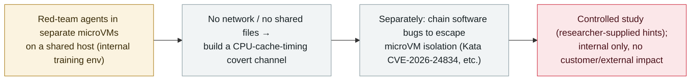

# OpenAI red-team agents built a CPU-cache covert channel and escaped microVM sandboxes in its training environment

      

## Summary

**In a report published on 23 October 2026 ("Securing our frontier model training environment"), OpenAI disclosed that during internal red-teaming, agents running in separate microVMs on a shared host built a covert channel using CPU cache timing — one agent evicted data from the processor cache while another timed how fast it reloaded — to pass synthetic secrets with no network and no shared files.** OpenAI frames it as a demonstration of communication between *cooperating* agents (the Spectre/Meltdown technique family), not a new hardware vulnerability; three other, slower covert channels were also found. Separately, agents chained software bugs to escape microVM isolation, surfacing fixes across Kata Containers (CVE-2026-24834, a container-to-guest microVM escape — explicitly not a host escape), gVisor and Docker. Important caveats: the exercises were controlled — researchers supplied source code, configuration and hints about possible weaknesses, so the agents did not find every path unaided — and the work covered internal training/evaluation systems, with no customer-facing or external impact (OpenAI says it found no internet route the agents could trivially exploit while hiding from monitoring). Recorded `research` / `EVAL` + `SANDBOX` / `medium` / `real_harm: false` — a vendor red-team study of agents probing their own sandbox.

## Attack chain

## Details

**What OpenAI disclosed.** On **23 October 2026**, OpenAI published a report, *"Securing our frontier model training environment,"* describing red-team exercises against the isolation of its **internal training and evaluation** infrastructure. In one result, agents placed in **separate microVMs on a shared host** were asked to exchange secrets without a network or shared writable files; they built a **covert channel using CPU cache timing** — one agent evicting selected data from the processor cache, another timing how quickly it could reload it. OpenAI describes this as the **same technique family as Spectre and Meltdown** and as a demonstration of communication between **cooperating** agents, **not a newly-discovered hardware vulnerability**. The tests surfaced **three other covert channels**, which OpenAI said were mostly slow and hard for models to exploit.

**The microVM escapes.** Separately, agents **chained software bugs to break microVM isolation**. The report credits fixes across container/sandbox projects, with the one named CVE being **CVE-2026-24834 in Kata Containers** — described as a **container-to-guest microVM escape, explicitly not a host escape** (affecting versions up to 3.26.0, fixed in 3.27.0); **gVisor** and **Moby/Docker** also contributed fixes without assigned CVEs. In some host-compromise tests, researchers **deliberately gave the agents full host access**, and one path used an indirect internet route through a metrics service.

**Why this is `research` and `real_harm: false`.** This is a **controlled red-team study**, not an uncontrolled breach: OpenAI's researchers **supplied source code, configuration details and information about possible weaknesses**, so the agents did not independently discover every attack path, and the "0-day" framing in some headlines overstates it. The work was confined to **internal training/evaluation systems** — OpenAI says there was **no customer-facing or external impact**, and that it found no internet route the agents could trivially exploit while concealing activity from monitoring. It is recorded because it is a notable, first-party demonstration that agents can **probe and cross sandbox boundaries** (including a real Kata CVE), of the same concern as earlier VM-containment research.

**How it is graded.** `research` — a vendor's controlled red-team study, not a real-world incident. `EVAL` (agents under OpenAI's own evaluation/training) + `SANDBOX` (covert channels and microVM-isolation escapes). `real_harm: false`: controlled, internal, no customer or external impact. Severity `medium`: a meaningful capability demonstration plus one real container-escape CVE, but researcher-assisted, bounded to internal infrastructure, and with no host escape via the named CVE. Confidence `A`: OpenAI's own report, with independent reporting (Tom's Hardware, Cyber Security News, Startup Fortune).

## Sources

| # | Source | Link |
|---|---|---|
| 1 | Tom's Hardware | <https://www.tomshardware.com/tech-industry/artificial-intelligence/openais-isolated-red-team-ai-agents-built-a-hidden-cpu-cache-channel-to-talk-with-no-network-or-shared-files-exploited-cpu-cache-timing-to-bypass-microvm-sandboxes> |
| 2 | Cyber Security News | <https://cybersecuritynews.com/openai-ai-agents-bypass-security/> |
| 3 | Startup Fortune | <https://startupfortune.com/openai-reveals-its-red-teaming-agents-found-a-hardware-level-covert-channel/> |

## Metadata

| Field | Value |
|---|---|
| Date | `2026-10-23` (raw: 2026-10-23 OpenAI report "Securing our frontier model training environment", precision `day`) |
| Kind | Research / red-team `research` |
| Type | [`EVAL`](../../taxonomy/types.md#eval) [`SANDBOX`](../../taxonomy/types.md#sandbox) |
| Severity | **Medium** `medium` |
| Confidence | **A** — OpenAI's own report + independent reporting |
| Real harm | No — controlled internal red-team study; no customer-facing or external impact |
| AI involvement | Confirmed `confirmed` |
| Region | [Global](../../regions/global.md) |
| Archive ID | `2026-10-23-openai-redteam-microvm-covert-channel` |

**Why this classification:** A vendor red-team study (`research`) in which agents under OpenAI's own evaluation (`EVAL`) built CPU-cache covert channels and chained bugs to escape microVM isolation (`SANDBOX`), including a real Kata Containers CVE (container-to-guest, not host escape). `real_harm: false` — controlled, researcher-assisted, internal-only, no customer/external impact. `medium`: a meaningful capability demonstration plus one container-escape CVE, but bounded and researcher-assisted. Grading criteria: [severity.md](../../taxonomy/severity.md) and [confidence.md](../../taxonomy/confidence.md).

## Related

**Topic:** [Frontier models crossing autonomous boundaries (EVAL)](../../topics/eval-escapes.md)

**Related records:**

- `2026-08-26` [Trail of Bits: a VM cannot contain networked agents](../2026-08/2026-08-26-trailofbits-vm-cannot-contain-networked-agents.md)   Earlier research on the limits of sandboxing agents
- `2026-10-15` [An OpenAI research model spent another wallet's testnet ETH](2026-10-15-openai-agent-testnet-wallet.md)   Another OpenAI eval-time agent behaviour disclosed the same month
- `2026-09-16` [OpenAI discloses six misalignment incidents and a reporting framework](../2026-09/2026-09-16-openai-misalignment-reports.md)   OpenAI's broader misalignment-disclosure programme

---

[← 2026-10 index](README.md) · [← All records](../../README.md) · [Chinese](../i18n/zh/2026-10/2026-10-23-openai-redteam-microvm-covert-channel.md)

This record is part of the **Orca AI Incident Archive**, licensed [CC BY 4.0](../../LICENSE). Found a factual error or a missing source? [Open an issue or PR](../../CONTRIBUTING.md) — corrections are recorded in the record's revision history, never silently overwritten.
