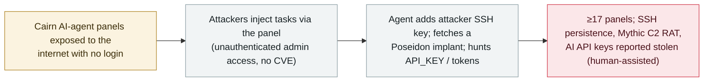

# Attackers hijack exposed Cairn AI-agent panels in the wild to plant SSH keys, a Poseidon implant, and steal API keys

      

## Summary

**Security firm NorForge reported (27 October 2026) that attackers are hijacking internet-exposed, login-less panels of Cairn — an open platform where you give an AI agent a goal and it works autonomously, posting findings to a web panel — and injecting tasks that weaponise the agents.** Across at least 17 exposed panels (some red-team / CTF environments), observed activity from around 20 October included a task that had the agent add an attacker SSH key to the kali account's `authorized_keys`; a 21 October "Local worker maintenance" task that delivered a base64 script fetching a Poseidon implant (a Go-based Mythic C2 payload, via Bunny.net CDN); and recon tasks hunting secrets such as `API_KEY` and `ANTHROPIC_AUTH_TOKEN`, with AI-model API keys reported stolen. NorForge tracks two separate clusters — AIA0009 (persistence + malware, "cairnscan" tag) and AIA0010 (credential theft + finding more panels). Entry was unauthenticated administrative access to exposed panels, not a new software CVE. NorForge observed passively and could not confirm the campaigns ran fully autonomously — synchronized activity suggests scripting, and it believes humans stepped in at key points (a pause before malware, and the C2/download-server setup). Recorded `incident` / `INFRA` + `WEAPON` / `high` / `real_harm: true`.

## Attack chain

## Details

**What Cairn is, and what happened.** **Cairn** is an open platform for running AI agents: a user defines a goal and a starting point, and the agent works on its own, posting findings as "facts" to a web panel. Anyone who can reach the panel can create and manage tasks — so an **internet-exposed panel with no authentication** hands an attacker control of the agent. Security firm **NorForge** reported on **27 October 2026** (covered by Cyber Security News and GBHackers) that attackers are doing exactly this in the wild, with activity observed from around **20 October**. NorForge watched the exposed panels **passively** and did not interact with the attackers.

**The injected tasks.** Across **at least 17 exposed panels** — some belonging to red-team and CTF exercises — NorForge saw malicious tasks:
- **SSH persistence**: a task named "Install kali SSH key" had the agent add an **attacker-controlled public key** to the kali user's `authorized_keys`, with agent output confirming it.
- **Malware**: on **21 October**, a "Local worker maintenance" task delivered a **base64-encoded script** that downloaded a **Poseidon implant** — a Go-based payload associated with the open-source **Mythic** command-and-control ecosystem, reportedly communicating via **Bunny.net** CDN infrastructure; it ran until an operator created a stop file.
- **Secret theft**: recon tasks searched files and environment variables for terms like `API_KEY` and `ANTHROPIC_AUTH_TOKEN`, and some tasks wrote secrets into public fact texts; NorForge reported **AI-model API keys stolen** (though it could not confirm whether attackers crossed container-isolation boundaries).

**Two clusters, and the autonomy caveat.** NorForge tracks two provisional clusters: **AIA0009** (random hex task-name suffixes, "cairnscan" tag; persistence, access and the only one seen deploying malware) and **AIA0010** (task names mimicking Cairn's intent labels; hunting internal services, credentials and more panels). It found **no shared hard indicators** between them, so treats them as separate. Importantly, NorForge **does not claim the campaigns were fully autonomous AI**: synchronized activity across panels suggests **scripting**, and it believes **humans intervened at key points** (a pause before malware deployment, and standing up the C2 and download servers). The entry point was **unauthenticated administrative access to exposed panels, not a newly-disclosed software vulnerability**.

**How it is graded.** `incident` — a real, in-the-wild campaign. `INFRA` (exposed AI-agent orchestration panels are the attack surface) + `WEAPON` (the hijacked agents are driven to install persistence, deploy a RAT and steal credentials). `real_harm: true`: a Poseidon implant was actually delivered and attacker SSH keys actually installed on compromised panels. Severity `high`: real in-the-wild agent weaponisation across ≥17 panels with RAT deployment, but bounded to **exposed/misconfigured** panels (several of them red-team/CTF environments) rather than hardened production, and with the autonomy/human-involvement caveat. Confidence `A`: NorForge's technical research, carried by Cyber Security News and GBHackers. Dated to the 27 October report; activity from ~20 October.

## Sources

| # | Source | Link |
|---|---|---|
| 1 | Cyber Security News (NorForge research) | <https://cybersecuritynews.com/ai-pentesting-agents/> |
| 2 | GBHackers (NorForge research) | <https://gbhackers.com/ai-pentesting-panels/> |
| 3 | Vibe Incidents | <https://vibeincidents.com/incidents/cairn-exposed-panels-ai-intrusions/> |

## Metadata

| Field | Value |
|---|---|
| Date | `2026-10-27` (raw: 2026-10-27 NorForge report via Cyber Security News / GBHackers; activity from ~2026-10-20, precision `day`) |
| Kind | Real incident `incident` |
| Type | [`INFRA`](../../taxonomy/types.md#infra) [`WEAPON`](../../taxonomy/types.md#weapon) |
| Severity | **High** `high` |
| Confidence | **A** — NorForge research + Cyber Security News + GBHackers |
| Real harm | Yes — Poseidon implant delivered and attacker SSH keys installed on exposed Cairn panels in the wild |
| AI involvement | Confirmed `confirmed` |
| Region | [Global](../../regions/global.md) |
| Archive ID | `2026-10-27-cairn-exposed-agent-panels-hijacked` |

**Why this classification:** In-the-wild hijacking of exposed Cairn AI-agent panels (`INFRA` — exposed agent orchestration) in which the agents are driven to install SSH persistence, deploy a Poseidon/Mythic implant and steal credentials (`WEAPON`). `incident` with `real_harm: true` because malware and attacker SSH keys were actually planted. `high`, not critical, because it is bounded to exposed/misconfigured panels (several red-team/CTF) and NorForge could not confirm full AI autonomy (human involvement at key points). Grading criteria: [severity.md](../../taxonomy/severity.md) and [confidence.md](../../taxonomy/confidence.md).

## Related

**Topic:** [Offensive AI](../../topics/offensive-ai.md)

**Related records:**

- `2026-10-21` [Storm-0940 drives the ConnectWise supply-chain compromise with the ARTEX agentic AI framework](2026-10-21-storm-0940-artex-connectwise-supply-chain.md)   Another agentic-AI offensive framework used in the wild
- `2026-10-06` [ARTEX AI used against South Korean banks](2026-10-06-artex-ai-south-korea-banks.md)   An open agentic pentest tool turned to real attacks
- `2026-09-22` [ClosedQuorum AI C2 implant](../2026-09/2026-09-22-closedquorum-ai-c2-implant.md)   Another AI-driven command-and-control implant

---

[← 2026-10 index](README.md) · [← All records](../../README.md) · [Chinese](../i18n/zh/2026-10/2026-10-27-cairn-exposed-agent-panels-hijacked.md)

This record is part of the **Orca AI Incident Archive**, licensed [CC BY 4.0](../../LICENSE). Found a factual error or a missing source? [Open an issue or PR](../../CONTRIBUTING.md) — corrections are recorded in the record's revision history, never silently overwritten.
