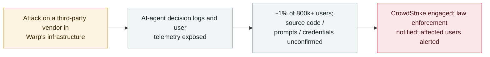

# Warp discloses a third-party vendor breach that exposed AI-agent decision logs and user telemetry

      

## Summary

**On 27 October 2026, Warp — an agentic development environment / AI terminal — disclosed that an attack on a third-party vendor in its infrastructure exposed AI-agent decision logs and user telemetry.** CEO Zach Lloyd said Warp detected the activity on a Friday, estimated roughly 1% of its users may be affected (Warp reports 800,000+ users, implying several thousand accounts), and said it has engaged CrowdStrike, notified law enforcement, and alerted affected users. Warp did not clarify whether source code, prompts, or credentials were among the exposed data — the confirmed categories are agent decision logs and telemetry. Reports describing an "agent-swarm" attack are an analyst hypothesis, not a confirmed attribution, and the vendor has not been named. Recorded `incident` / `EXFIL` + `INFRA` / `medium` / `real_harm: true` — a real breach exposing agent-specific operational data, scope and sensitivity still bounded/unconfirmed.

## Attack chain

## Details

**What happened.** On **27 October 2026**, Warp — an **agentic development environment / AI terminal** — disclosed a breach affecting a **third-party vendor** in its infrastructure. The exposed data, per the company, consisted of **AI-agent decision logs and user telemetry**. CEO **Zach Lloyd** said the activity was detected on a Friday and that the incident remains under investigation.

**Scope and response.** Lloyd estimated roughly **1% of users** may be affected; with Warp reporting **800,000+** users, that implies several thousand accounts. Warp has engaged **CrowdStrike** to assist, **notified law enforcement**, and **alerted affected users**. The company has **not named the vendor** and has **not clarified** whether source code, prompts, or credentials were among the exposed data — only agent decision logs and telemetry are confirmed. Because agent decision logs can capture what a coding agent did and saw, security commentators advised affected users to rotate any secrets they may have pasted into Warp AI.

**Caveats.** Some coverage frames this as an "agent-swarm" intrusion, but that is an **analyst working hypothesis, not a confirmed attribution** by Warp. The precise sensitivity of the exposed logs is not established.

**How it is graded.** `incident` — a confirmed, real breach, not a disclosed-but-unused flaw. `EXFIL` (agent-specific data left the trust boundary via the vendor compromise) and `INFRA` (the exposed asset is the operational data of an agentic development platform). `real_harm: true`: real user data (agent decision logs + telemetry) was exposed in a confirmed breach affecting real accounts — unlike a demo. Severity `medium`: bounded to ~1% of users and the sensitivity of the exposed logs is unconfirmed (no confirmed source code, prompt, or credential leak), so it is not graded higher. Confidence `A`: BleepingComputer's first reporting plus Warp's CEO statement and independent coverage.

## Sources

| # | Source | Link |
|---|---|---|
| 1 | BleepingComputer | <https://www.bleepingcomputer.com/news/security/warp-discloses-breach-exposing-ai-agent-logs-user-telemetry-data/> |
| 2 | Atlabyte | <https://atlabyte.com/en/news/warp-reports-data-breach-ai-agent-logs-and-user-telemetry-affected> |
| 3 | Archyde | <https://www.archyde.com/warp-exposes-user-logs-and-telemetry-in-third-party-vendor-breach/> |

## Metadata

| Field | Value |
|---|---|
| Date | `2026-10-27` (raw: 2026-10-27 Warp disclosure, precision `day`) |
| Kind | Real incident `incident` |
| Type | [`EXFIL`](../../taxonomy/types.md#exfil) [`INFRA`](../../taxonomy/types.md#infra) |
| Severity | **Medium** `medium` |
| Confidence | **A** — BleepingComputer + Warp CEO statement + independent coverage |
| Real harm | Yes — agent decision logs and user telemetry exposed in a confirmed breach affecting real accounts |
| AI involvement | Confirmed `confirmed` |
| Region | [Global](../../regions/global.md) |
| Archive ID | `2026-10-27-warp-vendor-breach-agent-logs` |

**Why this classification:** A confirmed third-party-vendor breach of the Warp agentic development platform that exposed agent decision logs and user telemetry (`EXFIL` — agent data left the boundary; `INFRA` — operational data of an agent platform). `incident` with `real_harm: true` because real user data was exposed in a real breach. `medium` because it is bounded (~1% of users) and the sensitivity is unconfirmed (no confirmed source/prompt/credential leak); the "agent-swarm" attribution is an unconfirmed hypothesis. Grading criteria: [severity.md](../../taxonomy/severity.md) and [confidence.md](../../taxonomy/confidence.md).

## Related

**Topic:** [Agent infrastructure exposure (INFRA)](../../topics/agent-infra.md)

**Related records:**

- `2026-10-17` [OpenCode Console breach exposes users' stored AI-provider API keys](2026-10-17-opencode-console-breach-api-keys.md)   Another agent-platform breach exposing user data the same month
- `2026-09-29` [PixelLeak: coding agents pushed internal screenshots to public GitHub](../2026-09/2026-09-29-pixelleak-coding-agents-screenshots-github.md)   Another exposure of agent-side operational data
- `2026-09-26` [Meta Muse marketplace address leak](../2026-09/2026-09-26-meta-muse-marketplace-address-leak.md)   Another agent-platform data exposure

---

[← 2026-10 index](README.md) · [← All records](../../README.md) · [Chinese](../i18n/zh/2026-10/2026-10-27-warp-vendor-breach-agent-logs.md)

This record is part of the **Orca AI Incident Archive**, licensed [CC BY 4.0](../../LICENSE). Found a factual error or a missing source? [Open an issue or PR](../../CONTRIBUTING.md) — corrections are recorded in the record's revision history, never silently overwritten.
