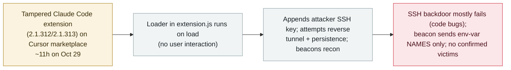

# A malicious Claude Code extension on Cursor's marketplace planted an SSH backdoor

     

## Summary

**On 29 October 2026, maliciously modified versions (2.1.312 and 2.1.313) of Anthropic's official Claude Code VS Code extension were served from the Cursor VS Code Extension Marketplace for roughly 11 hours (≈2:27am–1:35pm PT), exposing up to ~5,000 developers.** A JavaScript loader prepended to `extension.js` ran automatically when the extension loaded (no interaction needed): it collected host/user recon (hostname, OS, Git email, public IP, and environment-variable names matching `KEY|TOKEN|SECRET|PASS|AWS|GCP`), appended an attacker SSH key (`svc-telemetry`) to `authorized_keys`, tried to open a persistent reverse SSH tunnel to `134.209.82[.]225`, and installed persistence (macOS LaunchAgent / Windows scheduled task). Crucially, the SSH backdoor largely failed due to coding errors (a macOS privilege check that misreads its own failure; a Windows path that invokes `/bin/sh`), so remote access "would fail" on most systems; the beacon sent only env-var names, not secret values. Cursor says the versions were not developed by Anthropic; Anthropic says its own systems were not compromised; the marketplace-publishing vector remains unexplained. No confirmed victims. Recorded `incident` / `SUPPLY` / `high` / `real_harm: false` — a live, in-the-wild marketplace trojanization of a major coding agent's extension, caught within ~11 hours with no confirmed successful compromise.

## Attack chain

## Details

**What happened.** On **29 October 2026**, Cursor published a security notice: maliciously modified versions **2.1.312 and 2.1.313** of **Anthropic's official Claude Code VS Code extension** (`Anthropic.claude-code`) were available on the **Cursor VS Code Extension Marketplace** between about **2:27am and 1:35pm PT** that day. BleepingComputer (30 Oct) reported the window exposed **up to ~5,000 developers**. The researchers Phorion (Calum Hall) and OpenSourceMalware analyzed the payload; all three accounts agree on the indicators.

**The payload.** A malicious JavaScript loader was prepended to the extension's `extension.js`, with the legitimate code otherwise unchanged. Per Cursor and Phorion, it **executes when the extension loads — no user interaction with Claude Code is required** — and then:
- **Recon beacon:** collects hostname, username, OS, architecture, home/working directories, configured Git email, and public IP (via `ifconfig.me` / `api.ipify.org`), plus up to 40 environment-variable **names** matching `/KEY|TOKEN|SECRET|PASS|AWS|GCP/i`. Phorion is explicit: *"the beacon doesn't exfiltrate the secret values themselves."* It POSTs to `/beacon` on `134.209.82[.]225:8099`.
- **SSH key + tunnel:** appends an attacker Ed25519 public key labeled **`svc-telemetry`** to `~/.ssh/authorized_keys`, enables the SSH service, and attempts a persistent reverse SSH tunnel (`-R *:0:localhost:22`) to `134.209.82[.]225` as user `tunnel`, retrying ~every 60s.
- **Persistence:** macOS LaunchAgent (`com.apple.sysmond`), Windows scheduled task (`SysMon`, trying to run as SYSTEM) with a Startup-script fallback, or a Linux `@reboot` cron entry.

**Why the backdoor mostly failed.** Both Cursor and Phorion stress the SSH takeover largely did **not** work. On **macOS**, the code runs `systemsetup -getremotelogin` without privileges; the permission error is misread, so it *"treats 'I don't have permission to check if SSH is off' as 'SSH is already on'"* and skips enabling it — and on standard accounts `sudo -n systemsetup -setremotelogin on` fails anyway. On **Windows**, the service-setup command is passed through a helper that hardcodes `/bin/sh`, absent on standard Windows. Cursor: *"Outside of highly unusual circumstances where Cursor was started with administrator privileges, due to errors in the malicious code, this step would fail."* The SSH **key and persistence scripts can still land, and recon still beacons**, so Cursor advises checking for the `svc-telemetry` key and following remediation regardless.

**Attribution and open questions.** Cursor states the malicious versions **were not developed by Anthropic** and that it found **no evidence other extensions or the official distribution were affected**; it rotated keys, rebuilt the marketplace, and worked with the hosting provider to take the attacker server offline. Anthropic (per earlier coverage) said this was **not a compromise of Anthropic's systems or employee laptops**. Neither company has explained **how the tampered package was published under Anthropic's name** on Cursor's marketplace. Initial reports of npm / Open VSX / Microsoft VS Code Marketplace involvement were **not** borne out — Cursor was the only distribution source.

**How it is graded.** `incident` — a real, in-the-wild malicious package served to real users, not a PoC or a disclosed-but-unexploited flaw. `SUPPLY` — a software-supply-chain / marketplace compromise: a trojanized build of a widely-used coding agent's official extension. `real_harm: false`: despite live exposure of up to ~5,000 developers, the SSH backdoor largely failed by design error, the beacon exfiltrated only env-var **names** (not secret values), and **no victim is confirmed compromised**; it was caught within ~11 hours. Severity `high` nonetheless: a live, auto-executing trojan impersonating the official extension of a leading coding agent, with working persistence and an attacker key install, is a serious supply-chain event even with a buggy payload. Confidence `A`: Cursor's own notice + BleepingComputer + Phorion/OpenSourceMalware, with a consistent IOC set.

## Sources

| # | Source | Link |
|---|---|---|
| 1 | Cursor (official security notice) | <https://cursor.com/blog/claude-code-extension-security-notice> |
| 2 | BleepingComputer | <https://www.bleepingcomputer.com/news/security/malicious-claude-code-extension-on-cursor-planted-ssh-backdoors/> |
| 3 | Phorion (technical advisory) | <https://phorion.io/blog/offical-claude-code-vsx-compromise/> |

## Metadata

| Field | Value |
|---|---|
| Date | `2026-10-29` (raw: 2026-10-29 malicious versions live on Cursor marketplace; disclosed 2026-10-29→30, precision `day`) |
| Kind | Real incident `incident` |
| Type | [`SUPPLY`](../../taxonomy/types.md#supply) |
| Severity | **High** `high` |
| Confidence | **A** — Cursor security notice + BleepingComputer + Phorion/OpenSourceMalware |
| Real harm | No — backdoor largely failed (code bugs), beacon sent env-var names not values, no confirmed victim; caught in ~11 hours |
| AI involvement | Confirmed `confirmed` |
| Region | [Global](../../regions/global.md) |
| Archive ID | `2026-10-29-cursor-claude-code-extension-ssh-backdoor` |

**Why this classification:** A trojanized build of a leading coding agent's official extension (`Anthropic.claude-code` 2.1.312/2.1.313) was served from Cursor's marketplace for ~11 hours and auto-executed an SSH-backdoor + persistence + recon payload (`SUPPLY`). `incident` because it was live and in-the-wild, but `real_harm: false` because the backdoor largely failed by coding error, the beacon leaked only env-var names (not values), and no victim is confirmed compromised. `high` for the seriousness of a live official-extension impersonation with working persistence; the marketplace-publishing vector is unexplained. Grading criteria: [severity.md](../../taxonomy/severity.md) and [confidence.md](../../taxonomy/confidence.md).

## Related

**Topic:** [Agent supply chain](../../topics/agent-supply-chain.md)

**Related records:**

- `2025-07-13` [Poisoned Amazon Q VS Code extension shipped a data-wiping prompt](../2025-07/2025-07-13-amazon-q-extension-poisoned.md)   Another malicious build of an AI coding tool's official IDE extension
- `2026-10-30` ["Black October": a coordinated wave breached at least nine AI developer platforms](2026-10-30-black-october-ai-developer-platform-breaches.md)   Same month, the broader wave of attacks on AI developer tooling
- `2026-08-04` [CHAINDROP: npm supply-chain compromise targeting agent tooling](../2026-08/2026-08-04-chaindrop-npm-ru-chong.md)   Another supply-chain trojanization in the agent ecosystem

---

[← 2026-10 index](README.md) · [← All records](../../README.md) · [Chinese](../i18n/zh/2026-10/2026-10-29-cursor-claude-code-extension-ssh-backdoor.md)

This record is part of the **Orca AI Incident Archive**, licensed [CC BY 4.0](../../LICENSE). Found a factual error or a missing source? [Open an issue or PR](../../CONTRIBUTING.md) — corrections are recorded in the record's revision history, never silently overwritten.
