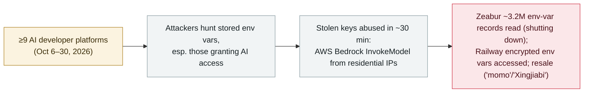

# "Black October": a coordinated wave breached at least nine AI developer platforms to harvest AI-access credentials

      

## Summary

**On 30 October 2026, Wiz published "Black October," documenting a coordinated wave in which at least nine AI developer platforms disclosed security incidents in a single month, with attackers "explicitly hunting stored environment variables, with a focus on those granting AI access."** The nine: Fireworks AI (Oct 6), Andromeda (Oct 9), Zeabur (Oct 14), Lightning AI (Oct 15), OpenCode (Oct 16–17), Railway (Oct 20), Warp (Oct 23), CommandCode (Oct 28), and Northflank (Oct 30). Several victims (Fireworks, OpenCode, Warp) reported indications of an "agent-swarm" attack. Stolen keys were abused within ~30 minutes for AWS Bedrock `InvokeModel` calls from residential IPs, and downstream resale operations ("momo", "Xingjiabi") were observed — though Wiz says it cannot definitively link the resellers to the initial compromise. Independently, Zeabur's own report confirms ~3.2M environment-variable records read (and the company is shutting down), and Railway's own report confirms encrypted env vars were accessed (third parties cite up to 100k workspaces; an alleged $371k crypto theft is unverified). Recorded `incident` / `CRED` + `INFRA` / `high` / `real_harm: true` — a confirmed, cross-platform campaign targeting AI credentials; attribution is loose (Wiz does not tie it to one actor) and several per-platform investigations are ongoing.

## Attack chain

## Details

**What "Black October" is.** On **30 October 2026**, Wiz researchers (Benjamin Read, Rami McCarthy) published **"Black October for AI Developer Platforms,"** synthesizing a month in which **at least nine AI developer platforms disclosed security incidents**. Wiz frames them as connected by a shared pattern rather than attributed to a single operator: *"While there is no single vulnerability or dependency linking these attacks, the overall picture is strongly aligned…"* The common thread: *"All public reports highlight targeted exploitation, explicitly hunting stored environment variables, with a focus on those granting AI access."* Axios covered the wave on **28 October** (framing it as a "Y2K lesson" for AI developer tooling).

**The nine platforms (with disclosed/observed dates).**

| Platform | Date | What was reported |
|---|---|---|
| Fireworks AI | Oct 6 | Reported **indications of an "agent-swarm" attack**; root cause attributed to credential access |
| Andromeda | Oct 9 | Called the attack part of an "industry-wide attack" |
| **Zeabur** | Oct 14 | Leaked internal credentials → shared cluster → platform DB; **~3.2M env-var records read**; **company shutting down** |
| Lightning AI | Oct 15 | Credential access (previously hit in the Mini-Shai-Hulud supply-chain campaign) |
| **OpenCode** | Oct 16–17 | **Indications of an "agent-swarm" attack** — *already in this archive* ([record](2026-10-17-opencode-console-breach-api-keys.md)) |
| Railway | Oct 20 | Privilege escalation in build infrastructure; **encrypted env vars accessed** (third parties: up to 100k workspaces); alleged $371k crypto theft **unverified** |
| **Warp** | Oct 23 | **Indications of an "agent-swarm" attack**; third-party vendor dependency — *already in this archive* ([record](2026-10-27-warp-vendor-breach-agent-logs.md)) |
| CommandCode | Oct 28 | Attributed its incident to an attempted "distillation" |
| Northflank | Oct 30 | Listed; details pending |

**The "agent-swarm" thread and downstream abuse.** Fireworks, OpenCode, and Warp each reported *indications* of an "agent-swarm" attack. Wiz observed that the **first unauthorized use of stolen keys came within ~30 minutes** of credential access — a single `InvokeModel` call from a residential IP, sweeping multiple organizations in a one-minute burst. Wiz also documented two reselling operations for abused LLM tokens ("momo", centered on `23.106.46.239`; "Xingjiabi", at `xingjiabiapi.org` / `38.246.114.118`), but states plainly: *"We do not have evidence that links them directly to the 'Black October' attacks."* No CVE is named; Wiz assigns no formal threat-actor name.

**Independently confirmed harm.** This record does not rest on Wiz alone. **Zeabur's own preliminary report** (and BleepingComputer/SCWorld coverage) confirms that, on **Oct 14–15**, an attacker used leaked plaintext internal credentials (not rotated after an August breach) to reach the shared cluster and read the platform database — **~3.2M environment-variable records** — and that Zeabur is **winding down** (services stop by 31 Dec 2026). **Railway's own preliminary report** confirms a privilege-escalation issue in build infrastructure (Oct 20) and anomalous access to systems storing customer environment variables (Oct 21), with encrypted env vars possibly accessed.

**How it is graded.** `incident` — a confirmed, real, cross-platform campaign (multiple victims published their own breach reports), not a single disclosed flaw. `CRED` (the defining loot is AI-access credentials / API keys / tokens harvested from env vars) + `INFRA` (AI developer platforms are the attack surface). `real_harm: true`: Zeabur read of ~3.2M records and forced shutdown, Railway env-var access, and confirmed Bedrock token abuse are real-world harm. Severity `high` rather than critical: breadth is large and one platform is shutting down, but attribution is deliberately loose (Wiz ties nothing to a single actor), several per-platform investigations are ongoing, and the largest dollar claims (Railway's alleged $371k; OpenCode's "consumer bills in the hundreds to thousands") are unverified social-media reports. Confidence `A`: Wiz research + Zeabur's and Railway's own reports + BleepingComputer/SCWorld + Axios.

## Sources

| # | Source | Link |
|---|---|---|
| 1 | Wiz Research ("Black October") | <https://wiz.io/blog/black-october-for-ai-developer-platforms> |
| 2 | Zeabur (preliminary incident report) | <https://zeabur.com/blogs/october-2026-security-incident> |
| 3 | BleepingComputer (Zeabur shutting down) | <https://www.bleepingcomputer.com/news/security/zeabur-shutting-down-after-second-security-breach-in-two-months/> |
| 4 | Railway (preliminary incident report) | <https://blog.railway.com/p/preliminary-report-october-security-incident> |
| 5 | Axios | <https://www.axios.com/2026/10/28/cybersecurity-black-october-ai-hacks> |

## Metadata

| Field | Value |
|---|---|
| Date | `2026-10-30` (raw: 2026-10-30 Wiz "Black October" synthesis; campaign activity ~2026-10-06 to 2026-10-30, precision `day`) |
| Kind | Real incident `incident` |
| Type | [`CRED`](../../taxonomy/types.md#cred) [`INFRA`](../../taxonomy/types.md#infra) |
| Severity | **High** `high` |
| Confidence | **A** — Wiz research + Zeabur's & Railway's own reports + BleepingComputer/SCWorld + Axios |
| Real harm | Yes — Zeabur ~3.2M env-var records read and shutting down; Railway encrypted env vars accessed; Bedrock token abuse confirmed |
| AI involvement | Confirmed `confirmed` |
| Region | [Global](../../regions/global.md) |
| Archive ID | `2026-10-30-black-october-ai-developer-platform-breaches` |

**Why this classification:** A confirmed, cross-platform campaign (≥9 AI developer platforms in one month) whose defining goal was harvesting stored environment variables that grant AI access (`CRED`), with the platforms themselves as the attack surface (`INFRA`). `incident` with `real_harm: true` because multiple victims published their own breach reports with concrete impact (Zeabur ~3.2M records + shutdown; Railway env-var access; Bedrock abuse). `high`, not critical: broad but with loose attribution (Wiz ties it to no single actor), ongoing per-platform investigations, and unverified top-line dollar claims. Grading criteria: [severity.md](../../taxonomy/severity.md) and [confidence.md](../../taxonomy/confidence.md).

## Related

**Topic:** [Agent infrastructure exposure (INFRA)](../../topics/agent-infra.md)

**Related records:**

- `2026-10-27` [Warp discloses a third-party vendor breach that exposed AI-agent decision logs and user telemetry](2026-10-27-warp-vendor-breach-agent-logs.md)   One of the nine "Black October" platforms, recorded individually
- `2026-10-17` [OpenCode Console breach exposes users' stored AI-provider API keys](2026-10-17-opencode-console-breach-api-keys.md)   Another of the nine, recorded individually
- `2026-10-21` [LiteLLM 1.107.0 supply-chain compromise](2026-10-21-litellm-1-107-supply-chain-compromise.md)   Same month, AI infrastructure targeted for credentials

---

[← 2026-10 index](README.md) · [← All records](../../README.md) · [Chinese](../i18n/zh/2026-10/2026-10-30-black-october-ai-developer-platform-breaches.md)

This record is part of the **Orca AI Incident Archive**, licensed [CC BY 4.0](../../LICENSE). Found a factual error or a missing source? [Open an issue or PR](../../CONTRIBUTING.md) — corrections are recorded in the record's revision history, never silently overwritten.
