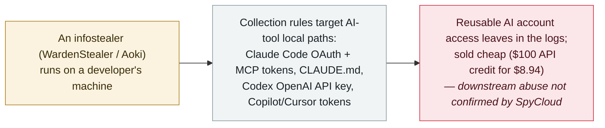

# SpyCloud: infostealers now harvest AI coding-tool tokens and API keys — WardenStealer and Aoki target Claude Code and Codex

      

## Summary

**On 30 October 2026, SpyCloud (Trevor Hilligoss) reported that infostealer malware now harvests credentials from AI coding tools, naming two families — WardenStealer and Aoki — that pull tokens and API keys from local Claude Code, Codex, Copilot, Cursor and desktop AI apps.** SpyCloud first saw WardenStealer on 3 August 2026 and has ingested 130,000+ unique infections; Aoki (a Go stealer) appeared in its recaptured data on 4 October 2026 (Symantec published on Aoki 15 October). What they take is account access and context: Claude Code's OAuth access and refresh tokens, tokens for connected MCP servers, the account config (user/machine IDs) and the `CLAUDE.md` instruction file; Codex's auth file with an OpenAI API key plus access/refresh tokens; Copilot and Cursor token files; and desktop-app cookies. A criminal market has adjusted in step — a $100 Codex or Claude API credit advertised for $8.94, AI subscriptions at 40–60% below list, a Telegram bot at up to 91% off, and a wholesaler paying suppliers 35% of billings for Anthropic/AWS-Bedrock Claude keys. SpyCloud is explicit that it cannot confirm abuse of these specific credentials (and that not all material being sold was necessarily taken by these stealers), so this is recorded `research` / `CRED` + `EXFIL` / `medium` / `real_harm: false` — the escalation of the trend first recorded for Gen Digital on 8 September 2026.

## Attack chain

## Details

**What SpyCloud reported.** On **30 October 2026**, SpyCloud's Trevor Hilligoss published *"Infostealers now target AI tokens and API keys,"* documenting — from SpyCloud's recaptured-malware-log telemetry — that infostealer families have added AI coding tools to their collection scope. Two families anchor the report: **WardenStealer**, first seen by SpyCloud on **3 August 2026** (Gen Digital places its earliest builds in early May), with **more than 130,000** unique infections ingested; and **Aoki**, a **Go**-based Windows stealer first seen in SpyCloud's recaptured data on **4 October 2026**, which sorts stolen AI material into a dedicated `AISessions` folder with per-tool subfolders (Symantec published its own Aoki analysis on **15 October 2026**).

**What is taken — access and context.** The stolen files are the agents' local credentials and state, not preferences:

- **Claude Code** — the OAuth **access and refresh tokens**, tokens for connected **MCP servers**, the account configuration file (user and machine identifiers), and the **`CLAUDE.md`** standing-instruction file.
- **Codex** — the authentication file holding an **OpenAI API key** plus access and refresh tokens (referred to as "Codex CLI" in WardenStealer logs).
- **GitHub Copilot and Cursor** — token files (seen in Aoki logs).
- **Claude Desktop / ChatGPT desktop** — configuration, plan/usage history and Netscape-format session cookies.

As SpyCloud notes, resetting a password does not revoke these tokens, which is what makes them valuable.

**The market adjusted in step.** SpyCloud shows the buyer's side: a **$100 Codex API credit advertised for $8.94** (and a $100 Claude API token for the same), a Russian-language shop selling Claude/ChatGPT/Grok subscriptions **40–60% below list**, a Telegram bot offering OpenAI/Anthropic access **up to 91% off** with $1 deposits, and a wholesale service paying suppliers **35% of billings** for Anthropic and AWS-Bedrock Claude keys (20% for OpenAI).

**The limits, stated by SpyCloud.** This is a capability-and-market trend, not a named-victim breach. SpyCloud is explicit that it **cannot confirm that all of the material being sold was taken by infostealer malware**, and it does not document confirmed abuse of victim credentials from these two families (the oft-cited $46,000/day figure is a 2024 Sysdig estimate; the Storm-2139 case is from 2024 and involved stolen Azure OpenAI keys). This record keeps those limits.

**How it is graded.** `research` — a vendor analysis of its own telemetry and the criminal market, not an incident with a named victim. `CRED` (what is harvested is **reusable credentials** — OAuth tokens, MCP tokens, API keys) + `EXFIL` (those credentials leave the machine in stealer logs). `real_harm: false`: the harvesting is real and measured (130,000+ WardenStealer infections), but SpyCloud confirms **no specific downstream account takeover** tied to these families — the same basis as the archive's Gen Digital record. Severity `medium`: the underlying data (reusable tokens and MCP credentials) is genuinely sensitive and the trend is one-way. Confidence `A`: SpyCloud's own recaptured-data analysis, corroborated independently by Symantec's Aoki report (via Infosecurity Magazine) and Cyber Security News. `ai_involvement: confirmed`: the targeted artifacts are AI-agent credentials and instruction files. This is the **escalation** of the trend first recorded for Gen Digital (8 September 2026) — now specifically AI coding-tool OAuth/MCP tokens and a priced resale market.

## Sources

| # | Source | Link |
|---|---|---|
| 1 | SpyCloud ("Infostealers now target AI tokens and API keys") | <https://spycloud.com/blog/infostealers-now-target-ai-tokens-and-api-keys/> |
| 2 | Infosecurity Magazine (Aoki infostealer / Symantec) | <https://www.infosecurity-magazine.com/news/aoki-infostealer-ai-coding/> |
| 3 | Cyber Security News | <https://cybersecuritynews.com/hackers-use-new-infostealer-malware/> |

## Metadata

| Field | Value |
|---|---|
| Date | `2026-10-30` (raw: 2026-10-30 SpyCloud report; WardenStealer first seen 2026-08-03, Aoki 2026-10-04, precision `day`) |
| Kind | Research / vendor analysis `research` |
| Type | [`CRED`](../../taxonomy/types.md#cred) [`EXFIL`](../../taxonomy/types.md#exfil) |
| Severity | **Medium** `medium` |
| Confidence | **A** — SpyCloud's own recaptured-data analysis, with independent Symantec (Aoki) and Cyber Security News corroboration |
| Real harm | No — harvesting is real and measured, but SpyCloud confirms no specific downstream account takeover |
| AI involvement | Confirmed `confirmed` — the targeted artifacts are AI-agent credentials and instruction files |
| Region | [Global](../../regions/global.md) |
| Archive ID | `2026-10-30-spycloud-ai-coding-tool-token-theft` |

**Why this classification:** A vendor analysis of SpyCloud's own recaptured malware logs and the criminal market (`research`), showing infostealers harvesting reusable AI coding-tool credentials — OAuth/MCP tokens, API keys (`CRED`) — that leave the machine in stealer logs (`EXFIL`). `real_harm: false`: the trend is real and measured but SpyCloud confirms no specific downstream account takeover tied to these families (same basis as the Gen Digital record). `medium` severity because the data is genuinely sensitive. Confidence `A` — SpyCloud's own data plus independent Symantec and Cyber Security News reporting. Dated to SpyCloud's post (30 October 2026). Grading criteria: [severity.md](../../taxonomy/severity.md) and [confidence.md](../../taxonomy/confidence.md).

## Related

**Topic:** [Agent infrastructure exposure](../../topics/agent-infra.md)

**Related records:**

- `2026-09-08` [Infostealers turn to AI-agent data: collection rules now target Claude, Cursor and Codex](../2026-09/2026-09-08-gen-digital-infostealers-ai-agent-data.md)   The same trend, first recorded — this SpyCloud report is its escalation (named families, OAuth/MCP tokens, priced market)
- `2026-10-17` [OpenCode Console breach leaks stored AI API keys](2026-10-17-opencode-console-breach-api-keys.md)   Where stolen AI credentials turned into named, billed abuse
- `2026-06-24` [Operation Endgame (Europol) takes down StealC and Amadey](../2026-06/2026-06-24-operation-endgame-europol-stealc.md)   The commodity-stealer market this behaviour rides on

---

[← 2026-10 index](README.md) · [← All records](../../README.md) · [Chinese](../i18n/zh/2026-10/2026-10-30-spycloud-ai-coding-tool-token-theft.md)

This record is part of the **Orca AI Incident Archive**, licensed [CC BY 4.0](../../LICENSE). Found a factual error or a missing source? [Open an issue or PR](../../CONTRIBUTING.md) — corrections are recorded in the record's revision history, never silently overwritten.
