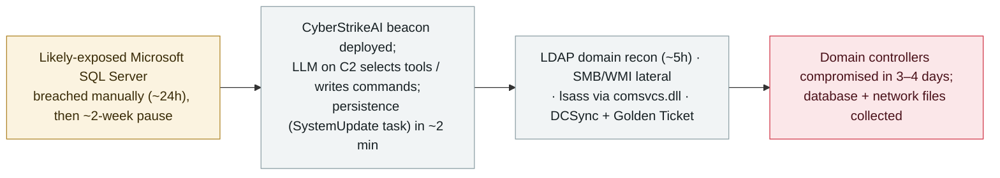

# CyberStrikeAI in the wild: an LLM-orchestrated intrusion reaches domain admin at education targets in Latin America and Africa

      

## Summary

**On 2 November 2026, Kaspersky (press release + a Securelist report, "CyberStrikeAI in the wild") documented real-world intrusions at education-sector organizations across several countries in Latin America and Africa, in which an LLM orchestrator drove the post-exploitation.** CyberStrikeAI is an open-source, Go-based AI penetration-testing framework; in these attacks the LLM ran on the attacker's C2 server (selecting tools, writing commands, reading results) while the on-host implant carried no AI and simply executed tasks. Kaspersky reconstructed one case: a human operator first breached a likely-exposed Microsoft SQL Server (`sqlservr.exe` 16.0.1000) over ~24h, paused ~2 weeks, then deployed the CyberStrikeAI beacon — which set persistence (a `SystemUpdate` scheduled task) within ~2 minutes, ran LDAP domain recon (~5h), moved laterally over SMB/WMI, dumped registry hives and lsass via comsvcs.dll, and ran DCSync + Golden Ticket with a renamed Mimikatz. Domain controllers were compromised within 3–4 days of implant deployment; the final stage was data collection (database records from the SQL server, files from network resources). Kaspersky does not attribute the activity to a known group and cannot confirm a single operator across infrastructure; Chinese-language script comments, use of Chinese services (DNSLog.cn) and UTC+8 restart timing suggest a Chinese-speaking operator. Recorded `incident` / `WEAPON` + `CRED` / `high` / `real_harm: true`.

## Attack chain

## Details

**What Kaspersky reported.** On **2 November 2026**, Kaspersky issued a press release and a Securelist report, *"CyberStrikeAI in the wild: the use of AI in real-world attacks on organizations,"* describing intrusions at **education-sector organizations in several countries across Latin America and Africa** (no specific organizations or countries are named). **CyberStrikeAI** is an open-source, Go-based (Apache-2.0) AI penetration-testing framework whose maintainers describe it as built for authorized assessments; here it was abused in real attacks.

**The architecture.** The design keeps the model off the victim: an **LLM orchestrator runs on the attacker's C2 server** — it selects tools, writes the commands and analyses the returned output — while the **implant on the compromised host carries no AI functionality** and simply executes the tasks it is handed. A human operator sets the objectives; Kaspersky notes human involvement at goal-setting but does not quantify ongoing oversight.

**The reconstructed intrusion.** In one reconstructed case:

1. **Initial access (manual, ~24h).** The first malicious commands ran from `sqlservr.exe` (version 16.0.1000) — Kaspersky calls a likely-exposed Microsoft SQL Server the "likely initial access vector." The operator collected basic system data and deployed local utilities (e.g. RogueWinRM, GodPotato).
2. **Pause (~2 weeks).** Operations went quiet.
3. **Beacon + autonomy.** The operator deployed the **CyberStrikeAI beacon**, which received tasks from the LLM on the C2. Within **~2 minutes** it established **persistence** via a scheduled task named **`SystemUpdate`**.
4. **Domain recon (~5h).** LDAP queries enumerated user accounts, subnets and Azure credentials.
5. **Lateral movement + credential theft.** Over SMB administrative shares and WMI; registry hives dumped with `reg.exe`; credentials extracted from `lsass.exe` via `comsvcs.dll`. With domain-admin credentials it ran **DCSync** and **Golden Ticket** attacks using a **renamed Mimikatz**.
6. **Outcome.** **Domain controllers were compromised within 3–4 days** of implant deployment, giving full domain-administrative control. The **final stage was data collection** — database records queried from the education organization's SQL server, and files collected from network resources. (Kaspersky describes *collection*; it does not detail external exfiltration to a specific destination, and it names no student/staff record counts.)

**Attribution — stated carefully.** Kaspersky says the evidence **does not link** the activity to any known group and that it cannot be certain the same operator is behind related campaigns. Chinese-language comments in PowerShell scripts, the use of Chinese services (e.g. DNSLog.cn) and UTC+8 business-hours restart timing **"suggest a connection"** to a Chinese-speaking operator — a suggestion, not an attribution. CyberStrikeAI has prior documented abuse (earlier FortiGate-focused and Japan-focused reporting); this education-sector campaign in Latin America and Africa is a distinct Kaspersky-documented case.

**How it is graded.** `incident` — real, forensically reconstructed intrusions, not a demonstration. `WEAPON` (an AI framework orchestrating offensive operations end-to-end) + `CRED` (what is confirmed is **credential theft and full domain-controller takeover** — lsass dumping, DCSync, Golden Ticket; data "collection" is described but external exfiltration of named records is not confirmed, so this is `CRED`, not `EXFIL`). `real_harm: true`: the **domain-controller compromise and credential theft are confirmed** at real education organizations. Severity `high`, not critical: the compromise is real but Kaspersky names no victims, quantifies no data loss, and reports no critical-infrastructure impact. Confidence `A`: Kaspersky's own Securelist forensic report and press release, with independent reporting. `ai_involvement: confirmed`: the LLM-on-C2 orchestration is the documented core of the technique.

## Sources

| # | Source | Link |
|---|---|---|
| 1 | Securelist / Kaspersky ("CyberStrikeAI in the wild") | <https://securelist.com/cyberstrikeai-attacks/121715/> |
| 2 | Kaspersky press release | <https://www.kaspersky.com/about/press-releases/kaspersky-uncovers-ai-driven-attacks-on-educational-organizations-in-latin-america-and-africa> |
| 3 | Security Online | <https://securityonline.info/cyberstrikeai-framework-attacks> |

## Metadata

| Field | Value |
|---|---|
| Date | `2026-11-02` (raw: 2026-11-02 Kaspersky press release / Securelist report; intrusions observed Sept–Oct 2026, precision `day`) |
| Kind | Real incident `incident` |
| Type | [`WEAPON`](../../taxonomy/types.md#weapon) [`CRED`](../../taxonomy/types.md#cred) |
| Severity | **High** `high` |
| Confidence | **A** — Kaspersky's own Securelist forensic report + press release, with independent reporting |
| Real harm | Yes — confirmed domain-controller compromise and credential theft at real education organizations |
| AI involvement | Confirmed `confirmed` — LLM-on-C2 orchestration is the core technique |
| Region | [Global](../../regions/global.md) |
| Archive ID | `2026-11-02-cyberstrikeai-education-latam-africa` |

**Why this classification:** A forensically reconstructed, real intrusion in which an AI framework (CyberStrikeAI) orchestrated the attack end-to-end (`WEAPON`) and achieved domain-controller takeover via credential theft (`CRED` — lsass/DCSync/Golden Ticket; external exfiltration of named records is not confirmed, so not `EXFIL`), hence `real_harm: true`. `high` not critical: the compromise is confirmed but no victims are named, no data-loss figures are given, and no critical-infrastructure impact is reported. Region `GLOBAL` — targets span Latin America and Africa with no named countries (the taxonomy has no Africa code). `confirmed` AI involvement from the LLM-on-C2 design. Attribution to a Chinese-speaking operator is "suggested," not established. Grading criteria: [severity.md](../../taxonomy/severity.md) and [confidence.md](../../taxonomy/confidence.md).

## Related

**Topic:** [Offensive AI (agents used by attackers)](../../topics/offensive-ai.md)

**Related records:**

- `2026-11-05` ["Hacking on Autopilot": Check Point's ARTEX cybercrime forensics](2026-11-05-artex-hacking-on-autopilot-cybercrime.md)   Another open-source AI pentest harness abused for autonomous-leaning crime
- `2026-11-04` ["BOSSAI": a lone operator's 12-agent AI attack mesh](2026-11-04-bossai-ai-attack-mesh-taiwan-emergency.md)   Another LLM-orchestrated real-world intrusion campaign
- `2026-09-22` [Carbonato: a Docker-borne Hermes Agent botnet](../2026-09/2026-09-22-carbonato-docker-hermes-agent-botnet.md)   Another offensive-AI framework operated at scale

---

[← 2026-11 index](README.md) · [← All records](../../README.md) · [Chinese](../i18n/zh/2026-11/2026-11-02-cyberstrikeai-education-latam-africa.md)

This record is part of the **Orca AI Incident Archive**, licensed [CC BY 4.0](../../LICENSE). Found a factual error or a missing source? [Open an issue or PR](../../CONTRIBUTING.md) — corrections are recorded in the record's revision history, never silently overwritten.
