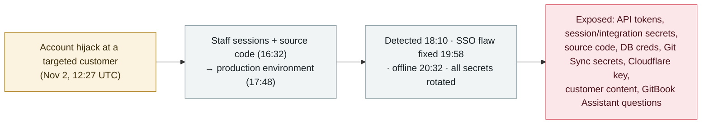

# GitBook discloses a targeted breach it attributes to AI agents, exposing infrastructure and customer credentials

      

## Summary

**On 2 November 2026, documentation platform GitBook was breached in what it called "a sophisticated, highly targeted attack using AI agents"; it disclosed the incident on 3 November.** Per GitBook's own post-mortem, an attacker hijacked an account at a targeted customer at 12:27 UTC, reached staff sessions and source code by 16:32, and the production environment by 17:48; GitBook detected it at 18:10, fixed an SSO flaw at 19:58, and took itself offline at 20:32, restoring service ~16 hours later after rotating every secret. Potentially exposed: GitBook API tokens, integration and session-signing secrets, internal source code, infrastructure secrets, database credentials, Git Sync secrets, a Cloudflare API key, customer content, repo access each customer had granted, and questions visitors asked the GitBook Assistant; passwords, billing and IPs were not. GitBook forced customers to rotate all tokens and re-authenticate the GitBook MCP server. PancakeSwap moved its docs off GitBook. The "AI agents" attribution is GitBook's inference from the attacker's "speed and precision", not a forensically confirmed finding — hence `ai_involvement: unverified`. Recorded `incident` / `CRED` + `INFRA` / `high` / `real_harm: true`.

## Attack chain

## Details

**What happened.** GitBook — a documentation platform widely used by software and cryptocurrency projects — published a security disclosure on **3 November 2026** stating it "has been the target of a sophisticated, highly targeted attack using AI agents." Its post-mortem gives a minute-by-minute timeline (UTC) for **2 November**: **12:27** an account at the targeted customer is hijacked; **16:32** the attacker reaches staff sessions and then source code; **17:48** the attacker reaches the production environment; **18:10** an internal alert fires and investigation begins; **19:58** an SSO flaw is fixed; **20:32** compromised accounts are disabled and GitBook is taken offline. On **3 November**, GitBook redeployed with new secrets (**02:34**, invalidating pre-existing API tokens), completed rotating all secrets and came back online after ~16 hours of downtime (**11:56**), and later rotated the GitLab tokens used for Git Sync (**22:51**). GitBook says the attacker held production access for roughly 2h45m on the evening of 2 November and ~40 minutes early on 3 November.

**What was exposed.** Per GitBook, potentially accessed data includes GitBook API tokens; integration tokens and secrets; session signing secrets; documentation sites using authenticated access; the GitHub and GitLab access each customer had granted to GitBook (limited to those repositories); customer content such as docs, spaces and change requests; internal source code, infrastructure secrets, database credentials, Git Sync secrets, and a **Cloudflare API key**; and **"questions asked to GitBook Assistant by your site visitors."** GitBook states billing information, passwords and IP addresses were **not** compromised, and it found no evidence that other customers' content was modified.

**On the "AI agents" claim.** GitBook frames the AI-agent involvement as an **inference from the attacker's behaviour**, not a forensic finding: the post-mortem says the attacker "moved with a speed and precision that pointed to an attack driven largely by automation and AI." The entry vector GitBook describes is an **SSO flaw plus account hijack** at a targeted customer — not GitBook's own AI products. Because the AI attribution rests on observed speed rather than recovered tooling, this record uses `ai_involvement: unverified` (and does **not** claim GitBook's AI Assistant or MCP server was the vector — those appear only as *exposed surface*: Assistant questions were among the data potentially read, and customers must re-authenticate the MCP server).

**Remediation and customer action.** GitBook revoked all personal API tokens, rotated all production and GitBook-managed customer secrets (including Git Sync and GitLab keys), recycled staging/production nodes, reversed actions taken by the compromised service account, and closed the exploited paths. It instructs customers to create a new API token, rotate third-party tokens and integration secrets, regenerate the authenticated-access signing key, **re-authenticate the GitBook MCP server**, reconnect Git Sync/GitLab, and review environments for the attacker IPs `94.183.188.91`, `45.139.84.195`, and `198.251.83.217`. Downstream, **PancakeSwap** took its docs offline and later moved them off GitBook (saying its app was unaffected), and **TradeXYZ** warned users not to click links in its documentation during the investigation.

**How it is graded.** `incident` — a real, disclosed breach with first-party confirmation. `CRED` (the defining loss is credentials/secrets — API tokens, integration/session secrets, DB credentials, a Cloudflare key) + `INFRA` (GitBook is shared documentation infrastructure for many AI/dev/crypto projects, with an AI Assistant and MCP server in scope). `real_harm: true`: source code, infrastructure secrets and customer secrets were exposed, forcing fleet-wide rotation, and at least one large customer migrated away. Severity `high`, not critical: production access was contained to ~3 hours, GitBook found no content modification, and passwords/billing/IPs were not compromised. `ai_involvement: unverified`: GitBook attributes AI agents from attacker speed, not from recovered tooling. Confidence `A`: detailed first-party post-mortem, corroborated by Decrypt and ForkLog.

## Sources

| # | Source | Link |
|---|---|---|
| 1 | GitBook (official security incident disclosure & post-mortem) | <https://www.gitbook.com/status/security-incident-2026-11-03> |
| 2 | Decrypt | <https://decrypt.co/382465/crypto-docs-gitbook-ai-agent-security-breach> |
| 3 | ForkLog | <https://forklog.com/en/hackers-breach-gitbook-using-ai-agents/> |

## Metadata

| Field | Value |
|---|---|
| Date | `2026-11-02` (raw: 2026-11-02 intrusion; disclosed 2026-11-03, precision `day`) |
| Kind | Real incident `incident` |
| Type | [`CRED`](../../taxonomy/types.md#cred) [`INFRA`](../../taxonomy/types.md#infra) |
| Severity | **High** `high` |
| Confidence | **A** — first-party GitBook post-mortem + Decrypt + ForkLog |
| Real harm | Yes — source code, infrastructure secrets, a Cloudflare key and customer secrets exposed; fleet-wide rotation forced; PancakeSwap migrated away |
| AI involvement | Unverified `unverified` — GitBook infers AI agents from attacker speed/precision, not from recovered tooling |
| Region | [Global](../../regions/global.md) |
| Archive ID | `2026-11-02-gitbook-ai-agent-breach` |

**Why this classification:** A first-party-confirmed breach of shared documentation infrastructure whose defining loss is credentials and secrets (`CRED` + `INFRA`). `real_harm: true` because source code, infrastructure secrets, a Cloudflare API key and customer secrets were exposed, forcing fleet-wide rotation and at least one customer migration. `high`, not critical: ~3h contained production access, no content modification, and passwords/billing/IPs safe. `ai_involvement: unverified` because GitBook's AI-agent attribution is an inference from attacker speed, not a forensic finding. Grading criteria: [severity.md](../../taxonomy/severity.md) and [confidence.md](../../taxonomy/confidence.md).

## Related

**Topic:** [Agent infrastructure exposure (INFRA)](../../topics/agent-infra.md)

**Related records:**

- `2026-10-30` ["Black October": a coordinated wave breached at least nine AI developer platforms to harvest AI-access credentials](../2026-10/2026-10-30-black-october-ai-developer-platform-breaches.md)   Same month-long pattern of AI/dev-platform infrastructure breached for stored credentials
- `2026-10-27` [Warp discloses a third-party vendor breach that exposed AI-agent decision logs and user telemetry](../2026-10/2026-10-27-warp-vendor-breach-agent-logs.md)   Another AI-tooling vendor breach disclosed in the same wave
- `2026-10-17` [OpenCode Console breach exposes users' stored AI-provider API keys](../2026-10/2026-10-17-opencode-console-breach-api-keys.md)   Credential-harvesting breach of an AI developer platform

---

[← 2026-11 index](README.md) · [← All records](../../README.md) · [Chinese](../i18n/zh/2026-11/2026-11-02-gitbook-ai-agent-breach.md)

This record is part of the **Orca AI Incident Archive**, licensed [CC BY 4.0](../../LICENSE). Found a factual error or a missing source? [Open an issue or PR](../../CONTRIBUTING.md) — corrections are recorded in the record's revision history, never silently overwritten.
