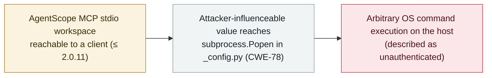

# AgentScope MCP Workspace API: unauthenticated OS command injection (CVE-2026-123022)

      

## Summary

**CVE-2026-123022, published 5 November 2026, is an OS command-injection flaw (CWE-78) in the MCP Workspace API of AgentScope — an open-source multi-agent framework — that trackers describe as unauthenticated process execution.** The workspace component passes an attacker-influenceable value into `subprocess.Popen` (in `_config.py`), so a remote request to an exposed AgentScope MCP stdio workspace can run arbitrary OS commands on the host. Affected versions run through 2.0.11 (listed as 2.0.0–2.0.11; one tracker narrows it to 2.0.4–2.0.11); the fix is PR #3448 on `agentscope-ai/agentscope`. Severity ratings disagree — CVSS v3.1 7.3 (High), CVSS v4.0 6.9, and one vendor (Red Hat) labels it Critical — and at time of recording the NVD entry is still "Deferred" with no official GitHub Security Advisory (GHSA), so this is confidence `B`, not `A`. It is distinct from the earlier AgentScope code-injection issues (CVE-2026-6603, in `execute_shell_command`/`execute_python_code` ≤1.0.18) and the authorization flaw CVE-2026-123023. No confirmed in-the-wild exploitation. Recorded `vulnerability` / `INFRA` + `MCP` / `high` / `real_harm: false`.

## Attack chain

## Details

**The flaw.** **CVE-2026-123022** (published **5 November 2026**) is an **OS command injection** (CWE-78; CWE-77 also listed) in the **MCP Workspace API** of **AgentScope**, an open-source multi-agent framework. The workspace component passes a value an attacker can influence — the command argument — into **`subprocess.Popen`** in **`_config.py`**, allowing arbitrary OS commands to run on the host. Public trackers and the referenced advisory file describe the issue as **"unauthenticated process execution"** against an exposed AgentScope MCP stdio workspace, i.e. the exposed workspace surface does not require authentication to reach the vulnerable path.

**Affected versions and fix.** The flaw affects AgentScope up to and including **2.0.11** (listed as 2.0.0–2.0.11; one database narrows the lower bound to 2.0.4). The fix is tracked as **PR #3448** on `agentscope-ai/agentscope`. Until patched, operators should **disable or restrict external access to the MCP Workspace API** and never expose it to untrusted networks.

**Caveats recorded honestly.** The severity ratings are inconsistent — **CVSS v3.1 7.3 (High)**, **CVSS v4.0 6.9 (Medium)**, while **Red Hat labels it Critical**. At the time of recording, the **NVD entry is marked "Deferred"** (official NVD analysis incomplete) and there is **no official GitHub Security Advisory (GHSA)** — the most detailed write-up is a file in a personal repository, not a vendor-published advisory. These gaps are why this record carries **confidence `B`** rather than `A`, even though the CVE is MITRE-assigned and backed by a concrete code fix. It is a **distinct** issue from AgentScope's earlier code-injection CVEs (e.g. **CVE-2026-6603** in `execute_shell_command`/`execute_python_code`, versions ≤1.0.18) and from the separate authorization flaw **CVE-2026-123023** (fixed in 2.0.9).

**How it is graded.** `vulnerability` — a disclosed flaw, not a used-in-anger incident. `INFRA` (AgentScope is **agent-runtime infrastructure** — a multi-agent framework) and `MCP` (the vulnerable surface is its **MCP Workspace API**). `real_harm: false`: **no confirmed in-the-wild exploitation** reported. Severity `high` rather than `critical`: this archive's severity reflects what has already happened, so an unauthenticated-RCE-class flaw with no known exploitation — and one that depends on the MCP workspace being exposed — is `high` here (the same basis as Loom for AWS, a CVSS-10 agent-platform flaw also recorded `high`; see Related). Confidence `B`: MITRE-assigned CVE with a concrete fix (PR #3448), but NVD analysis is "Deferred," there is no official GHSA, and severity scores disagree. `ai_involvement: confirmed`: the vulnerable component is an AI-agent framework's MCP workspace.

## Sources

| # | Source | Link |
|---|---|---|
| 1 | NVD — CVE-2026-123022 | <https://nvd.nist.gov/vuln/detail/CVE-2026-123022> |
| 2 | AgentScope — fix (PR #3448) | <https://github.com/agentscope-ai/agentscope/pull/3448> |
| 3 | OpenCVE — CVE-2026-123022 | <https://app.opencve.io/cve/CVE-2026-123022> |

## Metadata

| Field | Value |
|---|---|
| Date | `2026-11-05` (raw: 2026-11-05 CVE-2026-123022 published; NVD analysis "Deferred"; fix in AgentScope PR #3448, precision `day`) |
| Kind | Vulnerability disclosure `vulnerability` |
| Type | [`INFRA`](../../taxonomy/types.md#infra) [`MCP`](../../taxonomy/types.md#mcp) |
| Severity | **High** `high` |
| Confidence | **B** — MITRE-assigned CVE with a concrete fix (PR #3448), but NVD "Deferred", no official GHSA, and severity scores disagree |
| Real harm | No — no known in-the-wild exploitation |
| AI involvement | Confirmed `confirmed` — the vulnerable component is an AI-agent framework's MCP workspace |
| Region | [Global](../../regions/global.md) |
| Archive ID | `2026-11-05-agentscope-mcp-command-injection-cve-2026-123022` |

**Why this classification:** A disclosed OS-command-injection flaw in the MCP Workspace API of the AgentScope multi-agent framework (`INFRA` — agent-runtime infrastructure; `MCP` — the MCP workspace surface). `vulnerability`, not an incident. `real_harm: false` — no known exploitation. `high` not `critical`: severity records what has happened, and an unauthenticated-RCE-class flaw with no in-the-wild use that is also exposure-dependent is `high` here (as with Loom for AWS). Confidence `B` (not `A`): NVD analysis is "Deferred," there is no official GHSA, and the severity ratings disagree (7.3 High vs. Red Hat "Critical"). Grading criteria: [severity.md](../../taxonomy/severity.md) and [confidence.md](../../taxonomy/confidence.md).

## Related

**Topic:** [Agent infrastructure exposure (INFRA)](../../topics/agent-infra.md)

**Related records:**

- `2026-10-02` [Loom for AWS: missing authentication hands any client super-admin (CVE-2026-103956)](../2026-10/2026-10-02-loom-aws-agent-control-plane-cve-2026-103956.md)   Another agent-platform flaw where an exposed control surface needs no auth
- `2026-09-14` [Bifrost AI gateway (CVE-2026-90898)](../2026-09/2026-09-14-bifrost-ai-gateway-cve-2026-90898.md)   Another AI-agent-infrastructure weakness
- `2025-06-13` [Smithery.ai MCP server path traversal](../2025-06/2025-06-13-smithery-ai-lu-jing-chuan-yue.md)   An earlier MCP-surface vulnerability

---

[← 2026-11 index](README.md) · [← All records](../../README.md) · [Chinese](../i18n/zh/2026-11/2026-11-05-agentscope-mcp-command-injection-cve-2026-123022.md)

This record is part of the **Orca AI Incident Archive**, licensed [CC BY 4.0](../../LICENSE). Found a factual error or a missing source? [Open an issue or PR](../../CONTRIBUTING.md) — corrections are recorded in the record's revision history, never silently overwritten.
