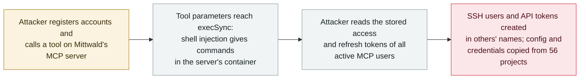

# German host Mittwald breached through a shell-injection flaw in its own MCP server; 56 customer projects compromised

       

## Summary

**On 7 November 2026 the German web host Mittwald disclosed that an attacker had broken into its platform through a flaw in its MCP server, the service that lets customers connect AI assistants such as Claude or ChatGPT to the mStudio hosting panel.** In a post-mortem published on 25 November, Mittwald identified the flaw as a shell injection in one of the server's tools: the `comment` and `passphrase` parameters of a tool call were placed into a command line and run with `execSync`, giving arbitrary command execution in the server's container. The MCP server holds valid access and refresh tokens for every active user, so the attacker read those tokens, including those of Mittwald employees, and used them to create SSH users and API tokens in other people's names and to copy configuration files and credentials out of projects. The attacker first probed the flaw on 21 October, exploited it from 27 October and was detected on 4 November; Mittwald shut the MCP server down, revoked all tokens and suspended mStudio login and SSH access from 5 to 7 November. It classified 56 projects as compromised and assumes data left them. Everyone who had used the MCP server was affected, along with projects their accounts could reach. Mittwald says it built the MCP server largely with AI coding agents and that the vulnerable code came from a test context and reached production unnoticed. In a second phase from 9 November the attacker returned, and on the night of 12 November exploited a previously unknown flaw in the Neos CMS to breach mittwald.de. Mittwald infers from the speed of the logged steps that the attacker used AI tools; The Record notes it gave no other evidence for that.

## Attack chain

## Details

**What the MCP server was for.** Mittwald's MCP server let a customer connect the mStudio panel to an AI assistant and then create projects, install apps or manage SSH access by chat. A customer signed in to the MCP server with OAuth2; the server received an access token and a refresh token for the Mittwald API and kept both in a session store, and when the assistant called a tool the server used that token to talk to the API in the customer's name. Some tools were wrappers around Mittwald's command-line client. As the post-mortem puts it, the consequence that mattered is that the MCP server holds the valid tokens of all active users at all times.

**The flaw.** One tool built a command line from the `comment` and `passphrase` parameters of the tool call using a template string and ran it with `execSync`, which hands the whole string to a shell. Whoever calls the tool chooses those parameters freely, so a command substitution in the comment ran before the intended `ssh-keygen` command started. The post-mortem says the temporary file name `mcp-eval-key` suggests the code came from a test context and moved into the production path unnoticed, and that no static analysis was configured for the project to flag `execSync` with interpolated variables.

**Mittwald's account of why it shipped.** The company says it built the MCP server largely with AI coding agents, a deliberate choice to gain early experience with agentic workflows in a fast-moving area. Its review practice and guardrails for agent-written code were less developed then than now; agent-written code usually looks plausible, is cleanly commented and follows known patterns, which tempts reviewers to check function rather than whether each line is safe in context. Mittwald adds that the same mistake happens to humans and that a thorough review should have caught it. It now applies binding review rules to agent-written code.

**Timeline of the first phase.** First tests on 21 October 2026, the evening much of the industry was occupied with the PHP2Shell vulnerability. From 23 October the attacker moved on the platform as a regular user, registering test accounts and trying simple injections. On 27 October at 14:58 the attacker registered another account and at 15:03 exploited the MCP flaw. Mittwald noticed unusual behaviour on the morning of 4 November, blocked the attacker's first account at 11:11, identified the MCP server as the entry point and shut it down. On 5 November it disabled new registrations and then mStudio login and SSH access to customer projects; both came back on 7 November. Outside forensic specialists were engaged and the authorities informed.

**What was taken and who was affected.** With the tokens, the attacker created SSH users and API tokens in other people's names in mStudio and copied configuration files and credentials out of projects. Mittwald says everyone who used the MCP server was affected, together with the projects their accounts could access, even where the project owner never used the MCP server. In 56 of those projects the attacker demonstrably acted; Mittwald classed them as compromised, assumes data left them, locked them and examined them forensically. An attempt in the first phase to reach Mittwald's internal systems through a further flaw in extension webhooks failed.

**The second phase.** From 9 November the attacker looked for new ways in, including throwaway mStudio accounts, hosting accounts managed through the older customer centre and vulnerable plugins in customer websites. On the night of 12 November the attacker exploited a zero-day in the Neos content management system that runs mittwald.de: the underlying Flow framework processed file uploads before checking that the requester was logged in, and the extension blocklist let `.phar` files through, so a web shell could be uploaded. The attacker read the site's configuration and database. Mittwald noticed shortly after the web shell's first call, suspended logins again on 12 and 13 November, and says a Neos security update has been available since 13 November. The MCP server remains offline.

**AI use by the attacker is an inference.** Mittwald writes that only seconds lay between individual steps and many actions ran in parallel, and that it therefore assumes the attacker used AI tools. The Record reports that Mittwald provided no other evidence of AI involvement and did not answer when asked how it distinguishes AI tools from conventional scripts. The record's `ai_involvement: confirmed` refers to the attack surface, which Mittwald itself identifies as its MCP server; it does not rest on the claim about the attacker's tooling.

**How it is graded.** `incident`: a confirmed breach disclosed by the affected company, with customer projects compromised. `MCP` because the flaw is in a tool of the MCP server itself; `CRED` because what the attacker took from the server were the users' tokens; `EXFIL` because configuration files and credentials were copied out of projects and Mittwald assumes data left the 56 compromised ones. `high`: a confirmed breach of customer environments at a hosting provider through its agent-facing interface, with a bounded number of projects and no evidence that internal systems were reached.

## Sources

| # | Source | Link |
|---|---|---|
| 1 | Mittwald incident post (Robert Meyer, 2026-11-07, in German) | <https://www.mittwald.de/blog/mittwald/sicherheitsvorfall-am-mcp-server> |
| 2 | Mittwald post-mortem (Martin Helmich, 2026-11-25, in German) | <https://www.mittwald.de/blog/mittwald/postmortem-wie-ein-angreifer-ueber-unseren-mcp-server-und-neos-eindrang> |
| 3 | The Record | <https://therecord.media/cyberattack-germany-ai-mittwald> |
| 4 | webhosting.today | <https://webhosting.today/2026/11/09/mittwald-traces-a-breach-of-56-customer-projects-to-its-mcp-server/> |

## Metadata

| Field | Value |
|---|---|
| Date | `2026-11-07` (raw: 2026-11-07 (Mittwald incident post; flaw first probed 2026-10-21, exploited from 2026-10-27, detected 2026-11-04; post-mortem published 2026-11-25), precision `day`) |
| Kind | Real incident `incident` |
| Type | [`MCP`](../../taxonomy/types.md#mcp) [`CRED`](../../taxonomy/types.md#cred) [`EXFIL`](../../taxonomy/types.md#exfil) |
| Severity | **High** `high` |
| Confidence | **A** — Mittwald's own incident post and detailed post-mortem; The Record and webhosting.today report from them |
| Real harm | Yes — 56 customer projects classed as compromised; user tokens read and abused; configuration files and credentials copied |
| AI involvement | Confirmed `confirmed` — the entry point is Mittwald's MCP server, by its own account; the attacker's use of AI tools is Mittwald's inference from timing and is not confirmed |
| Region | [Europe](../../regions/eu.md) |
| Archive ID | `2026-11-07-mittwald-mcp-server-breach` |

**Why this classification:** A breach confirmed by the affected company, entered through a flaw in a tool of its own MCP server (`MCP`), in which the tokens the server held for its users were read and abused (`CRED`) and project data copied (`EXFIL`), hence `incident` and `real_harm: true`. `high`: customer environments at a hosting provider compromised through the agent-facing interface, bounded at 56 projects. `confidence: A` for a first-hand disclosure with a technical post-mortem. The claim that the attacker used AI is flagged as an inference; the classification does not depend on it. Grading criteria: [severity.md](../../taxonomy/severity.md) and [confidence.md](../../taxonomy/confidence.md).

## Related

**Topic:** [Agent supply-chain poisoning](../../topics/agent-supply-chain.md) · [Agent infrastructure exposure](../../topics/agent-infra.md)

**Related records:**

- `2026-11-10` [Chainstack: an ARTEX-driven intrusion used an unauthenticated internal MCP tool server with cluster-admin rights](2026-11-10-chainstack-artex-unauthenticated-mcp-server.md)   The same weeks, the same lesson: an MCP server holding broad privileges became the attacker's lever
- `2026-10-19` [OpenCode: a malicious MCP server runs code on the developer's machine during OAuth sign-in](../2026-10/2026-10-19-opencode-mcp-oauth-rce.md)   Another MCP flaw on the OAuth and token path, from the client side
- `2026-11-05` [AgentScope: MCP stdio command injection (CVE-2026-123022)](2026-11-05-agentscope-mcp-command-injection-cve-2026-123022.md)   The same bug class, command injection through an MCP path, disclosed two days earlier as a CVE

---

[← 2026-11 index](README.md) · [← All records](../../README.md) · [Chinese](../i18n/zh/2026-11/2026-11-07-mittwald-mcp-server-breach.md)

This record is part of the **Orca AI Incident Archive**, licensed [CC BY 4.0](../../LICENSE). Found a factual error or a missing source? [Open an issue or PR](../../CONTRIBUTING.md) — corrections are recorded in the record's revision history, never silently overwritten.
