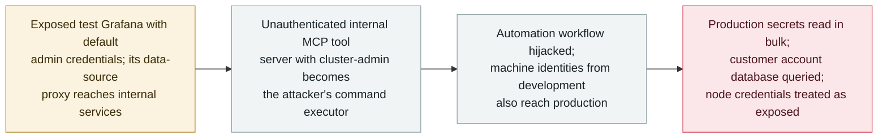

# Chainstack: an ARTEX-driven intrusion used an unauthenticated internal MCP tool server with cluster-admin rights to reach production

        

## Summary

**On 10 November 2026 the blockchain-infrastructure provider Chainstack added technical details to the incident report it first published on 3 November, describing an intrusion that it assesses with high confidence was carried out with ARTEX, an open-source framework that orchestrates LLM agents to automate intrusions.** The attacker entered on 26 October through an internet-exposed test Grafana instance in a development Kubernetes cluster that still had its default administrator credentials, and used Grafana's data-source proxy to reach internal services. One of those was an internal MCP tool server that exposes Kubernetes operations to AI agents: it required no authentication and ran with a service account bound to cluster-admin, and Chainstack says it served as the attacker's command executor. From development the attacker obtained machine credentials that also reached production, on 29 October listed and read secrets in a production cluster, and on 31 October read secrets in bulk from the production cloud secrets manager, used a compromised VPN key to join the database network and queried production databases. A database containing customer account information was accessed: organisation names, account-holder names, member email addresses and password hashes may have been exposed, and systems holding node credentials were reachable, so customers were asked to change passwords and rotate node credentials and API keys. Chainstack detected the intrusion on 31 October and cut the access paths that day. It found no evidence that a software vulnerability was exploited: the chain was default credentials, exposed administrative functionality, missing authentication, over-broad permissions and long-lived credentials. Chainstack attributes the tooling, not the actor.

## Attack chain

## Details

**Initial access.** A test Grafana instance had been deployed to a development Kubernetes cluster in July 2026. It was reachable from the internet with no single sign-on or basic authentication in front of it, and its default administrator credentials had never been changed. From 19:26 UTC on 26 October the attacker logged in, created data sources pointing at internal addresses and used Grafana's data-source proxy as a pivot, connecting over about two hours to dozens of internal services including identity, database, automation and monitoring endpoints. The proxy had no destination allowlist and no network policy limited where Grafana could connect.

**The MCP tool server.** At 21:01 the attacker reached an internal MCP tool server that exposes Kubernetes operations to AI agents. It required no authentication and ran with a service account bound to cluster-admin. Chainstack says network flows, those permissions and the changes that followed indicate it served as the attacker's command executor; the individual tool calls could not be recovered. Over the next hour and a half the attacker tested write access to an internal workflow engine, created administrator users in the development identity provider, and replaced the JavaScript served by a development web application by mounting attacker-supplied files over the originals through ConfigMap volumes. The same technique was applied to the staging web application and the development Grafana on 27 October; the injected loader referenced a second-stage script that Chainstack did not retrieve.

**From development to production.** On 29 October the attacker rewrote a workflow in the workflow-automation platform directly in its database so that it ran shell commands, triggered it with a valid webhook token and restored the original. The run returned the automation pod's environment, its Kubernetes service-account token and a machine identity for the infrastructure access gateway. That identity and a second one belonging to deployment automation were then used to list the secrets of a production Kubernetes cluster and read several, including cloud and infrastructure credentials. On 31 October, with a key for the cloud service account of the infrastructure-as-code automation, the attacker read secrets in bulk from the production cloud secrets manager between 01:40 and 08:31, created further keys and a Kubernetes service account as an independent way back in, ran short-lived and privileged pods in production and registered rogue instances with the access gateway.

**Database access and detection.** The secrets included the private key of a VPN peer on the database network. When the attacker used it, two clients presented the same peer identity, the tunnel endpoint flapped between them and a database replication pipeline failed; that failure started the investigation. From about 07:30 the attacker connected to a production database as an administrative user from attacker-created pods and exfiltrated query results through pod command output in base64 chunks, and queried the view that holds role password hashes on one instance. Separately the attacker used a BI tool's API key to run SQL queries and read stored connection details. Chainstack cut the access paths on 31 October; some copied credentials for external services kept working until rotated, with the last observed use at 06:28 on 2 November.

**What was exposed.** A database containing customer account information: organisation names, account-holder names, the email addresses of organisation members and password hashes may have been exposed. Systems holding node credentials were accessible; Chainstack has no evidence they were read but treats them as exposed. Customer nodes, the console and the API were not modified, and payment-card details are not stored. Customers were asked to change passwords, rotate node credentials, regenerate platform API keys and watch for phishing.

**Why Chainstack names ARTEX.** Attacker-created resources consistently carried `artx` / `artex` prefixes, often with numeric suffixes, in workflow names, identities, pods, service accounts, a systemd timer and DNS proof records. Chainstack assesses with high confidence that the attacker used ARTEX and says the conclusion concerns the tooling: none of its indicators appear among the actor-specific indicators published for the named groups known to use the framework, so it attributes the tooling, not the actor. It also says its findings indicate the incident was part of a broader AI-powered campaign reported in late October. No outside party has independently verified the account; GovInfoSecurity and EconoTimes report from Chainstack's page, and Wiz lists Chainstack's default-credential Grafana among that campaign's entry points.

**How it is graded.** `incident`: a breach confirmed by the affected company with customer data accessed. `WEAPON` because an agent framework was the attacker's tool; `MCP` because the pivotal step was an unauthenticated MCP tool server carrying cluster-admin rights; `CRED` because the intrusion advanced by harvesting machine identities, keys and secrets; `EXFIL` because database query results left the environment. `high`: production secrets read in bulk and customer account data accessed at an infrastructure provider, with no evidence of customer-facing services being altered.

## Sources

| # | Source | Link |
|---|---|---|
| 1 | Chainstack incident report (created 2026-11-03, technical details added 2026-11-10) | <https://chainstack.com/security-incident-nov-2026/> |
| 2 | GovInfoSecurity | <https://www.govinfosecurity.com/cryptohack-roundup-chainstack-luxors-ai-breaches-a-33445> |
| 3 | EconoTimes | <https://econotimes.com/Chainstack-Breach-May-Have-Exposed-Customer-Account-Data-1776115> |
| 4 | Wiz Research (lists Chainstack among the campaign's victims) | <https://www.wiz.io/blog/agentic-attacks-artex-offensive-ai-frameworks> |

## Metadata

| Field | Value |
|---|---|
| Date | `2026-11-10` (raw: 2026-11-10 (Chainstack adds technical details to its incident report first published 2026-11-03; intrusion ran 2026-10-26 to 2026-10-31, last use of a copied credential 2026-11-02), precision `day`) |
| Kind | Real incident `incident` |
| Type | [`WEAPON`](../../taxonomy/types.md#weapon) [`MCP`](../../taxonomy/types.md#mcp) [`CRED`](../../taxonomy/types.md#cred) [`EXFIL`](../../taxonomy/types.md#exfil) |
| Severity | **High** `high` |
| Confidence | **A** — Chainstack's own incident report with a detailed technical timeline and indicators; GovInfoSecurity and EconoTimes report from it; Wiz lists it among the campaign's victims |
| Real harm | Yes — a customer account database queried; production secrets read in bulk; node credentials treated as exposed and rotated |
| AI involvement | Confirmed `confirmed` — Chainstack assesses with high confidence that ARTEX was used, from `artx` / `artex` markers across the attacker's artifacts; this is its own assessment of tooling, not actor |
| Region | [Global](../../regions/global.md) |
| Archive ID | `2026-11-10-chainstack-artex-unauthenticated-mcp-server` |

**Why this classification:** A breach confirmed by the affected company in which an agent framework was the attacker's tooling (`WEAPON`), the pivotal step was an unauthenticated MCP tool server with cluster-admin rights (`MCP`), the intrusion advanced by harvesting identities and secrets (`CRED`) and database results were taken out (`EXFIL`), hence `incident` and `real_harm: true`. `high`: production secrets and customer account data at an infrastructure provider, with customer-facing services unaltered. `confidence: A` for a first-hand report with a technical timeline; the ARTEX finding is the company's own high-confidence assessment and is recorded as such. Grading criteria: [severity.md](../../taxonomy/severity.md) and [confidence.md](../../taxonomy/confidence.md).

## Related

**Topic:** [Offensive AI capability evolution](../../topics/offensive-ai.md) · [Agent supply-chain poisoning](../../topics/agent-supply-chain.md)

**Related records:**

- `2026-11-07` [German host Mittwald breached through a shell-injection flaw in its own MCP server](2026-11-07-mittwald-mcp-server-breach.md)   The same weeks: another provider whose own MCP server was the way in
- `2026-10-30` [Black October: a coordinated wave breached at least nine AI developer platforms](../2026-10/2026-10-30-black-october-ai-developer-platform-breaches.md)   The late-October campaign Chainstack says its incident belongs to
- `2026-11-06` [WorkOS traces a customer-data breach to a security researcher's escaped ARTEX AI agent](2026-11-06-workos-escaped-artex-agent-breach.md)   Another company that identified ARTEX from markers in its own logs, in the same week

---

[← 2026-11 index](README.md) · [← All records](../../README.md) · [Chinese](../i18n/zh/2026-11/2026-11-10-chainstack-artex-unauthenticated-mcp-server.md)

This record is part of the **Orca AI Incident Archive**, licensed [CC BY 4.0](../../LICENSE). Found a factual error or a missing source? [Open an issue or PR](../../CONTRIBUTING.md) — corrections are recorded in the record's revision history, never silently overwritten.
