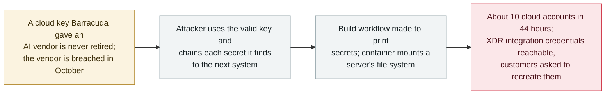

# Barracuda: an ARTEX-matched intrusion crossed about 10 cloud accounts in 44 hours through a stale key left with an AI vendor

      

## Summary

**On 11 November 2026 the security vendor Barracuda published an account of an intrusion into parts of its cloud environment, saying the attacker's probe names, indicators, working order and built-in routines for hunting credentials and wallets all match ARTEX, an open-source AI-driven penetration-testing framework.** The attacker did not exploit a vulnerability: it used a valid cloud access key that Barracuda had given a third-party vendor, a company working in AI, for an earlier project and never retired. The vendor's own development environment was compromised in October, which appears to be where the key was found. The first call with the key came at 04:33 UTC on 1 November; over the next 24 hours the attacker used each secret it found to reach the next system, from cloud accounts to a data-analytics system, to a source-code access token, to Kubernetes clusters. Early on 2 November it pushed short-lived branches to a handful of repositories to trigger a build workflow written to print the build system's secrets into the job log, encoded to defeat log masking. The last recorded activity was at 23:31 UTC on 2 November: about 10 cloud accounts in roughly 44 hours. It deployed a container that mounted a server's file system to harvest credentials and tried to create a new administrative cloud identity, which was blocked. An engineer noticed unusual activity on 4 November, by which time the attacker had finished. One system it reached stores the credentials Barracuda XDR uses to collect data from customers' systems; Barracuda found no direct evidence they were viewed but could not rule it out and asked potentially affected customers to recreate them. Barracuda attributes how the attacker operated, not who it was.

## Attack chain

## Details

**How it started.** Barracuda says the attacker did not break in but used a valid cloud access key. As part of a previous project the company had given a cloud access key to a third-party vendor, a company working in AI, and did not retire the key when that work finished; the post says plainly that this is on Barracuda. In October the vendor's own development environment was compromised, and that appears to be where the attacker found the key. The vendor is not named.

**What Barracuda observed.** All times are UTC. On 1 November at 04:33 the attacker made its first call with the key and within minutes was mapping what the key could reach, reading stored secrets such as AWS access keys and Azure service-principal secrets. Over the next 24 hours it used each secret to reach the next system: from cloud accounts to a data-analytics system, from there to a source-code access token, from there to Kubernetes clusters. In just under four hours early on 2 November it pushed short-lived branches to a handful of repositories to trigger a build workflow written to print the build system's secrets into the job log, with the secrets encoded so the log's usual masking would not hide them. The last recorded activity was on 2 November at 23:31. In all the attacker touched about 10 cloud accounts in roughly 44 hours.

**Why Barracuda says ARTEX.** The attacker referred to resources with machine-style labels, the letter i followed by digits. Barracuda says the probe names, the other indicators it collected, the order in which the attacker worked through its systems and its built-in routines for hunting credentials and wallets all match ARTEX, an open-source AI-driven penetration-testing framework released in July 2026 in which a planner agent decides the next step and worker agents run common tools. Because many groups use ARTEX, Barracuda says the match tells it how the attacker operated, not who it was. This identification is Barracuda's own and has not been independently verified.

**What the attacker wanted.** Credentials and secrets everywhere: it read secret stores, decrypted infrastructure-as-code state files, and pulled credentials from server metadata services and Kubernetes service accounts. On servers where it gained shell access its commands searched for environment variables named WALLET, MNEMONIC, SEED and PRIV, Ethereum keystore files, extended private keys and seed-phrase files; no wallet material existed there. Barracuda adds that some of the secrets within reach were credentials for AI services, that the vendor it came through is an AI company, and that it would be naive to rule out AI credentials and compute as part of the prize. It compares the chain to the October intrusion at Railway.

**Persistence, detection and customers.** Using access to a Kubernetes cluster, the attacker deployed a container that mounted the underlying server's file system read-only, enough to harvest that server's credentials, and tried to create a new administrative cloud identity, which was blocked. On 4 November an engineer noticed unusual activity on their own account, and the same day the vendor contacted Barracuda about its own incident. The container was removed that evening and credentials were rotated across every system involved. One system the attacker reached stores the credentials Barracuda XDR uses to collect data from customers' connected systems. Barracuda found no direct evidence they were viewed, but logging there was not detailed enough to rule it out, so it treated every credential in reach as potentially compromised and contacted customers with potentially affected Managed XDR Cloud or Monitored Endpoint integration credentials, asking them to revoke and recreate them.

**How it is graded.** `incident`: an intrusion disclosed by the affected company with a timeline and a customer advisory. `WEAPON` because, on Barracuda's account, an agent framework was the attacker's tool; `CRED` because the whole intrusion ran on a stale key and the secrets harvested from it, and what was put at risk is customer integration credentials. `real_harm: true`: about 10 cloud accounts, source repositories, the build system and Kubernetes clusters were accessed and secrets read. `high`: a security vendor's cloud environment compromised and customer credentials placed in reach, with no evidence that those credentials were used.

## Sources

| # | Source | Link |
|---|---|---|
| 1 | Barracuda blog (Arve Kjoelen, CISO): Forty-four hours | <https://blog.barracuda.com/2026/11/11/anatomy-of-a-machine-speed-intrusion> |
| 2 | BleepingComputer | <https://www.bleepingcomputer.com/news/security/barracuda-links-cloud-breach-to-artex-ai-powered-cyberattack/> |
| 3 | SecurityWeek | <https://www.securityweek.com/barracuda-hacked-amid-surge-in-artex-powered-cyberattacks/> |

## Metadata

| Field | Value |
|---|---|
| Date | `2026-11-11` (raw: 2026-11-11 (Barracuda blog post; Trust Center advisory 2026-11-10; intrusion ran 2026-11-01 04:33 UTC to 2026-11-02 23:31 UTC, detected 2026-11-04), precision `day`) |
| Kind | Real incident `incident` |
| Type | [`WEAPON`](../../taxonomy/types.md#weapon) [`CRED`](../../taxonomy/types.md#cred) |
| Severity | **High** `high` |
| Confidence | **A** — Barracuda's own account by its CISO, with a timeline and a customer advisory; BleepingComputer and SecurityWeek report from it; the vendor is unnamed and the ARTEX match is not independently verified |
| Real harm | Yes — about 10 cloud accounts, source repositories, the build system and Kubernetes clusters accessed and secrets read; customer XDR integration credentials in reach and rotated as a precaution |
| AI involvement | Confirmed `confirmed` — Barracuda says the attacker's probe names, indicators, working order and credential- and wallet-hunting routines all match ARTEX; this is its own identification of tooling, not of the actor |
| Region | [United States](../../regions/us.md) |
| Archive ID | `2026-11-11-barracuda-artex-stale-ai-vendor-key` |

**Why this classification:** An intrusion disclosed by the affected company in which, by its own account, an agent framework was the attacker's tooling (`WEAPON`) and every step ran on a stale third-party key and the secrets chained from it (`CRED`), hence `incident` and `real_harm: true`. `high`: a security vendor's cloud environment was crossed in under two days and customer integration credentials were put in reach, with no evidence they were used. `confidence: A` for a first-hand disclosure; the ARTEX identification is Barracuda's own and is recorded as such. Grading criteria: [severity.md](../../taxonomy/severity.md) and [confidence.md](../../taxonomy/confidence.md).

## Related

**Topic:** [Offensive AI capability evolution](../../topics/offensive-ai.md) · [Agent infrastructure exposure](../../topics/agent-infra.md)

**Related records:**

- `2026-10-30` [Black October: a coordinated wave breached at least nine AI developer platforms](../2026-10/2026-10-30-black-october-ai-developer-platform-breaches.md)   The October wave Barracuda's post points to, including the Railway intrusion it compares itself with
- `2026-11-10` [Chainstack: an ARTEX-driven intrusion reached production through an unauthenticated MCP tool server](2026-11-10-chainstack-artex-unauthenticated-mcp-server.md)   Another company-disclosed ARTEX intrusion from the same days, also chaining credentials rather than exploiting a flaw
- `2026-10-21` [Microsoft ties the ConnectWise supply-chain compromise to Storm-0940 driving attacks with ARTEX](../2026-10/2026-10-21-storm-0940-artex-connectwise-supply-chain.md)   An earlier ARTEX intrusion that also arrived through a supplier relationship

---

[← 2026-11 index](README.md) · [← All records](../../README.md) · [Chinese](../i18n/zh/2026-11/2026-11-11-barracuda-artex-stale-ai-vendor-key.md)

This record is part of the **Orca AI Incident Archive**, licensed [CC BY 4.0](../../LICENSE). Found a factual error or a missing source? [Open an issue or PR](../../CONTRIBUTING.md) — corrections are recorded in the record's revision history, never silently overwritten.
