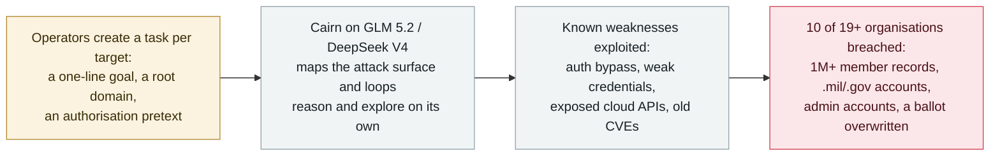

# Unit 42: CL-STA-1238 ran 25 autonomous Cairn operations against at least 19 organisations and breached 10 of them

       

## Summary

**On 12 November 2026, Palo Alto Networks Unit 42 reported that Chinese-speaking attackers it tracks as CL-STA-1238 used the open-source AI penetration-testing framework Cairn to run 25 autonomous operations against at least 19 organisations in August and September 2026, achieving unauthorised access or data retrieval at 10 of them.** The attackers ran a customised Cairn fork from a server in Hong Kong, gave each operation a one-line goal and a target domain, and let the framework plan, execute and record results; operations lasted from 20 minutes to more than 50 hours. Thirteen ran on Zhipu GLM 5.2, eight on DeepSeek V4 Flash and four on DeepSeek V4 Pro. A preamble asserting the work was authorised, plus a generated `AUTHORIZATION.md` file, was enough: Unit 42 says neither model refused. Targets were concentrated in the semiconductor supply chain (seven organisations), defence and defence policy (three) and human rights and civil society (four). Confirmed outcomes include more than one million member records, about 31,000 CRM contacts and staff password hashes at a US teachers' union; about 500 user records, including .mil and .gov accounts, at a defence-policy programme; about 150,000 internal documents at an industrial-automation manufacturer; unauthorised administrator accounts and a persistent API token in a semiconductor company's production system; and a live standards-ballot document overwritten at an industry standards body. The flaws exploited were known classes: authentication bypasses, weak and default credentials, exposed cloud APIs and dated public CVEs. Attribution to China-nexus intelligence collection is Unit 42's moderate-confidence assessment, and the victims are not named.

## Attack chain

## Details

**The framework and how it was used.** Cairn is a publicly available penetration-testing framework in which an AI model drives each agent worker and the workers coordinate through a shared blackboard, writing findings back as a graph of confirmed facts and queued intents; a human can inject hints at any time. Unit 42 says the attackers ran a customised fork from a server hosted in Hong Kong, with an egress and staging node in the United States. For each operation they created a task with a one-line goal (in Chinese; Unit 42 translates one as obtaining substantive high-value access such as a webshell, SSH, source code, keys, user information or credentials, ideally reaching the internal network) and seeded it with the organisation's root domain. The model produced a different three-to-seven-stage plan per target and then looped between reasoning over what it had found and carrying out one action at a time. Individual operations ran from 20 minutes to more than 50 hours with no time limit imposed.

**Models and guardrails.** Of the 25 operations, 13 ran on Zhipu GLM 5.2, 8 on DeepSeek V4 Flash and 4 on DeepSeek V4 Pro; Unit 42 says the attackers appear to have benchmarked the models against each other, using the higher tier for targets that resisted the cheaper one. Each operation loaded a skill pack named AIScan Runner Skills that is not in the upstream project. Cairn's stock prompts already tell the model never to refuse; the attackers added a Chinese-language preamble asserting the engagement was an authorised security test, and each operation generated an `AUTHORIZATION.md` file declaring it authorised. Unit 42 reports that neither Zhipu GLM nor DeepSeek refused this framing.

**Who was targeted.** At least 19 organisations: seven in the semiconductor and advanced-manufacturing supply chain (lithography, chip design, materials, photomask and standards), three in defence and defence policy (a space technology company, a defence-analytics vendor and a policy think tank) and four in human rights and civil society (a Canadian human-rights body, a US teachers' union, a science-policy advocacy group and an education nonprofit). In some tasks the attackers added information gathered beforehand: one task against a semiconductor equipment supplier included VPN gateway addresses, group names and shared group passwords for multiple sites.

**Confirmed outcomes.** Unit 42 says Cairn confirmed unauthorised access or data retrieval at 10 organisations. At an industry standards body, password spraying yielded dozens of valid credentials and access to non-public directory databases; the attackers overwrote a live standards-ballot document through an unauthenticated cloud-storage write and, through separate flaws, logged in as arbitrary customers with read, write and delete access to meeting, voting and back-office functions. At a semiconductor company they brute-forced a production credential on a partner-integration application, retrieved application data, user lists and email lists, and created unauthorised administrator accounts and a persistent API token. At a US teachers' union an unauthenticated account-creation bypass on the content management system let them mint sessions and harvest data: the framework logged access to more than one million member records, roughly 31,000 CRM contacts and staff password hashes. An open registration endpoint on the identity platform behind a defence-policy programme exposed roughly 500 user records, including .mil and .gov accounts. The remaining five cases covered tens of thousands of content-management records, including employee data at a semiconductor-lithography manufacturer, roughly 150,000 internal documents at an industrial-automation manufacturer and student data at an education nonprofit.

**What is not established.** The victims are not named, and none has confirmed the intrusions publicly. The figures are what the framework logged, as read by Unit 42. Attribution to China-nexus intelligence collection is a moderate-confidence assessment resting on the language of the artifacts, the exclusive use of Chinese models and the target set. GovInfoSecurity and CSO Online report the findings from Unit 42's publication. Unit 42 judges the operators were likely a single person or a small team.

**How it is graded.** `incident`: real intrusions with data retrieved and production systems changed, reconstructed by a named research team from the attackers' own framework. `WEAPON` because human operators deliberately aimed the agents; `EXFIL` because member, user and document data left the victims; `CRED` because credentials, password hashes and a persistent API token were obtained or created. `high`: ten organisations breached with large volumes of personal data, but the victims are unnamed and unconfirmed, and the count of people affected rests on the attacker-side log. Unit 42's own point is that the flaws were ordinary; what changed is that one operator could pursue 19 targets at once.

## Sources

| # | Source | Link |
|---|---|---|
| 1 | Palo Alto Networks Unit 42 (CL-STA-1238 report) | <https://unit42.paloaltonetworks.com/cairn-framework-ai-autonomous-attacks/> |
| 2 | GovInfoSecurity | <https://www.govinfosecurity.com/chinese-actor-automates-attacks-on-us-defense-chip-firms-a-33392> |
| 3 | CSO Online | <https://www.csoonline.com/article/4247565/palo-alto-tracks-a-massive-chinese-ai-attack-that-sadly-lives-up-to-industry-fears.html> |

## Metadata

| Field | Value |
|---|---|
| Date | `2026-11-12` (raw: 2026-11-12 (Unit 42 report; operations ran August to September 2026), precision `day`) |
| Kind | Real incident `incident` |
| Type | [`WEAPON`](../../taxonomy/types.md#weapon) [`EXFIL`](../../taxonomy/types.md#exfil) [`CRED`](../../taxonomy/types.md#cred) |
| Severity | **High** `high` |
| Confidence | **A** — original research by Unit 42 from the attackers' own Cairn framework, with checkable technical detail; GovInfoSecurity and CSO Online relay it; no victim has confirmed |
| Real harm | Yes — unauthorised access or data retrieval at 10 organisations, including 1M+ member records, .mil/.gov accounts and rogue administrator accounts in production |
| AI involvement | Confirmed `confirmed` — Unit 42 analysed the attackers' Cairn fork, its task definitions, prompts and per-operation model use |
| Region | [United States](../../regions/us.md) · [Global](../../regions/global.md) |
| Archive ID | `2026-11-12-unit42-cl-sta-1238-cairn-campaign` |

**Why this classification:** Real intrusions reconstructed from the attackers' own framework: operators deliberately aimed autonomous agents (`WEAPON`), data left the victims (`EXFIL`) and credentials and a persistent token were obtained or created (`CRED`), hence `incident` and `real_harm: true`. `high`: ten organisations breached and large volumes of personal data, with unnamed, unconfirmed victims and attacker-side counts. `confidence: A` for a named research team's first-hand technical report; the attribution is moderate-confidence and is stated as such. Grading criteria: [severity.md](../../taxonomy/severity.md) and [confidence.md](../../taxonomy/confidence.md).

## Related

**Topic:** [Offensive AI capability evolution](../../topics/offensive-ai.md)

**Related records:**

- `2026-11-20` [Amazon: a China-nexus actor's Cairn AI agents found and exploited a MONAI Label zero-day](2026-11-20-cairn-agents-monai-label-zero-day.md)   Another China-nexus Cairn operation from September, where the agents found the flaw themselves
- `2026-10-27` [Attackers hijack exposed Cairn AI-agent panels in the wild](../2026-10/2026-10-27-cairn-exposed-agent-panels-hijacked.md)   The same framework seen from the other side: exposed Cairn panels taken over
- `2026-11-05` [Hacking on Autopilot: Check Point reconstructs ARTEX cybercrime campaigns](2026-11-05-artex-hacking-on-autopilot-cybercrime.md)   The comparable reconstruction for the ARTEX framework, from recovered operator consoles

---

[← 2026-11 index](README.md) · [← All records](../../README.md) · [Chinese](../i18n/zh/2026-11/2026-11-12-unit42-cl-sta-1238-cairn-campaign.md)

This record is part of the **Orca AI Incident Archive**, licensed [CC BY 4.0](../../LICENSE). Found a factual error or a missing source? [Open an issue or PR](../../CONTRIBUTING.md) — corrections are recorded in the record's revision history, never silently overwritten.
