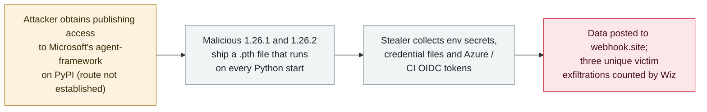

# Microsoft's agent-framework PyPI package is hijacked to ship a credential stealer aimed at Azure and CI pipelines

      

## Summary

**On 17 November 2026, two malicious releases of `agent-framework`, Microsoft's official Python package for building AI agents, were published to PyPI with a credential stealer added.** Version 1.26.1 appeared at 20:35 UTC and 1.26.2 at about 21:08 UTC; both were unavailable by about 21:30 UTC, and 1.26.0 is the last safe version. The package has roughly 190,000 to 200,000 downloads a month. Each release dropped a `.pth` file into site-packages, so the stealer ran on every Python interpreter start even if the package was never imported. It collected secret-named environment variables (including Azure, AWS, GitHub, OpenAI and Hugging Face names), credential files such as Azure CLI state, `.npmrc`, `.git-credentials` and Docker config, secrets from other processes' environments, and tried to mint Azure managed-identity, Azure DevOps and GitHub Actions OIDC tokens; everything was posted to a single webhook.site URL. Wiz, which could read the attacker's free-tier webhook, counted 50 stored requests, of which 17 represent three unique, successful exfiltrations of victim data. Wiz reports that the attacker appears to have compromised a client certificate and private key for Microsoft's internal release pipeline (ESRP), and that the attacker's tooling identified itself as Cairn, an open-source AI penetration-testing framework. StepSecurity notes that a new maintainer account was added to the project the same day and that the second release was uploaded after PyPI quarantined the first. Microsoft has not published an advisory; a spokesperson told The Register it had made some repositories private while investigating malicious content. How the publishing credentials were obtained is not known.

## Attack chain

## Details

**What was published and when.** `agent-framework` is Microsoft's Python framework for building AI agents and coordinating them in workflows. The legitimate 1.26.0 was published on 12 November 2026. On 17 November a malicious 1.26.1 was uploaded at 20:35 UTC and a second malicious release, 1.26.2, at about 21:08 UTC; by about 21:30 UTC neither was available on PyPI. StepSecurity records that a maintainer account named `vibiret` was created and added to the project on 17 November, that 1.26.1 was uploaded as a wheel only with no provenance, and that the second release was uploaded after the first had been quarantined. OX Security gives 192,534 monthly downloads; Wiz gives about 41,000 a week and BleepingComputer roughly 200,000 a month.

**How the payload ran.** Version 1.26.1 dropped `agent_framework_meta.pth` into the site-packages root. Python executes import lines in `.pth` files at every interpreter start, so the stealer ran in every Python process in that environment whether or not the package was imported. Because the release pulled in the genuine `agent-framework-core` 1.26.0, the framework kept working. The code forked into a detached session, set a marker environment variable so it fired once per process tree, and used file and function names made to look like SDK telemetry. Version 1.26.2 was a repack with a different trigger (`af_runtime_diag.pth` and a new top-level module), so a search for the 1.26.1 file names misses it.

**What it collected.** Environment variables whose names contain strings such as TOKEN, SECRET, PASSWORD, KEY, AZURE, AWS, GITHUB, OPENAI, HF_ and FOUNDRY; secret-looking values from up to 300 other processes' environments; up to 60 credential files (Azure CLI state, `.npmrc`, `pip.conf`, `.netrc`, `.git-credentials`, Docker config, Hugging Face tokens, Azure DevOps agent credentials, `.env` and JSON files under `/app` and `/workspace`); Azure DevOps OIDC tokens where the pipeline variables were present; and Azure managed-identity tokens for a dozen resources including ARM, Graph, Key Vault and Storage. Version 1.26.2 added GitHub Actions OIDC theft in workflows with `id-token: write`, more variable names and GitHub-hosted runner paths. Everything was compressed, encoded and sent in one HTTPS POST to a hard-coded webhook.site URL, with no fallback channel and no retry.

**What limited the damage.** The attacker used a free-tier webhook.site URL not attached to an account, which accepts at most 100 requests and expires after seven days. Wiz confirmed the token was on the free tier and that a maximum of 50 requests were captured. Of those, four came from the attacker's own machines, 29 appear to come from sandboxes, vendor scanners and tests, and the remaining 17 represent three unique, successful exfiltrations of victim data. Those requests can still contain working cloud, CI and registry credentials.

**How the attacker got publishing access is not settled.** Wiz reports that the attacker appears to have compromised a client certificate and private key for Microsoft ESRP, the internal service used to sign and publish the package; a first publish attempt from AWS was rejected by ESRP's IP filtering and a second from Microsoft-owned IP space succeeded. The Register's reporting points at a compromised administrator account in Microsoft's GitHub organisation, and OX Security says the attackers appear to have found a way to hijack the wheel creation flow. Microsoft has published no advisory or post-mortem; its statement to The Register says only that it had made some repositories private while it investigates malicious content. How the credentials were obtained is not known.

**The attacker's tooling.** Wiz observed part of the operation because the attacker's tooling reported its own progress to the same public webhook it used for exfiltration. That tooling identified itself as Cairn: it staged the package at `/tmp/cairn_pkg` and sent a `CAIRN_ESRP_PROBE2` connectivity probe. Before publishing, the attacker ran the stealer on their own machine, and that run captured an AI coding-agent configuration that appears to be the open-source Pi harness backed by a GLM-family model. This is Wiz's observation alone and has not been confirmed by Microsoft.

**How it is graded.** `incident`: malicious code was served from the official package of a major vendor and ran on real hosts. `SUPPLY` because the attack sits on the dependency chain of agent builders; `CRED` because what the payload takes is keys and tokens. `real_harm: true` on Wiz's count of three successful victim exfiltrations. `high`: an official agent framework was trojanised and working credentials left victim environments, while the exposure window was under an hour and the confirmed victim count is small.

## Sources

| # | Source | Link |
|---|---|---|
| 1 | Wiz Research (timeline, root cause, analysis of exfiltrated data) | <https://www.wiz.io/blog/malicious-version-of-microsofts-agent-framework-published-to-pypi> |
| 2 | OX Security (payload analysis) | <https://www.ox.security/blog/breaking-hijacked-releases-of-microsofts-official-agent-framework-steals-azure-and-ci-credentials/> |
| 3 | StepSecurity (release and maintainer timeline) | <https://www.stepsecurity.io/blog/microsoft-agent-framework-pypi-package-compromised> |
| 4 | The Register (carries Microsoft's statement) | <https://www.theregister.com/security/2026/11/18/microsofts-official-python-agent-framework-hijacked-to-distribute-malware/5310858> |
| 5 | BleepingComputer | <https://www.bleepingcomputer.com/news/security/microsofts-agent-framework-pypi-package-compromised-to-steal-credentials/> |

## Metadata

| Field | Value |
|---|---|
| Date | `2026-11-17` (raw: 2026-11-17 (malicious agent-framework 1.26.1 published 20:35 UTC and 1.26.2 about 21:08 UTC; both unavailable by about 21:30 UTC; Wiz root-cause update 2026-11-18), precision `day`) |
| Kind | Real incident `incident` |
| Type | [`SUPPLY`](../../taxonomy/types.md#supply) [`CRED`](../../taxonomy/types.md#cred) |
| Severity | **High** `high` |
| Confidence | **A** — three independent technical analyses of the published artefacts (Wiz, OX Security, StepSecurity), plus BleepingComputer's reporting and Microsoft's statement to The Register; no Microsoft advisory |
| Real harm | Yes — three unique, successful exfiltrations of victim data counted by Wiz from the attacker's webhook |
| AI involvement | Confirmed `confirmed` — the trojanised package is Microsoft's official framework for building AI agents; Wiz additionally reports the attacker's tooling identified itself as the Cairn agent framework |
| Region | [Global](../../regions/global.md) |
| Archive ID | `2026-11-17-microsoft-agent-framework-pypi-hijack` |

**Why this classification:** Malicious releases of an official agent framework ran on real hosts (`incident`): the attack is on the dependency chain of agent builders (`SUPPLY`) and takes keys and tokens (`CRED`), with three successful victim exfiltrations counted, hence `real_harm: true`. `high`: a major vendor's agent package was trojanised, limited by a sub-hour window and a capped webhook. `confidence: A`: several independent analyses of the same public artefacts agree on the payload and timeline; the route to publishing access differs between sources and is recorded as unsettled. Grading criteria: [severity.md](../../taxonomy/severity.md) and [confidence.md](../../taxonomy/confidence.md).

## Related

**Topic:** [Agent supply-chain poisoning](../../topics/agent-supply-chain.md)

**Related records:**

- `2026-10-21` [LiteLLM 1.107.0 compromised: malicious PyPI/Docker build ships a credential stealer](../2026-10/2026-10-21-litellm-1-107-supply-chain-compromise.md)   The previous month's trojanised AI-tooling release on PyPI, with the same goal of harvesting credentials
- `2026-10-08` [Tensorlake's npm SDK is compromised in a wave that harvests AI-agent credentials and configs](../2026-10/2026-10-08-tensorlake-npm-sdk-compromise.md)   The npm-side counterpart: an agent SDK used to collect agent credentials
- `2026-11-20` [Amazon: a China-nexus actor's Cairn AI agents found and exploited a MONAI Label zero-day](2026-11-20-cairn-agents-monai-label-zero-day.md)   Another November report in which the attacker's tooling is the Cairn framework

---

[← 2026-11 index](README.md) · [← All records](../../README.md) · [Chinese](../i18n/zh/2026-11/2026-11-17-microsoft-agent-framework-pypi-hijack.md)

This record is part of the **Orca AI Incident Archive**, licensed [CC BY 4.0](../../LICENSE). Found a factual error or a missing source? [Open an issue or PR](../../CONTRIBUTING.md) — corrections are recorded in the record's revision history, never silently overwritten.
