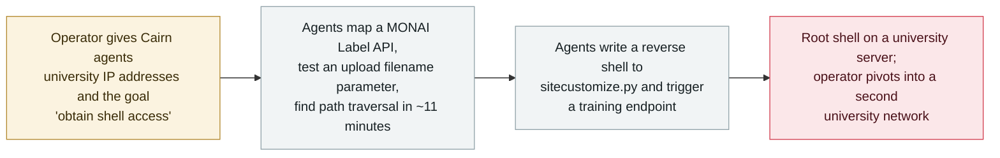

# Amazon: a China-nexus actor's Cairn AI agents found and exploited a MONAI Label zero-day on their own to root a university server

     

## Summary

**On 20 November 2026, Amazon Threat Intelligence reported that autonomous AI agents run by a China-nexus actor discovered a previously unknown vulnerability in the open-source medical-imaging AI application MONAI Label and used it to take full control of a university server.** Amazon found the operator's Cairn instance (an open-source autonomous AI penetration-testing framework) exposed without authentication on 10 September 2026, with prompts, project configurations and AI output readable by anyone. The campaign ran for about 48 hours from 8 September against IP addresses of universities in East Asia outside mainland China, with goals that were variations of "obtain shell access". Against the MONAI Label server the agents mapped the API, tested an upload endpoint's filename parameter for path traversal and reached arbitrary file write in about 11 minutes; in a later session they wrote a Python reverse shell to `sitecustomize.py`, triggered a training endpoint and got a shell running as root. Amazon assesses with high confidence that the flaw was a zero-day. The operator then gave the agents a proxy into a second university network through a server running the same software, which Amazon infers was compromised with the same flaw. Two other operations failed: about 16 hours and 148 actions against an open Redis server, and more than 30,000 credential combinations against a GPU server. The maintainers published advisory GHSA-qc22-rmgc-vg94 on 18 November (versions up to 0.8.5 affected, 0.8.6 patched); CISA added CVE-2026-133968 to its Known Exploited Vulnerabilities catalog on 23 November. Attribution to a China-nexus actor is Amazon's moderate-confidence assessment; the victims are not named and no data theft is stated.

## Attack chain

## Details

**How Amazon saw it.** On 10 September 2026 Amazon Threat Intelligence identified a server with a publicly hosted, unauthenticated instance of Cairn. Because the operator left it open, the whole operational history was visible: project configurations, the operator's prompts and the AI output. The prompts were written in Simplified Chinese and timestamps in executed scripts were set to China Standard Time. The campaign targeted IP addresses associated with universities in East Asia outside mainland China over about 48 hours beginning 8 September 2026. The operator supplied a list of IP addresses and variations of the goal to obtain shell access; the agents planned, executed and adjusted without the operator choosing each next step.

**The zero-day.** Against a server running MONAI Label, the agents identified the framework, mapped its API endpoints and found an upload endpoint with a filename parameter. They tested it for path traversal and it was vulnerable: per Amazon, about 11 minutes passed between mapping the API and arbitrarily writing files on the server. In a later session the agents used the same flaw to write a Python reverse-shell payload to `sitecustomize.py`, a file Python imports at interpreter startup, then called a training API endpoint to spawn a new Python process, which imported the payload and opened a reverse shell running as root. Amazon says the flaw matched no advisory, fix, issue or database entry at the time and assesses with high confidence that it was a zero-day.

**What the maintainers and CISA published.** The MONAI Label advisory GHSA-qc22-rmgc-vg94 (published 18 November 2026, rated Critical by the maintainers, credited to Amazon's vulnerability disclosure programme) describes the flaw: the `PUT /datastore/image` endpoint uses a caller-controlled `image` query parameter as the image ID without validation, so a value such as `../../../tmp/x` writes the uploaded content anywhere the process can write; `PUT /datastore/label` builds its destination the same way. Versions up to and including 0.8.5 are affected and 0.8.6 is patched. The CISA catalog lists CVE-2026-133968 for this flaw, added on 23 November 2026 with a remediation due date of 26 November.

**The operations that failed.** The longest operation ran about 16 hours and 148 sequential actions against a Redis instance that allowed unauthenticated access: the agents tried replication abuse, a scripting-sandbox escape, configuration-file writes and memory corruption, attempted Log4Shell against another service on the host, mapped the internal Docker network through a server-side request forgery flaw in a co-located Qdrant instance and sprayed credentials at PostgreSQL, SSH and other services. None of it worked. A second operation ran for more than 6 hours against a university GPU server: the agents built a list of about 80 real usernames from faculty directories, lab sites, archived pages and papers, then tried more than 30,000 credential combinations against SSH and other university systems without finding a working login.

**Where the human stepped in.** After the agents found the zero-day, the operator supplied a proxy that tunnelled into a second university network. The server behind the proxy ran the same vulnerable software; Amazon infers, but does not state as observed, that the operator had used the zero-day to compromise it. The operator then directed the agents at other machines in that network.

**What is not established.** Attribution to a China-nexus actor is Amazon's moderate-confidence assessment, based on the language of the prompts, the script timezone and the choice of targets. The affected universities are not named; they were not AWS customers and were notified through a government partner. Amazon does not describe data being taken. The model driving the agents is not named. The account rests on Amazon's reading of the exposed instance; SecurityWeek and The Register report it from Amazon's post rather than from independent access.

**How it is graded.** `incident`: a real intrusion against real organisations, observed from the attacker's own console, with a maintainer advisory and a CISA catalog entry that confirm the flaw and its exploitation. `WEAPON`: a human operator deliberately pointed an agent framework at targets. `high`: full control of one server is confirmed and a second compromise is inferred, but no data loss or service impact is reported, so it is not graded `critical`. It is marked as a landmark because the agents found the vulnerability themselves during the operation, rather than being handed a known exploit.

## Sources

| # | Source | Link |
|---|---|---|
| 1 | Amazon Threat Intelligence (AWS Security Blog, CJ Moses) | <https://aws.amazon.com/blogs/security/chinese-nexus-actors-cairn-ai-agents-found-a-zero-day-on-their-own/> |
| 2 | MONAI Label security advisory GHSA-qc22-rmgc-vg94 | <https://github.com/Project-MONAI/MONAILabel/security/advisories/GHSA-qc22-rmgc-vg94> |
| 3 | CISA Known Exploited Vulnerabilities catalog (CVE-2026-133968, added 2026-11-23) | <https://www.cisa.gov/known-exploited-vulnerabilities-catalog?field_cve=CVE-2026-133968> |
| 4 | SecurityWeek | <https://www.securityweek.com/amazon-china-linked-hackers-ai-agents-exploited-medical-software-zero-day/> |
| 5 | The Register | <https://www.theregister.com/security/2026/11/20/china-attackers-deployed-ai-agents-that-autonomously-found-and-exploited-a-0-day-to-take-over-a-university-server/5311382> |

## Metadata

| Field | Value |
|---|---|
| Date | `2026-11-20` (raw: 2026-11-20 (Amazon Threat Intelligence post; campaign ran 2026-09-08 to 2026-09-10; MONAI Label advisory GHSA-qc22-rmgc-vg94 published 2026-11-18; CVE-2026-133968 added to CISA KEV 2026-11-23), precision `day`) |
| Kind | Real incident `incident` |
| Type | [`WEAPON`](../../taxonomy/types.md#weapon) |
| Severity | **High** `high` |
| Confidence | **A** — Amazon Threat Intelligence's own report from the attacker's exposed console, plus the maintainers' advisory and the CISA catalog entry; SecurityWeek and The Register relay Amazon |
| Real harm | Yes — root shell on one university server; a second university server inferred compromised; no data loss stated |
| AI involvement | Confirmed `confirmed` — Amazon read the agents' prompts, actions and output in the operator's unauthenticated Cairn instance |
| Region | [Asia-Pacific](../../regions/apac.md) |
| Archive ID | `2026-11-20-cairn-agents-monai-label-zero-day` |

**Why this classification:** A real intrusion in which an operator pointed autonomous agents at targets (`WEAPON`) and the agents themselves found and exploited an unknown flaw, confirmed by the maintainers' advisory and a CISA KEV entry, hence `incident` and `real_harm: true`. `high`, not `critical`: one server fully controlled and a second inferred, with no reported data loss. `confidence: A` for a first-hand vendor threat-intelligence report backed by the advisory and the catalog; the attribution is moderate-confidence and the second compromise is an inference, both stated as such. Grading criteria: [severity.md](../../taxonomy/severity.md) and [confidence.md](../../taxonomy/confidence.md).

## Related

**Topic:** [Offensive AI capability evolution](../../topics/offensive-ai.md)

**Related records:**

- `2026-11-12` [Unit 42: CL-STA-1238 ran 25 autonomous Cairn operations against at least 19 organisations](2026-11-12-unit42-cl-sta-1238-cairn-campaign.md)   Another China-nexus Cairn campaign from the same weeks, disclosed eight days earlier
- `2026-10-27` [Attackers hijack exposed Cairn AI-agent panels in the wild](../2026-10/2026-10-27-cairn-exposed-agent-panels-hijacked.md)   The same framework, with the exposure running the other way: open Cairn panels taken over by third parties
- `2026-09-22` [Gambit: three AI harnesses stole 600,000 card records from online retailers](../2026-09/2026-09-22-gambit-ai-agent-retail-card-theft.md)   The financially motivated Cairn use that Amazon's post cites as a separate actor

---

[← 2026-11 index](README.md) · [← All records](../../README.md) · [Chinese](../i18n/zh/2026-11/2026-11-20-cairn-agents-monai-label-zero-day.md)

This record is part of the **Orca AI Incident Archive**, licensed [CC BY 4.0](../../LICENSE). Found a factual error or a missing source? [Open an issue or PR](../../CONTRIBUTING.md) — corrections are recorded in the record's revision history, never silently overwritten.
