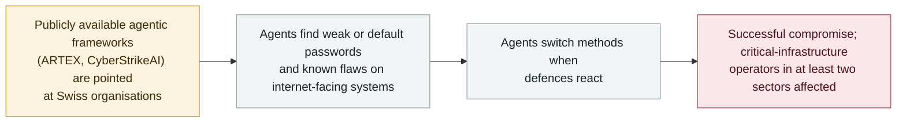

# Switzerland's NCSC confirms its first successful AI-agent cyberattacks, including on critical-infrastructure operators

     

## Summary

**On 24 November 2026 Switzerland's National Cyber Security Centre (NCSC) said it had received its first reports of cyberattacks against Swiss organisations in which the attack was carried out with the assistance of an AI agent, affecting organisations and operators of critical infrastructure in at least two sectors.** The NCSC states that in all such attacks known to it the use of AI agents led to successful compromise of the victim's IT systems, and that the attackers used so-called agentic offensive frameworks, which search for vulnerabilities, select attack tools, evaluate results and plan next steps on their own. It names ARTEX and CyberStrikeAI as examples of publicly accessible agents and says their number has almost doubled since October 2026. The attacks exploited easily guessed or default passwords and known vulnerabilities in internet-facing systems, and the agents switched to other methods when defences reacted. In a radio interview on 26 November the NCSC's director, Florian Schütz, said five confirmed cases were known, three of them against critical infrastructure, that no major outages had been reported and that it was still unclear who was behind them; Keystone-SDA reported from that interview that two of the attacks on critical infrastructure were successful, which differs from the advisory's wording. The victims and sectors are not named and no technical indicators are published in the advisory. BleepingComputer reports that Italy's CSIRT issued a parallel warning about large-scale AI-agent campaigns the same week.

## Attack chain

## Details

**What the NCSC said.** In an advisory published on 24 November 2026 the NCSC said that in recent days it had received its first reports of cyberattacks against organisations in Switzerland in which the attack was carried out with the assistance of an AI agent. Various organisations and operators of critical infrastructure across at least two sectors were affected, and in all attacks known to the NCSC the use of AI agents led to the successful compromise of the victim's IT systems. It calls this a shift in the threat landscape and expects more rapid and successful attacks.

**How it describes the attackers' tools.** The attackers used so-called agentic offensive frameworks: AI agents that, for example, independently search for vulnerabilities, select suitable attack tools, evaluate the results, and plan and execute the next steps. Such agents can be used for penetration testing and by attackers alike. They exploit standard or easily guessed passwords and known vulnerabilities in internet-connected systems, need a fraction of the time a human would, and switch to other known methods when defences react. The NCSC names ARTEX and CyberStrikeAI as examples of agents accessible via the internet and says their number has almost doubled since October 2026.

**The follow-up interview.** On 26 November NCSC director Florian Schütz told Swiss radio and television that five confirmed cases were known, three of them against critical infrastructure. Keystone-SDA, reporting from that interview, says two of the attacks on critical infrastructure were successful, that no major outages were stated and that it was still unclear who was behind the attacks. This differs from the advisory's statement that every known attack led to successful compromise; both are recorded here and the difference is not resolved in the sources.

**What is not published.** The advisory does not name the affected organisations or sectors, does not describe what was accessed or taken, and does not explain how the NCSC concluded that an AI agent was used or how autonomous the activity was. It says the NCSC shares technical indicators with critical-infrastructure operators; none are in the public text. Attribution is open.

**The Italian warning.** BleepingComputer, which reported the Swiss advisory on 25 November, says Italy's national CSIRT issued a parallel warning the same week about large-scale campaigns using autonomous AI agents against exposed endpoints, including one involving five agents coordinated by a single coordinator, and that both agencies listed four frameworks: ARTEX, CyberStrikeAI, DeepSeek Harness - Red Team and PentAGI. The Italian page itself was not read for this record, so that part rests on BleepingComputer.

**How it is graded.** `incident`: a government agency confirms real, successful attacks on real organisations, including operators of critical infrastructure. `WEAPON`: the attackers deliberately used agent frameworks as their tools. `real_harm: true`: the agency states that victims' systems were compromised. `medium`, not `high`: the public information is an aggregate statement without named victims, a stated impact or indicators, and no major outage was reported. Confidence `A` is for the NCSC's own advisory as the primary source of the claim; the unexplained basis for the AI attribution and the inconsistency over how many attacks succeeded are stated above rather than resolved.

## Sources

| # | Source | Link |
|---|---|---|
| 1 | Swiss National Cyber Security Centre (NCSC): AI agents: first confirmed cases in Switzerland (2026-11-24) | <https://www.bacs.admin.ch/en/26-ki-agenten-1-en> |
| 2 | BleepingComputer (also covers Italy's CSIRT warning) | <https://www.bleepingcomputer.com/news/security/italy-and-switzerland-warn-of-autonomous-ai-driven-cyberattacks/> |
| 3 | Nau.ch / Keystone-SDA (2026-11-26, in German) | <https://www.nau.ch/politik/bundeshaus/erste-cyberangriffe-auf-kritische-infrastruktur-mit-ki-agenten-67207328> |

## Metadata

| Field | Value |
|---|---|
| Date | `2026-11-24` (raw: 2026-11-24 (Swiss NCSC advisory; attacks reported 'in recent days'; NCSC director's radio interview 2026-11-26), precision `day`) |
| Kind | Real incident `incident` |
| Type | [`WEAPON`](../../taxonomy/types.md#weapon) |
| Severity | **Medium** `medium` |
| Confidence | **A** — the NCSC's own advisory is the primary source; BleepingComputer and Keystone-SDA report from it and from the director's interview; the public text names no victims or indicators |
| Real harm | Yes — the agency states victims' IT systems were successfully compromised, including critical-infrastructure operators in at least two sectors; no major outages reported |
| AI involvement | Confirmed `confirmed` — asserted by the NCSC, which does not explain how it determined that AI agents were used or how autonomous the activity was |
| Region | [Europe](../../regions/eu.md) |
| Archive ID | `2026-11-24-swiss-ncsc-first-ai-agent-attacks` |

**Why this classification:** A government agency confirms real, successful attacks on real organisations in which attackers deliberately used agent frameworks (`WEAPON`), hence `incident` and `real_harm: true`. `medium`: an aggregate statement with no named victims, impact or indicators and no reported major outage, even though critical infrastructure is involved. `confidence: A` for the agency's own advisory; the unexplained basis for AI attribution and the discrepancy over how many attacks succeeded are flagged rather than resolved. Grading criteria: [severity.md](../../taxonomy/severity.md) and [confidence.md](../../taxonomy/confidence.md).

## Related

**Topic:** [Offensive AI capability evolution](../../topics/offensive-ai.md)

**Related records:**

- `2026-10-15` [India's CERT-In issues a critical advisory after AI agents reached live systems of Indian organizations](../2026-10/2026-10-15-cert-in-ai-agents-attack-vectors.md)   An earlier national-CERT advisory on AI agents reaching live systems
- `2026-09-14` [Spain's AEPD receives the first AI-agent-driven breach notification](../2026-09/2026-09-14-spain-aepd-agent-breach.md)   Another European regulator-visible case of an agent doing the intrusion work
- `2026-11-05` [Hacking on Autopilot: Check Point reconstructs ARTEX cybercrime campaigns](2026-11-05-artex-hacking-on-autopilot-cybercrime.md)   The research behind one of the two frameworks the NCSC names

---

[← 2026-11 index](README.md) · [← All records](../../README.md) · [Chinese](../i18n/zh/2026-11/2026-11-24-swiss-ncsc-first-ai-agent-attacks.md)

This record is part of the **Orca AI Incident Archive**, licensed [CC BY 4.0](../../LICENSE). Found a factual error or a missing source? [Open an issue or PR](../../CONTRIBUTING.md) — corrections are recorded in the record's revision history, never silently overwritten.
