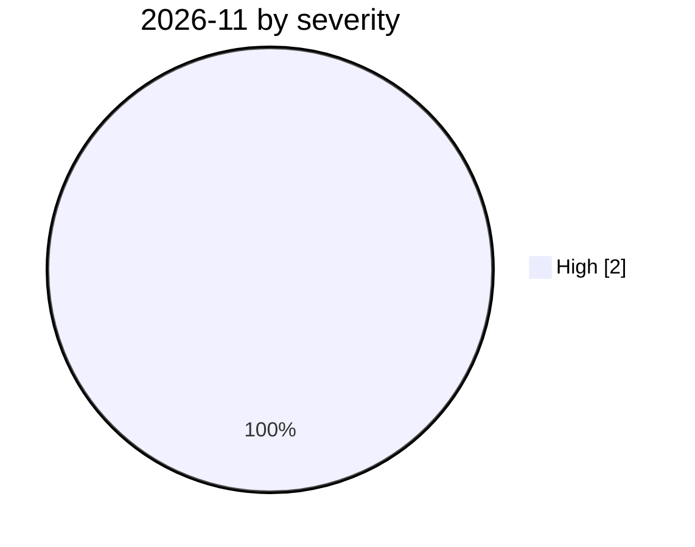

# 2026-11

<!-- BEGIN:summary -->
**2** records

 

## Records this month

| Date | Record | Type | Severity | Confidence | Real harm |
|---|---|---|---|---|---|
| `11-02` | [GitBook discloses a targeted breach it attributes to AI agents, exposing infrastructure and customer credentials](2026-11-02-gitbook-ai-agent-breach.md) | `CRED` `INFRA` | **High** | A | ✅ |
| `11-04` | ["BOSSAI": Acronis documents a lone operator's 12-agent AI attack mesh that breached emergency services across three countries](2026-11-04-bossai-ai-attack-mesh-taiwan-emergency.md) | `WEAPON` `EXFIL` | **High** | A | ✅ |

★ = `critical` · ⚠️ = disputed facts or attribution · real harm: ✅ confirmed victim / — none / · not applicable (policy and intelligence reports)
<!-- END:summary -->

<!-- BEGIN:nav -->
---

[← 2026-10](../2026-10/README.md) · [Archive index](../../README.md) · [By type](../../taxonomy/types.md)
<!-- END:nav -->
