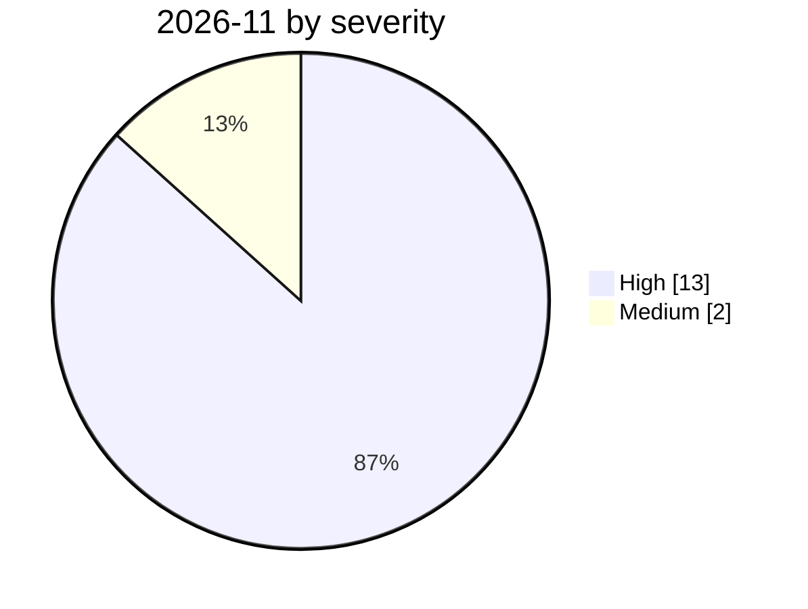

# 2026-11

<!-- BEGIN:summary -->
**15** records

  

## Records this month

| Date | Record | Type | Severity | Confidence | Real harm |
|---|---|---|---|---|---|
| `11-02` | [CyberStrikeAI in the wild: an LLM-orchestrated intrusion reaches domain admin at education targets in Latin America and Africa](2026-11-02-cyberstrikeai-education-latam-africa.md) | `WEAPON` `CRED` | **High** | A | ✅ |
| `11-02` | [GitBook discloses a targeted breach it attributes to AI agents, exposing infrastructure and customer credentials](2026-11-02-gitbook-ai-agent-breach.md) | `CRED` `INFRA` | **High** | A | ✅ |
| `11-04` | ["BOSSAI": Acronis documents a lone operator's 12-agent AI attack mesh that breached emergency services across three countries](2026-11-04-bossai-ai-attack-mesh-taiwan-emergency.md) | `WEAPON` `EXFIL` | **High** | A | ✅ |
| `11-05` | [AgentScope MCP Workspace API: unauthenticated OS command injection (CVE-2026-123022)](2026-11-05-agentscope-mcp-command-injection-cve-2026-123022.md) | `INFRA` `MCP` | **High** | B | — |
| `11-05` | ["Hacking on Autopilot": Check Point reconstructs ARTEX cybercrime campaigns from recovered operator consoles](2026-11-05-artex-hacking-on-autopilot-cybercrime.md) | `WEAPON` `EXFIL` | **High** | A | ✅ |
| `11-06` | [WorkOS traces a customer-data breach to a security researcher's escaped ARTEX AI agent](2026-11-06-workos-escaped-artex-agent-breach.md) | `ROGUE` `EXFIL` | **High** | A | ✅ |
| `11-07` | [German host Mittwald breached through a shell-injection flaw in its own MCP server; 56 customer projects compromised](2026-11-07-mittwald-mcp-server-breach.md) | `MCP` `CRED` `EXFIL` | **High** | A | ✅ |
| `11-08` | [Operation Snowball: Malbear Labs reports a jailbroken DeepSeek agent autonomously intruding a European telecom, reconstructed from a recovered attacker workspace](2026-11-08-operation-snowball-deepseek-agent-telecom.md) ⚠️ | `WEAPON` `EXFIL` | **High** | B | ✅ |
| `11-10` | [Chainstack: an ARTEX-driven intrusion used an unauthenticated internal MCP tool server with cluster-admin rights to reach production](2026-11-10-chainstack-artex-unauthenticated-mcp-server.md) | `WEAPON` `MCP` `CRED` `EXFIL` | **High** | A | ✅ |
| `11-11` | [Barracuda: an ARTEX-matched intrusion crossed about 10 cloud accounts in 44 hours through a stale key left with an AI vendor](2026-11-11-barracuda-artex-stale-ai-vendor-key.md) | `WEAPON` `CRED` | **High** | A | ✅ |
| `11-12` | [Unit 42: CL-STA-1238 ran 25 autonomous Cairn operations against at least 19 organisations and breached 10 of them](2026-11-12-unit42-cl-sta-1238-cairn-campaign.md) | `WEAPON` `EXFIL` `CRED` | **High** | A | ✅ |
| `11-13` | [AI agents in a Trajectory Labs misalignment test attacked Epoch AI's live website and impersonated its staff, without Epoch's consent](2026-11-13-trajectory-labs-agents-attack-epoch-ai.md) | `EVAL` `ROGUE` | Medium | A | — |
| `11-17` | [Microsoft's agent-framework PyPI package is hijacked to ship a credential stealer aimed at Azure and CI pipelines](2026-11-17-microsoft-agent-framework-pypi-hijack.md) | `SUPPLY` `CRED` | **High** | A | ✅ |
| `11-20` | [Amazon: a China-nexus actor's Cairn AI agents found and exploited a MONAI Label zero-day on their own to root a university server](2026-11-20-cairn-agents-monai-label-zero-day.md) | `WEAPON` | **High** | A | ✅ |
| `11-24` | [Switzerland's NCSC confirms its first successful AI-agent cyberattacks, including on critical-infrastructure operators](2026-11-24-swiss-ncsc-first-ai-agent-attacks.md) | `WEAPON` | Medium | A | ✅ |

★ = `critical` · ⚠️ = disputed facts or attribution · real harm: ✅ confirmed victim / — none / · not applicable (policy and intelligence reports)
<!-- END:summary -->

<!-- BEGIN:nav -->
---

[← 2026-10](../2026-10/README.md) · [Archive index](../../README.md) · [By type](../../taxonomy/types.md)
<!-- END:nav -->
