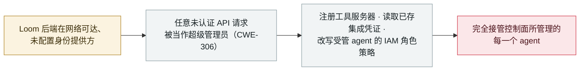

# Loom for AWS：缺失认证让任意客户端取得 agent 控制面的超级管理员权限（CVE-2026-103956）

Loom for AWS: missing authentication hands any client super-admin over the agent control plane (CVE-2026-103956)

      

## 概要

**AWS 于 2026 年 10 月 2 日（安全公告 2026-124-AWS）披露 **CVE-2026-103956**（CVSS **10.0**，严重）：**Loom for AWS**——AWS Labs 的开源平台，用于在 **Amazon Bedrock AgentCore Runtime** 上编排 AI agent——在**未配置身份提供方（IdP）时，会把 agent 控制面的超级管理员权限授予任意未认证的网络请求**。** 该缺陷（CWE-306，关键功能缺失认证）让远程客户端得以**注册工具服务器、读取已存的集成凭证、改写受管 agent 角色上的 IAM 策略**——即完全接管该平台所管理的 agent。AWS 已在 **Loom 1.6.1**（2026 年 8 月 4 日发布）修复，通告建议在把后端暴露到 loopback 之外前先配置 Amazon Cognito 用户池或外部 IdP（且切勿在非开发环境设置 `LOOM_ALLOW_UNAUTHENTICATED_LOCAL_DEV`）。同一公告还涵盖 CVE-2026-103957／-103958（Loom 的 SSRF，1.7.0 修复）与 CVE-2026-104019（SageMaker Unified Studio 命令注入）。**无确认的在野利用**（不在 CISA KEV；公开 PoC 之说未经证实）。记为 `vulnerability` / `INFRA` + `CRED` / `high` / `real_harm: false`——一个 CVSS 10、位于 agent 编排平台、无已知利用的缺陷。

## 攻击链

## 详情

**缺陷本身。** 2026 年 10 月 2 日，AWS 发布安全公告 2026-124-AWS，涵盖 **Loom for AWS**——AWS Labs 的开源项目，用于在 **Amazon Bedrock AgentCore Runtime** 上编排 AI agent。**CVE-2026-103956**（CVSS **10.0**，CWE-306——关键功能缺失认证）是其中的首要问题：当 Loom 部署**未配置身份提供方**时，后端会把*任何*对其应用 API 的请求都当作完全授权的请求。于是远程、未认证的客户端即可取得**agent 控制面的超级管理员权限**——注册工具服务器、读取已存的集成凭证、改写受管 agent 角色上的 IAM 策略。由于被暴露的是密钥与角色策略，一次成功请求就足以接管该平台所管理的每一个 agent。

**修复与缓解。** AWS 已在 **Loom 1.6.1**（**2026 年 8 月 4 日**发布）修复 CVE-2026-103956（公开通告随后于 10 月 2 日发出）。在升级前，AWS 建议**在把 Loom 后端暴露到 loopback 之外前先配置 Amazon Cognito 用户池或启用外部 IdP**，并确保在任何非开发部署中都不要设置 `LOOM_ALLOW_UNAUTHENTICATED_LOCAL_DEV`。由于该缺陷可读取凭证、改写 IAM 策略，防御方还应轮换 OAuth2 客户端密钥及平台托管的 IAM 会话凭证。同一公告批次还涵盖 **CVE-2026-103957** 与 **CVE-2026-103958**（Loom 在 OAuth2 发现与 MCP/A2A 连接处理中的 SSRF，已于 **1.7.0** 完全修复）与 **CVE-2026-104019**（SageMaker Unified Studio 启动脚本的 OS 命令注入）——此处仅作背景记录。

**如何分级。** 记为 `vulnerability`——已披露的缺陷，而非实战中被用的事件。`INFRA`（Loom 是 **agent 编排平台**——agent 的运行时基础设施）与 `CRED`（丢失的是**密钥**：已存集成凭证与 IAM 角色控制，而非数据越界外泄，因此归 `CRED` 而非 `EXFIL`）。`real_harm: false`：AWS 未报告利用、**不在 CISA KEV**，二手聚合站的公开 PoC 之说未经证实。评 `high` 而非 `critical`（尽管 CVSS 10.0）——本库严重度反映**已经发生了什么**，严重但无已知利用的缺陷在此记 `high`（与 [GitLab Duo](2026-10-02-gitlab-duo-ai-gateway-rce.md) CVSS 9.9、[EchoLeak](../../../2025-06/2025-06-11-echoleak.md) CVSS 9.3 同一口径），且属配置相关——仅**未配置 IdP**的部署受影响。可信度 `A`：AWS Labs 自家的 GitHub 安全通告（GHSA-vgmj-998f-r8mp）、AWS 安全公告与 NVD 记录，加独立报道。日期取公开通告（2026 年 10 月 2 日）；修复（1.6.1）在其之前（8 月 4 日）。

## 来源

| # | 来源 | 链接 |
|---|---|---|
| 1 | AWS Labs——Loom 安全通告（GHSA-vgmj-998f-r8mp） | <https://github.com/awslabs/loom/security/advisories/GHSA-vgmj-998f-r8mp> |
| 2 | AWS 安全公告 2026-124-AWS | <https://aws.amazon.com/security/security-bulletins/2026-124-aws/> |
| 3 | NVD — CVE-2026-103956 | <https://nvd.nist.gov/vuln/detail/CVE-2026-103956> |
| 4 | Cyber Security News | <https://gbhackers.com/aws-fixes-ai-agent-flaws/> |
| 5 | Security Online | <https://securityonline.info/loom-for-aws-sagemaker-flaws/> |

## 元数据

| 字段 | 值 |
|---|---|
| 日期 | `2026-10-02`（原始：2026-10-02 AWS 安全公告 2026-124-AWS／NVD；修复 Loom 1.6.1 于 2026-08-04 发布，精度 `day`） |
| 性质 | 漏洞披露 `vulnerability` |
| 类型 | [`INFRA`](../../../../taxonomy/types.md#infra) [`CRED`](../../../../taxonomy/types.md#cred) |
| 评级 | **高** `high` |
| 可信度 | **A**——AWS Labs GHSA + AWS 安全公告 + NVD，加独立报道 |
| 真实伤害 | 无——无已知在野利用；不在 CISA KEV；修复先于披露发布 |
| AI 参与 | 已确认 `confirmed` |
| 地区 | [全球](../../../../regions/global.md) |
| 档案 ID | `2026-10-02-loom-aws-agent-control-plane-cve-2026-103956` |

**分类理由：** Loom for AWS（面向 Amazon Bedrock AgentCore 的 AI agent 编排平台）的已披露缺陷（`INFRA`——agent 运行时基础设施；`CRED`——丢失的是密钥，即已存集成凭证与 IAM 角色控制，而非外泄的数据）。记 `vulnerability` 而非事件。`real_harm: false`——无已知利用、不在 CISA KEV、修复先于披露。`high` 而非 `critical`：严重度记录已发生之事，CVSS 10 但无在野利用、且配置相关（仅未配置 IdP 的部署）者在此记 `high`（与 GitLab Duo、EchoLeak 同口径）。日期取 AWS 通告（2026 年 10 月 2 日）。分级标准见 [severity.md](../../../../taxonomy/severity.md) 与 [confidence.md](../../../../taxonomy/confidence.md)。

## 相关条目

**专题：** [agent 基础设施暴露（INFRA）](../../../../topics/agent-infra.md)

**相关记录：**

- `2026-10-08` [AgentCorruption——一句 prompt 接管整个 AWS Bedrock AgentCore 账户](2026-10-08-agentcorruption-aws-bedrock-agentcore.md)   同一 AWS agent 技术栈，经 IMDS 而非缺失认证进入
- `2026-10-02` [GitLab Duo AI Gateway 提示模板沙箱逃逸（CVE-2026-90970）](2026-10-02-gitlab-duo-ai-gateway-rce.md)   同日披露的另一起 agent 基础设施缺陷
- `2026-09-14` [Bifrost AI 网关（CVE-2026-90898）](../../../2026-09/2026-09-14-bifrost-ai-gateway-cve-2026-90898.md)   另一处 AI 网关基础设施弱点

---

[← English original](../../../2026-10/2026-10-02-loom-aws-agent-control-plane-cve-2026-103956.md) · [2026-10 index](../../../2026-10/README.md) · [All records](../../../README.md) · [Home](../../../../README.md)

本条目属于 **Orca AI Incident Archive**，按 [CC BY 4.0](../../../../LICENSE) 授权。发现事实错误或缺少来源，请[提 issue 或 PR](../../../../CONTRIBUTING.md)——更正会写进条目的修订记录，不会静默覆盖。
