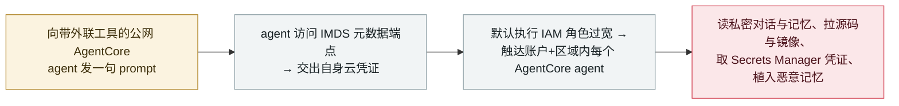

# AgentCorruption：一句 prompt 把 AWS Bedrock AgentCore agent 变成账户级接管

AgentCorruption: one prompt turns an AWS Bedrock AgentCore agent into an account-wide takeover

      

## 概要

**Zenity Labs 于 2026 年 10 月 8 日（SecTor 2026，多伦多）公开 **AgentCorruption**：向一个面向公网的 **Amazon Bedrock AgentCore** agent（带有常见的可外联工具）发出**一句自然语言 prompt**，即可令其访问 **IMDS 元数据端点**、交出自身云凭证；而由于 AgentCore 的默认执行 IAM 角色远宽于单个 agent，这些凭证可触达**同一 AWS 账户、同一区域内的每一个 AgentCore agent**。** 凭这些凭证，Zenity 研究者得以读取其它 agent 的**私密对话与长期记忆**、拉取其**源代码与容器镜像**、取出 **Secrets Manager 中存储的凭证**，并**植入恶意"记忆"**，悄悄把某个 agent 之后的对话改向攻击者控制的目标。根因是三者叠加：agent 能发 HTTP 请求、IMDS 可达的元数据凭证、以及过宽的默认执行角色。**未分配 CVE。** AWS 将该行为定性为"已记录、预期之内"（并指向由客户侧收窄权限），但此后已将新部署 agent 的 **IMDSv2 设为默认**、并**收窄了默认执行角色**。研究演示，无在野利用。记为 `vulnerability` / `INFRA` + `EXFIL` / `high` / `real_harm: false`。

## 攻击链

## 详情

**技术本身。** Zenity Labs 在 SecTor 2026（多伦多）上发表 AgentCorruption，并于 2026 年 10 月 8 日以多篇研究系列公开。攻击链始于攻击者向一个**面向公网的 Amazon Bedrock AgentCore agent**（配有常见的、可发起外联 HTTP 请求的工具）发出一句自然语言 prompt，令其访问 **AWS 实例元数据服务（IMDS）**，取回该 agent 执行角色的凭证。由于 AgentCore 的**默认执行 IAM 角色的权限范围远不止一个 agent**，这些凭证可触达**同一账户、同一区域内的每一个 AgentCore agent**——而不仅仅是被下达 prompt 的那一个。

**凭证能解锁什么。** 凭取得的角色，Zenity 研究者得以读取其它 agent 的**私密对话与长期记忆**、拷贝其**源代码与容器镜像**、取出存放在 **AWS Secrets Manager 的机密**。他们还向本无权使用的 agent **植入恶意的长期"记忆"**，使该 agent *之后* 的对话被引向攻击者控制的目标——这是一个持久、隐蔽的立足点，而非一次性读取。

**披露与 AWS 立场。** Zenity 早在 **2025 年 12 月 25 日** 就把底层的 IMDS 访问问题报给 AWS；AWS 回应后以 *informative*（供参考）关闭该报告，立场是该行为**已记录、属预期之内**，并认为客户应只授予执行角色其 agent 所需的权限。公开披露（AgentCorruption）随后于 **2026 年 10 月 8 日** 发布。此后 AWS 已把新部署 AgentCore agent 的 **IMDSv2 设为默认**，并**收窄了默认执行角色权限**（移除调用其它 agent、读取私密对话、触达 Secrets Manager 的能力，并收紧了其余权限）。

**如何分级。** 记为 `vulnerability`——研究者演示的缺陷链，而非实战中被用的事件。`INFRA`（agent 运行时／云平台 AgentCore 及其 IAM/IMDS 姿态）与 `EXFIL`（私密对话、源码、容器镜像、Secrets Manager 凭证离开受害 agent）。`real_harm: false`：受控研究演示，无已知在野利用，且厂商缓解已发布。评 `high` 而非 `critical`：账户级触达很严重，但部分取决于配置（公网 agent + 外联工具 + 过宽默认角色），且无确认受害方。**不**打 `disputed`：AWS 与 Zenity 的分歧只在于算不算*产品漏洞*（对"预期行为"），而非攻击是否成立。可信度 `A`：Zenity 详尽一手披露加独立报道（Dark Reading、The Next Web）。

## 来源

| # | 来源 | 链接 |
|---|---|---|
| 1 | Zenity Labs——AgentCorruption（发现者） | <https://zenity.io/press-release/zenity-labs-discloses-agentcorruption-a-chain-of-aws-agentcore-flaws> |
| 2 | Dark Reading | <https://darkreading.com/cloud-security/agentcorruption-aws-environments-at-risk-single-prompt> |
| 3 | The Next Web | <https://thenextweb.com/news/aws-agentcore-zenity-agentcorruption-one-prompt-agents> |

## 元数据

| 字段 | 值 |
|---|---|
| 日期 | `2026-10-08`（原始：2026-10-08 Zenity Labs／SecTor 2026 披露；底层 IMDS 问题 2025-12-25 报 AWS，精度 `day`） |
| 性质 | 漏洞披露 `vulnerability` |
| 类型 | [`INFRA`](../../../../taxonomy/types.md#infra) [`EXFIL`](../../../../taxonomy/types.md#exfil) |
| 评级 | **高** `high` |
| 可信度 | **A**——Zenity Labs 披露（发现者）加独立报道 |
| 真实伤害 | 无——研究演示；无已知在野利用；AWS 缓解已发布 |
| AI 参与 | 已确认 `confirmed` |
| 地区 | [全球](../../../../regions/global.md) |
| 档案 ID | `2026-10-08-agentcorruption-aws-bedrock-agentcore` |

**分类理由：** 研究者披露的 Amazon Bedrock AgentCore 缺陷链（`INFRA`——agent 运行时／云平台及其 IAM/IMDS 姿态；`EXFIL`——对话、源码、镜像、机密离开受害 agent）。记 `vulnerability` 而非事件。`real_harm: false`——受控演示、无已知利用、AWS 缓解已发布。`high` 而非 `critical`：账户级触达严重但部分取决于配置、且无确认受害方。不打 `disputed`——AWS 与 Zenity 的分歧在于定性（产品漏洞 vs 预期行为），非攻击是否成立。日期取 Zenity／SecTor 披露（2026 年 10 月 8 日）。分级标准见 [severity.md](../../../../taxonomy/severity.md) 与 [confidence.md](../../../../taxonomy/confidence.md)。

## 相关条目

**专题：** [agent 基础设施暴露（INFRA）](../../../../topics/agent-infra.md)

**相关记录：**

- `2026-10-02` [GitLab Duo AI Gateway 提示模板沙箱逃逸（CVE-2026-90970）](2026-10-02-gitlab-duo-ai-gateway-rce.md)   同月另一起 agent 基础设施缺陷
- `2026-09-09` [Noma：agent 平台中的工作流身份劫持](../../../2026-09/2026-09-09-noma-workflow-identity-hijacking.md)   过宽的 agent 身份被转为横向移动
- `2026-09-14` [Bifrost AI 网关（CVE-2026-90898）](../../../2026-09/2026-09-14-bifrost-ai-gateway-cve-2026-90898.md)   另一处 AI 网关基础设施弱点

---

[← English original](../../../2026-10/2026-10-08-agentcorruption-aws-bedrock-agentcore.md) · [2026-10 index](../../../2026-10/README.md) · [All records](../../../README.md) · [Home](../../../../README.md)

本条目属于 **Orca AI Incident Archive**，按 [CC BY 4.0](../../../../LICENSE) 授权。发现事实错误或缺少来源，请[提 issue 或 PR](../../../../CONTRIBUTING.md)——更正会写进条目的修订记录，不会静默覆盖。
