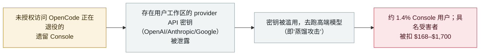

# OpenCode Console 被攻破，泄露用户存储的 AI 提供方 API 密钥

OpenCode Console breach exposes users' stored AI-provider API keys

      

## 概要

**开源 AI 编码 agent **OpenCode** 于 2026 年 10 月 17 日披露：一名未授权方入侵了其**正在退役的遗留 Console 系统**，泄露了 Console 存放在用户工作区中的**第三方 AI 提供方 API 密钥（OpenAI、Anthropic、Google）**。** OpenCode 称其为一次*"大规模蒸馏攻击（distillation attack）"*，影响约 **1.4% 的 Console 用户**——即那些关联了外部提供方的用户。被盗密钥**已被实际滥用**：多名具名用户报告了未授权扣费，包括 **$281（OpenAI）+ $168（Anthropic）**、**700 多美元**、**$1,700**——攻击者用受害者账户去跑高端模型。OpenCode 已邮件通知受影响用户，称正与三家提供方协作处置，并敦促用户**吊销并轮换**密钥。公司尚未公布总损失或事后分析。记为 `incident` / `CRED` + `INFRA` / `high` / `real_harm: true`——一次 agent 平台的凭据泄露，且有确认的财务损失。

## 攻击链

## 详情

**发生了什么。** 2026 年 10 月 17 日，OpenCode——一个开源 AI 编码 agent，其云端 Console 允许用户关联外部模型提供方——披露（经其 X 账号及致受影响用户的邮件）：一名未授权方入侵了其**正在退役的遗留 Console 系统**。入侵发生在 **10 月 16 至 17 日夜间**。存放在用户工作区中的 **provider API 密钥**——覆盖 OpenAI、Anthropic、Google——被泄露。OpenCode 把此事定性为一次*"大规模蒸馏攻击"*。

**范围与危害。** OpenCode 称约 **1.4% 的 Console 用户**受影响——即那些关联了外部提供方的用户，并逐一邮件通知（未收到邮件者不受影响）。被盗密钥**已被使用**：多名用户在 X 上公开报告了账单上的未授权扣费，包括 **$281（OpenAI）+ $168（Anthropic）**（Colin Parsons）、**700 多美元**的 OpenAI 用量（Francisco Giancarelli）、以及 **$1,700**（Preston Zeller）。其模式——用他人密钥对昂贵前沿模型大量查询——正是"蒸馏"之名的由来。OpenCode **未**公布百分比之外的受影响账户总数、总损失、IOC 清单或事后分析；称正与三家提供方协作处置。

**如何分级。** 记为 `incident`——真实的被攻破事件，而非已披露但未被利用的缺陷。`CRED`（丢失的是**密钥**——用户存储的 provider API 凭据）与 `INFRA`（被攻陷资产是 agent 平台自家的 Console 服务）。`real_harm: true`：与演示不同，这泄露了真实可用的密钥并被实际滥用，具名用户报告了真实扣费。评 `high` 而非 `critical`：有确认危害，但范围有限（约 1.4% 的单一产品 Console 用户、属计费滥用而非更深系统沦陷），且未见 API 计费之外的账户接管。可信度 `A`：OpenCode 自家披露（X 帖 + 客户邮件），经多家独立媒体与具名受害者佐证——但需注意收录时尚无一线安全媒体报道、OpenCode 也未发布完整事后分析。

## 来源

| # | 来源 | 链接 |
|---|---|---|
| 1 | Dealroom（引述 OpenCode 的 X 帖 + 客户邮件） | <https://dealroom.co/news/163473-opencode-breach-drains-users-ai-keys-as-platforms-holding-customer-crede/> |
| 2 | Crypto Briefing | <https://cryptobriefing.com/opencode-distillation-attack-api-key-breach/> |
| 3 | Startup Fortune | <https://startupfortune.com/opencode-breach-exposes-stored-openai-and-anthropic-keys-prompts-urgent-key-rotation/> |

## 元数据

| 字段 | 值 |
|---|---|
| 日期 | `2026-10-17`（原始：2026-10-17 OpenCode 披露；入侵发生在 2026-10-16 至 17 夜间，精度 `day`） |
| 性质 | 真实事件 `incident` |
| 类型 | [`CRED`](../../../../taxonomy/types.md#cred) [`INFRA`](../../../../taxonomy/types.md#infra) |
| 评级 | **高** `high` |
| 可信度 | **A**——OpenCode 自家披露（X + 客户邮件）+ 独立报道 + 具名受害者 |
| 真实伤害 | 有——provider API 密钥被泄露并滥用；具名用户报告 $168–$1,700 的未授权扣费 |
| AI 参与 | 已确认 `confirmed` |
| 地区 | [全球](../../../../regions/global.md) |
| 档案 ID | `2026-10-17-opencode-console-breach-api-keys` |

**分类理由：** OpenCode 编码 agent 的 Console 被攻破、泄露用户存储的 AI provider API 密钥（`CRED`——丢的是密钥；`INFRA`——被攻陷的是 agent 平台自家 Console）。记 `incident` 且 `real_harm: true`，因密钥被滥用、具名用户有真实扣费。`high` 而非 `critical`：有确认危害但范围有限（约 1.4% Console 用户、计费滥用）。可信度 `A`：OpenCode 自披露 + 独立报道 + 具名受害者。分级标准见 [severity.md](../../../../taxonomy/severity.md) 与 [confidence.md](../../../../taxonomy/confidence.md)。

## 相关条目

**专题：** [agent 基础设施暴露（INFRA）](../../../../topics/agent-infra.md)

**相关记录：**

- `2026-10-08` [AgentCorruption——一句 prompt 接管整个 AWS Bedrock AgentCore 账户](2026-10-08-agentcorruption-aws-bedrock-agentcore.md)   另一起暴露存储凭证的 agent 平台沦陷
- `2026-10-08` [Tensorlake npm SDK 投毒，收割 agent 配置与凭证](2026-10-08-tensorlake-npm-sdk-compromise.md)   同周——窃取 agent provider 密钥与配置
- `2026-10-02` [Loom for AWS agent 控制面未授权接管（CVE-2026-103956）](2026-10-02-loom-aws-agent-control-plane-cve-2026-103956.md)   另一处暴露存储集成凭证的 agent 平台

---

[← English original](../../../2026-10/2026-10-17-opencode-console-breach-api-keys.md) · [2026-10 index](../../../2026-10/README.md) · [All records](../../../README.md) · [Home](../../../../README.md)

本条目属于 **Orca AI Incident Archive**，按 [CC BY 4.0](../../../../LICENSE) 授权。发现事实错误或缺少来源，请[提 issue 或 PR](../../../../CONTRIBUTING.md)——更正会写进条目的修订记录，不会静默覆盖。
