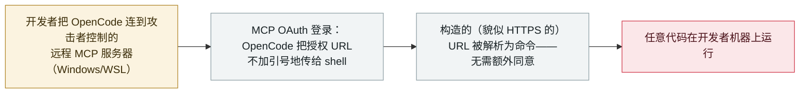

# OpenCode：恶意 MCP 服务器可在 OAuth 登录时于开发者机器上执行代码

OpenCode: a malicious MCP server runs code on the developer's machine during OAuth sign-in

     

## 概要

**2026 年 10 月 19 日，Pillar Security 披露了 **OpenCode** 编码 agent 的一个严重**远程代码执行**缺陷：攻击者控制的 **MCP 服务器可在 MCP OAuth 登录过程中于开发者机器上执行任意代码**，无需额外的用户交互或同意。** 缺陷在 Windows/WSL 的浏览器启动路径——OpenCode 把 OAuth URL 不加正确引号地传给 shell，于是一个构造的（哪怕看起来是 HTTPS 的）授权 URL 就变成了命令（macOS/Linux 不经 shell 启动浏览器，不受影响）。影响 **OpenCode 1.0.137–1.18.32**，并在 **1.18.33（9 月 28 日发布）中被静默修复**——Pillar 于 8 月 29 日上报，维护方（Anomaly）起初认为恶意 MCP 服务器不在其威胁模型内。关键是**没有 CVE、没有安全通告**，故扫描器与依赖告警都不会标出受影响安装。Pillar 评 **CVSS 9.8**，报告无在野利用。此事与同周披露的 [OpenCode Console 密钥泄露](2026-10-17-opencode-console-breach-api-keys.md)是**不同问题**。记为 `vulnerability` / `INFRA` / `high` / `real_harm: false`。

## 攻击链

## 详情

**缺陷本身。** 2026 年 **10 月 19 日**，Pillar Security（研究者 Eilon Cohen）发表《Open and Shut: Remote Code Execution in opencode via MCP OAuth》。当开发者把 **OpenCode** 编码 agent 连到一个远程 **MCP 服务器**时，OAuth 登录流程会在浏览器打开一个授权 URL。在 **Windows 与 WSL** 上，OpenCode 把该 URL **不加正确引号地传给 shell**，于是攻击者控制的 MCP 服务器可返回一个**构造的授权 URL——哪怕看起来是合法 HTTPS 链接——被解析为命令**，从而在**登录过程中于开发者机器上实现任意代码执行，无需额外用户交互或同意**。macOS 与 Linux 不经 shell 打开浏览器，不受影响。

**范围、修复与 CVE 缺口。** 影响 **OpenCode 1.0.137–1.18.32**，在 **1.18.33** 修复——Anomaly 于 **9 月 28 日**发布，但**作为一次重构静默修复、无 CVE、无安全通告**。Pillar 于 **8 月 29 日**私下上报；据 Pillar，维护方起初把恶意 MCP 服务器视为威胁模型之外。由于没有 CVE，漏洞扫描器与依赖告警都不会标出受影响安装，防御方须直接检查 OpenCode 版本并升级到 **1.18.33 或更高**。Pillar 还指出仅做 URL scheme 检查不够，真正的修复是正确引用该 URL（或改用基于参数的进程执行）。Pillar 评 **CVSS 9.8**，报告无在野利用迹象。

**如何分级。** `vulnerability`——已披露的缺陷，而非实战中被用的事件。`INFRA`（agent 自身运行时/客户端及其 MCP 处理是攻击面）。`real_harm: false`：无已知利用；在公开披露前已修复。评 `high` 而非 `critical`（尽管 Pillar 评 CVSS 9.8）——本库严重度反映**已经发生了什么**，严重但无在野利用的缺陷在此记 `high`；"无 CVE 静默修复"是显著的可见性风险，但本身不改变"已实现伤害"的评级。可信度 `A`：Pillar 的详细技术文 + 独立报道（The Hacker News、Infosecurity Magazine）。此事与另条单列的 OpenCode Console 凭据泄露是**不同问题**。

## 来源

| # | 来源 | 链接 |
|---|---|---|
| 1 | Pillar Security（发现者） | <https://www.pillar.security/blog/open-and-shut-remote-code-execution-in-opencode-via-mcp-oauth> |
| 2 | The Hacker News | <https://thehackernews.com/2026/10/opencode-flaw-lets-malicious-mcp.html> |
| 3 | Infosecurity Magazine | <https://www.infosecurity-magazine.com/news/opencode-quietly-patched-critical/> |

## 元数据

| 字段 | 值 |
|---|---|
| 日期 | `2026-10-19`（原始：2026-10-19 Pillar Security 披露；1.18.33 于 2026-09-28 修复；2026-08-29 上报厂商，精度 `day`） |
| 性质 | 漏洞披露 `vulnerability` |
| 类型 | [`INFRA`](../../../../taxonomy/types.md#infra) |
| 评级 | **高** `high` |
| 可信度 | **A**——Pillar Security 技术文 + The Hacker News + Infosecurity Magazine |
| 真实伤害 | 无——披露前已修复；无已知在野利用 |
| AI 参与 | 已确认 `confirmed` |
| 地区 | [全球](../../../../regions/global.md) |
| 档案 ID | `2026-10-19-opencode-mcp-oauth-rce` |

**分类理由：** OpenCode 编码 agent 的已披露 RCE——恶意 MCP 服务器在 OAuth 登录时在开发者主机上执行代码（`INFRA`——agent 运行时/客户端及 MCP 处理）。记 `vulnerability` 而非事件。`real_harm: false`——披露前已修复、无已知利用。`high` 而非 `critical`：严重度记录已发生之事，严重但无在野利用者记 `high`；无 CVE 的静默修复是可见性隐患、非已实现伤害。与 OpenCode Console 密钥泄露分列。分级标准见 [severity.md](../../../../taxonomy/severity.md) 与 [confidence.md](../../../../taxonomy/confidence.md)。

## 相关条目

**专题：** [agent 基础设施暴露（INFRA）](../../../../topics/agent-infra.md)

**相关记录：**

- `2026-10-17` [OpenCode Console 被攻破，泄露用户存储的 AI 提供方 API 密钥](2026-10-17-opencode-console-breach-api-keys.md)   同周另一起 OpenCode 问题——托管 Console，而非客户端
- `2026-10-02` [Loom for AWS agent 控制面未授权接管（CVE-2026-103956）](2026-10-02-loom-aws-agent-control-plane-cve-2026-103956.md)   另一处 agent 平台/MCP 基础设施缺陷
- `2026-07-31` [设计即暴露：可从网络触达的 MCP 服务器](../../../2026-07/2026-07-31-exposed-by-design-mcp-servers.md)   MCP 作为 agent 攻击面的更广模式

---

[← English original](../../../2026-10/2026-10-19-opencode-mcp-oauth-rce.md) · [2026-10 index](../../../2026-10/README.md) · [All records](../../../README.md) · [Home](../../../../README.md)

本条目属于 **Orca AI Incident Archive**，按 [CC BY 4.0](../../../../LICENSE) 授权。发现事实错误或缺少来源，请[提 issue 或 PR](../../../../CONTRIBUTING.md)——更正会写进条目的修订记录，不会静默覆盖。
