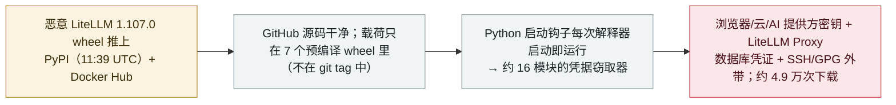

# LiteLLM 1.107.0 被投毒：恶意 PyPI/Docker 构建植入凭据窃取器

LiteLLM 1.107.0 compromised: malicious PyPI/Docker build ships a credential stealer

      

## 概要

**2026 年 10 月 21 日，**LiteLLM 1.107.0** 的一个恶意构建——这个被广泛使用的开源 LLM 网关/代理，为众多 AI agent 前置托管模型——被推上 **PyPI（11:39 UTC）与 Docker Hub**，内含凭据窃取器；在约 **4.9 万次下载**后，于 **13:20 UTC** 被 PyPI 隔离。** GitHub 源码是干净的，但全部 7 个预编译 **wheel** 都带载荷：一个 `.pth`/`sitecustomize` 的 **Python 启动钩子，每次解释器启动即运行**（哪怕应用从不 import litellm），通过约 16 个模块收割——浏览器凭据/cookie、**AWS/GCP/Azure** 凭证、**AI 提供方 API 密钥（OpenAI、Anthropic、Cohere）**、**LiteLLM Proxy 的 PostgreSQL 数据库里存的 LLM 提供方凭证**、以及 SSH/GPG 密钥与 shell 历史——随后加密外带到攻击者域名。还带有一个**处于休眠**的二阶段远程代码加载器（未见激活）。LiteLLM 已隔离该版本并下架 Docker 标签；初始攻击向量仍不明。这是 LiteLLM 包的**第二次**被投毒（继 [2026 年 3 月的后门版本](../2026-03/2026-03-24-litellm-backdoored-release.md)之后）。记为 `incident` / `SUPPLY` + `CRED` / `high` / `real_harm: true`——一次约 4.9 万次下载的 agent 基础设施恶意发行。

## 攻击链

## 详情

**发生了什么。** 2026 年 **10 月 21 日**，**LiteLLM** 的一个恶意版本 **1.107.0**——这个被众多 AI agent 与应用用来路由到模型提供方的开源 LLM 网关/代理——于 **PyPI 11:39 UTC** 与 **Docker Hub** 发布。多家安全厂商（Wiz、JFrog、Mend、OX Security、Datadog、Chainguard、Endor，以及经 The Hacker News 的 SafeDep/Socket/StepSecurity/Upwind）做了分析。PyPI 在 **13:20 UTC** 将其**隔离**；ClickPy 数据显示移除前约 **4.9 万次下载**。

**载荷。** **GitHub 源码是干净的**，但全部 **7 个预编译 wheel**（及 Docker 镜像）都带恶意代码——载荷可追溯到一个不在 v1.107.0 git tag 中的提交。一个 `.pth` 文件加 `sitecustomize.py` 安装了**每次解释器启动即执行的 Python 启动钩子**，故窃取器**即使应用从不 import `litellm` 也会运行**。它通过约 16 个模块收割：浏览器凭据与 cookie（Chrome/Firefox/Edge/Safari）、**AWS/GCP/Azure** 凭证与令牌、**AI 提供方 API 密钥（OpenAI、Anthropic、Cohere）**、**LiteLLM Proxy 的 PostgreSQL 数据库里存的 LLM 提供方凭证**、以及 SSH/GPG 密钥与 shell 历史，随后**加密外带**到攻击者控制的域名。还有一个**处于休眠**的二阶段远程代码加载器——Wiz 未观察到它拉取/运行远程代码——故本条定性为带潜伏加载器的凭据窃取器，而非正在运行的 RAT。

**为何 `real_harm: true`。** 与 PoC 或零下载被迅速拦下的情况不同，这是一次**真实分发的恶意发行**（约 4.9 万次下载），窃取器在无 import 的 Python 启动时即运行；各厂商一致建议**按已暴露处理、轮换该主机可达的全部凭证**。虽无具名受害者损失公布，但大规模的真实凭证暴露是可预期的后果。（LiteLLM 2026 年 3 月的投毒另条单列；这是第二次。）

**如何分级。** `incident`——真实恶意分发，而非已披露未被利用的缺陷。`SUPPLY`（agent 基础设施的 PyPI/Docker 构建被投毒）+ `CRED`（被盗的是密钥——云、AI 提供方、以及代理里存的 LLM 凭证）。`real_harm: true`（真实、约 4.9 万次下载、活跃窃取器）。评 `high`：分发面广、窃取凭据，但约 1.6 小时内被拦截隔离、二阶段保持休眠。可信度 `A`：Wiz、JFrog、Mend、OX、Datadog、Chainguard、Endor 等多家安全厂商并行分析 + The Hacker News。

## 来源

| # | 来源 | 链接 |
|---|---|---|
| 1 | Wiz | <https://www.wiz.io/blog/litellm-compromised-steals-credentials> |
| 2 | JFrog Security Research | <https://research.jfrog.com/post/litellm-hijacked-again/> |
| 3 | The Hacker News | <https://thehackernews.com/2026/10/litellm-compromised-in-supply-chain.html> |

## 元数据

| 字段 | 值 |
|---|---|
| 日期 | `2026-10-21`（原始：恶意 1.107.0 于 11:39 UTC 上传、13:20 UTC 在 PyPI 被隔离，精度 `day`） |
| 性质 | 真实事件 `incident` |
| 类型 | [`SUPPLY`](../../../../taxonomy/types.md#supply) [`CRED`](../../../../taxonomy/types.md#cred) |
| 评级 | **高** `high` |
| 可信度 | **A**——Wiz、JFrog、Mend、OX、Datadog、Chainguard、Endor 并行分析 + The Hacker News |
| 真实伤害 | 有——真实恶意发行、约 4.9 万次下载、凭据窃取器在 Python 启动时运行 |
| AI 参与 | 已确认 `confirmed` |
| 地区 | [全球](../../../../regions/global.md) |
| 档案 ID | `2026-10-21-litellm-1-107-supply-chain-compromise` |

**分类理由：** LiteLLM（为众多 agent 前置的 LLM 网关）的 PyPI/Docker 构建被投毒（`SUPPLY`），携带针对云、AI 提供方与代理内 LLM 凭证的窃取器（`CRED`）。记 `incident` 且 `real_harm: true`，因它是真实、广泛下载、带活跃窃取器的发行（厂商建议按已泄露处理）。`high` 而非 `critical`：面广但约 1.6 小时内被隔离、远程代码加载器保持休眠。第二次 LiteLLM 投毒，与 2026 年 3 月那次分列。分级标准见 [severity.md](../../../../taxonomy/severity.md) 与 [confidence.md](../../../../taxonomy/confidence.md)。

## 相关条目

**专题：** [agent 供应链](../../../../topics/agent-supply-chain.md)

**相关记录：**

- `2026-03-24` [LiteLLM 发布了带后门的版本](../../../2026-03/2026-03-24-litellm-backdoored-release.md)   LiteLLM 第一次被投毒——本条是第二次
- `2026-10-08` [Tensorlake npm SDK 投毒，收割 agent 配置与凭证](2026-10-08-tensorlake-npm-sdk-compromise.md)   同月——供应链窃取 AI agent 提供方密钥
- `2026-08-04` [ChainDrop npm 供应链投毒波](../../../2026-08/2026-08-04-chaindrop-npm-ru-chong.md)   另一起瞄准 agent 的包仓库投毒

---

[← English original](../../../2026-10/2026-10-21-litellm-1-107-supply-chain-compromise.md) · [2026-10 index](../../../2026-10/README.md) · [All records](../../../README.md) · [Home](../../../../README.md)

本条目属于 **Orca AI Incident Archive**，按 [CC BY 4.0](../../../../LICENSE) 授权。发现事实错误或缺少来源，请[提 issue 或 PR](../../../../CONTRIBUTING.md)——更正会写进条目的修订记录，不会静默覆盖。
