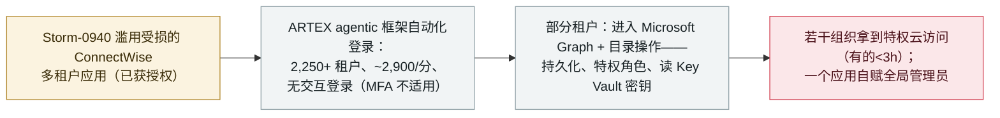

# 微软将 ConnectWise 供应链入侵归因于用 ARTEX agentic AI 框架驱动攻击的 Storm-0940

Microsoft ties the ConnectWise supply-chain compromise to Storm-0940 driving attacks with the ARTEX agentic AI framework

      

## 概要

**2026 年 10 月 21 日，微软威胁情报将 **ConnectWise 供应链入侵**归因于 **Storm-0940**（中国国家关联行为体），并称该组织用 **ARTEX agentic AI 渗透测试框架**自动化攻击全球数百家组织。** Storm-0940 滥用一个已获授权的 ConnectWise 多租户应用的受损凭证，**无需交互式登录（故 MFA 不适用）**即认证进入 Microsoft 365 环境——ARTEX 驱动的活动触达 **2,250+ 个租户、最高 2,900 次/分钟登录尝试**。微软称多数攻击未得手，**但在若干组织中拿到了特权云访问，有的在三小时内**：在受影响租户里，agent 越过认证进入 **Microsoft Graph 与目录操作**——侦察、**改应用凭证做持久化、改身份/组/特权角色、批量读取多个 Azure Key Vault 的密钥**，且有一个 ConnectWise 应用**自赋全局管理员角色**。微软未确认此役中发生数据外带。相关的一次（基本失败的）密码喷洒（10-10 至 10-14）打了 8 家组织的 327 个账户、15.1 万+ 次失败登录。记为 `incident` / `WEAPON` + `SUPPLY` / `critical` / `real_harm: true`、`landmark`——首个微软归因的、用 agentic-AI 框架规模化驱动供应链入侵的国家级行动。

## 攻击链

## 详情

**归因。** 2026 年 **10 月 21 日**，微软威胁情报发布博客，评估认为 **Storm-0940**——一个自 2021 年活跃的**中国国家关联**行为体——应对近期披露的某多租户应用 **ConnectWise 供应链入侵**负责，并称该组织用 **ARTEX agentic AI 渗透测试框架**自动化了对全球数百家组织的攻击。（微软将归因表述为"评估"，并称该活动并非源于微软自身系统、产品或服务的任何被攻破。）

**如何运作。** Storm-0940 利用 ConnectWise 应用（客户**已授予访问权**）的受损应用凭证，**通过该应用、无需交互式用户登录**即认证进入 Microsoft 365 环境，**因而 MFA 不适用**。ARTEX 自动化了扫描、**OAuth 应用滥用**与密码喷洒。与 ConnectWise 相关的活动涉及对 **2,250+ 个租户、最高每分钟 2,900 次**的登录尝试。

**实际得手了什么。** 微软称多数攻击未得手，**但 Storm-0940 在若干组织中拿到了特权云访问，有的在初始目标后三小时内**。在受影响租户中，AI 驱动的活动**越过认证进入 Microsoft Graph 与目录操作**：侦察、**改应用凭证做持久化**、**改身份/组/特权角色**。微软的检测指引还列出**跨多个 Azure Key Vault 批量读取密钥**（含密钥枚举与一次 unwrap 操作），并指出一个 ConnectWise 应用**自赋全局管理员角色**。微软**未**确认此役中是否访问或外带数据。另有一次基本失败的**密码喷洒**（**10-10 至 10-14**）打了 8 家组织的 327 个账户、15.1 万+ 次失败登录、未见成功认证。

**如何分级。** `incident`——真实在野行动。`WEAPON`（agentic AI 框架 ARTEX 驱动入侵）+ `SUPPLY`（入口是受损的 ConnectWise 多租户应用，供应链向量）。`real_harm: true`：不止"尝试"，微软确认在真实受害组织里**拿到特权云访问、做了持久化更改、改特权角色、自赋全局管理员、批量读取 Key Vault 密钥**——尽管未确认数据外带。评 `critical`：国家级行为体、机器速度的 agentic-AI 自动化、经绕过 MFA 的供应链向量在真实租户中取得确认的特权访问/持久化/密钥读取。`landmark: true`：首个微软归因的、用 **agentic-AI 框架**规模化驱动供应链入侵的国家级行动。可信度 `A`：微软威胁情报自家报告 + 独立报道（CyberScoop、Brandefense）。日期取 10 月 21 日微软披露。

## 来源

| # | 来源 | 链接 |
|---|---|---|
| 1 | 微软威胁情报 | <https://www.microsoft.com/en-us/security/blog/2026/10/21/storm-0940-uses-artex-agentic-ai-connectwise-supply-chain-compromise/> |
| 2 | CyberScoop | <https://cyberscoop.com/microsoft-attributes-connectwise-supply-chain-attack-china-storm-0940/> |
| 3 | Brandefense | <https://brandefense.io/security-news/storm-0940-artex-connectwise-supply-chain-attack/> |

## 元数据

| 字段 | 值 |
|---|---|
| 日期 | `2026-10-21`（原始：2026-10-21 微软威胁情报；相关密码喷洒 2026-10-10 至 2026-10-14，精度 `day`） |
| 性质 | 真实事件 `incident` |
| 类型 | [`WEAPON`](../../../../taxonomy/types.md#weapon) [`SUPPLY`](../../../../taxonomy/types.md#supply) |
| 评级 | **严重** `critical` |
| 可信度 | **A**——微软威胁情报报告 + 独立报道 |
| 真实伤害 | 有——在若干真实组织中取得特权云访问、持久化、特权角色更改、自赋全局管理员、读取 Key Vault 密钥 |
| AI 参与 | 已确认 `confirmed` |
| 地区 | [全球](../../../../regions/global.md) |
| 档案 ID | `2026-10-21-storm-0940-artex-connectwise-supply-chain` |

**分类理由：** 国家级行动（Storm-0940）用 ARTEX agentic AI 框架驱动 ConnectWise 供应链入侵（`WEAPON`——AI 作攻击驱动；`SUPPLY`——受损多租户应用向量）。记 `incident` 且 `real_harm: true`，因微软确认在真实组织取得特权云访问、持久化、特权角色更改与 Key Vault 密钥读取（数据外带未确认）。评 `critical`：规模、机器速度自动化、经绕过 MFA 的供应链向量取得确认的特权访问。`landmark`：首个微软归因的国家级 agentic-AI 规模化供应链入侵。分级标准见 [severity.md](../../../../taxonomy/severity.md) 与 [confidence.md](../../../../taxonomy/confidence.md)。

## 相关条目

**专题：** [进攻性 AI](../../../../topics/offensive-ai.md)

**相关记录：**

- `2026-10-06` [ARTEX AI 被用于攻击韩国银行](2026-10-06-artex-ai-south-korea-banks.md)   同一 ARTEX agentic 框架在另一战役中
- `2026-07-30` [Unit 42：中文使用者的自主进攻性行动](../../../2026-07/2026-07-30-unit42-chinese-speaking-autonomous-campaigns.md)   更早的国家级相邻 agentic 进攻行动
- `2026-10-21` [LiteLLM 1.107.0 供应链投毒](2026-10-21-litellm-1-107-supply-chain-compromise.md)   同日另一起 agent 生态供应链投毒

---

[← English original](../../../2026-10/2026-10-21-storm-0940-artex-connectwise-supply-chain.md) · [2026-10 index](../../../2026-10/README.md) · [All records](../../../README.md) · [Home](../../../../README.md)

本条目属于 **Orca AI Incident Archive**，按 [CC BY 4.0](../../../../LICENSE) 授权。发现事实错误或缺少来源，请[提 issue 或 PR](../../../../CONTRIBUTING.md)——更正会写进条目的修订记录，不会静默覆盖。
