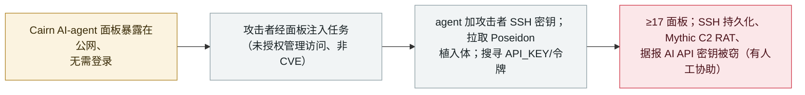

# 攻击者在野劫持暴露的 Cairn AI-agent 面板，植入 SSH 密钥、Poseidon 植入体并窃取 API 密钥

Attackers hijack exposed Cairn AI-agent panels in the wild to plant SSH keys, a Poseidon implant, and steal API keys

      

## 概要

**安全公司 **NorForge** 报告（2026 年 10 月 27 日）：攻击者正在野劫持**暴露在公网、无需登录的 Cairn 面板**——Cairn 是一个开放平台，你给 AI agent 下一个目标、它便自主执行并把发现贴到 web 面板——并注入任务把这些 agent 武器化。** 在**至少 17 个暴露面板**（部分是红队/CTF 环境）上，自约 **10 月 20 日**起观察到的活动包括：一个任务让 agent **把攻击者 SSH 密钥**加进 kali 账户的 `authorized_keys`；10 月 21 日一个名为"Local worker maintenance"的任务投放 base64 脚本去拉取 **Poseidon 植入体**（基于 Go 的 Mythic C2 载荷，经 Bunny.net CDN）；以及搜寻 `API_KEY`、`ANTHROPIC_AUTH_TOKEN` 等机密的侦察任务，**据报 AI 模型 API 密钥被窃**。NorForge 跟踪两个独立簇——**AIA0009**（持久化 + 恶意软件、"cairnscan"标签）与 **AIA0010**（窃凭据 + 搜寻更多面板）。入口是**对暴露面板的未授权管理访问，而非新的软件 CVE**。NorForge 系被动观察，**无法确认这些行动完全自主**——同步活动暗示有脚本化，并认为关键节点有人工介入（投毒前的暂停、C2/下载服务器搭建）。记为 `incident` / `INFRA` + `WEAPON` / `high` / `real_harm: true`。

## 攻击链

## 详情

**Cairn 是什么、发生了什么。** **Cairn** 是一个运行 AI agent 的开放平台：用户设定目标与起点，agent 便自主工作、把发现作为"facts"贴到 web 面板。任何能访问该面板的人都能创建和管理任务——因此**暴露在公网、无需认证的面板**等于把 agent 的控制权交给攻击者。安全公司 **NorForge** 于 **2026 年 10 月 27 日**报告（CyberSecurityNews 与 GBHackers 转载）：攻击者正在野这么干，活动自约 **10 月 20 日**起观察到。NorForge 对暴露面板系**被动观察**，未与攻击者交互。

**被注入的任务。** 在**至少 17 个暴露面板**——部分属红队与 CTF 演练——NorForge 看到恶意任务：
- **SSH 持久化**：名为"Install kali SSH key"的任务让 agent 把**攻击者控制的公钥**加进 kali 账户的 `authorized_keys`，并有 agent 输出确认。
- **恶意软件**：**10 月 21 日**，一个"Local worker maintenance"任务投放 **base64 编码脚本**，下载 **Poseidon 植入体**——一个与开源 **Mythic** C2 生态相关的 Go 载荷，据报经 **Bunny.net** CDN 通信；它一直运行，直到操作者创建停止文件。
- **窃取机密**：侦察任务在文件与环境变量中搜寻 `API_KEY`、`ANTHROPIC_AUTH_TOKEN` 等，部分任务把机密写进公开 fact 文本；NorForge 报告 **AI 模型 API 密钥被窃**（但无法确认攻击者是否跨越了容器隔离）。

**两个簇与自主性限定。** NorForge 跟踪两个暂定簇：**AIA0009**（任务名带随机十六进制后缀、"cairnscan"标签；持久化、访问，且是唯一见到投放恶意软件的）与 **AIA0010**（任务名模仿 Cairn 的意图标签；搜寻内部服务、凭据与更多面板）。两者**无共享硬指标**，故分开看待。重要的是，NorForge **并未断言这些行动是完全自主的 AI**：跨面板的同步活动暗示**脚本化**，并认为**关键节点有人工介入**（投毒前的暂停、搭建 C2 与下载服务器）。入口是**对暴露面板的未授权管理访问，而非新披露的软件漏洞**。

**如何分级。** `incident`——真实在野行动。`INFRA`（暴露的 AI-agent 编排面板是攻击面）+ `WEAPON`（被劫持的 agent 被驱动去装持久化、投 RAT、窃凭据）。`real_harm: true`：Poseidon 植入体确有投放、攻击者 SSH 密钥确有装入被攻陷面板。评 `high`：真实在野、跨≥17 面板的 agent 武器化并投 RAT，但限于**暴露/错配**面板（其中数个是红队/CTF 环境）、非加固生产，且有自主性/人工介入的限定。可信度 `A`：NorForge 技术研究，经 CyberSecurityNews 与 GBHackers 转载。日期取 10 月 27 日报告；活动自约 10 月 20 日。

## 来源

| # | 来源 | 链接 |
|---|---|---|
| 1 | Cyber Security News（NorForge 研究） | <https://cybersecuritynews.com/ai-pentesting-agents/> |
| 2 | GBHackers（NorForge 研究） | <https://gbhackers.com/ai-pentesting-panels/> |
| 3 | Vibe Incidents | <https://vibeincidents.com/incidents/cairn-exposed-panels-ai-intrusions/> |

## 元数据

| 字段 | 值 |
|---|---|
| 日期 | `2026-10-27`（原始：2026-10-27 NorForge 报告，经 CyberSecurityNews/GBHackers；活动自约 2026-10-20，精度 `day`） |
| 性质 | 真实事件 `incident` |
| 类型 | [`INFRA`](../../../../taxonomy/types.md#infra) [`WEAPON`](../../../../taxonomy/types.md#weapon) |
| 评级 | **高** `high` |
| 可信度 | **A**——NorForge 研究 + Cyber Security News + GBHackers |
| 真实伤害 | 有——Poseidon 植入体已投放、攻击者 SSH 密钥已装入在野暴露的 Cairn 面板 |
| AI 参与 | 已确认 `confirmed` |
| 地区 | [全球](../../../../regions/global.md) |
| 档案 ID | `2026-10-27-cairn-exposed-agent-panels-hijacked` |

**分类理由：** 在野劫持暴露的 Cairn AI-agent 面板（`INFRA`——暴露的 agent 编排），驱动 agent 装 SSH 持久化、投 Poseidon/Mythic 植入体、窃凭据（`WEAPON`）。记 `incident` 且 `real_harm: true`，因恶意软件与攻击者 SSH 密钥确有植入。评 `high` 而非 critical，因限于暴露/错配面板（数个为红队/CTF）、且 NorForge 无法确认完全自主（关键节点有人工介入）。分级标准见 [severity.md](../../../../taxonomy/severity.md) 与 [confidence.md](../../../../taxonomy/confidence.md)。

## 相关条目

**专题：** [进攻性 AI](../../../../topics/offensive-ai.md)

**相关记录：**

- `2026-10-21` [微软将 ConnectWise 供应链入侵归因于用 ARTEX agentic AI 框架驱动攻击的 Storm-0940](2026-10-21-storm-0940-artex-connectwise-supply-chain.md)   另一个在野使用的 agentic AI 进攻框架
- `2026-10-06` [ARTEX AI 被用于攻击韩国银行](2026-10-06-artex-ai-south-korea-banks.md)   一个开源 agentic 渗透工具被用于真实攻击
- `2026-09-22` [ClosedQuorum AI C2 植入体](../../../2026-09/2026-09-22-closedquorum-ai-c2-implant.md)   另一个 AI 驱动的命令控制植入体

---

[← English original](../../../2026-10/2026-10-27-cairn-exposed-agent-panels-hijacked.md) · [2026-10 index](../../../2026-10/README.md) · [All records](../../../README.md) · [Home](../../../../README.md)

本条目属于 **Orca AI Incident Archive**，按 [CC BY 4.0](../../../../LICENSE) 授权。发现事实错误或缺少来源，请[提 issue 或 PR](../../../../CONTRIBUTING.md)——更正会写进条目的修订记录，不会静默覆盖。
