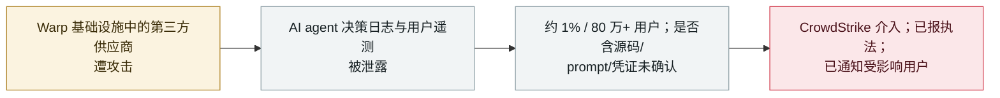

# Warp 披露第三方供应商被攻破，泄露了 AI agent 决策日志与用户遥测

Warp discloses a third-party vendor breach that exposed AI-agent decision logs and user telemetry

      

## 概要

**2026 年 10 月 27 日，**Warp**——一个 agentic 开发环境／AI 终端——披露：其基础设施中一家**第三方供应商**遭攻击，泄露了 **AI agent 决策日志与用户遥测**。** CEO Zach Lloyd 称 Warp 在某个周五检测到该活动，估计约 **1% 用户**可能受影响（Warp 称有 **80 万+** 用户，意味着数千账户），并已请 **CrowdStrike** 介入、通知执法、告知受影响用户。Warp **未说明**暴露数据是否含源码、prompt 或凭证——已确认的类别是 agent 决策日志与遥测。将其描述为"agent 蜂群"攻击的说法只是分析**假设、未经证实**，供应商名称也未公布。记为 `incident` / `EXFIL` + `INFRA` / `medium` / `real_harm: true`——一次真实泄露、暴露了 agent 专有的运行数据，但范围与敏感度仍有界/未确认。

## 攻击链

## 详情

**发生了什么。** 2026 年 **10 月 27 日**，Warp——一个 **agentic 开发环境／AI 终端**——披露其基础设施中一家**第三方供应商**遭到攻击。据公司说，被泄露的数据是 **AI agent 决策日志与用户遥测**。CEO **Zach Lloyd** 称该活动于某个周五被检测到，事件仍在调查中。

**范围与应对。** Lloyd 估计约 **1% 用户**可能受影响；Warp 称有 **80 万+** 用户，即数千账户。Warp 已请 **CrowdStrike** 协助、**通知执法**、**告知受影响用户**。公司**未公布供应商名称**，也**未说明**暴露数据是否含源码、prompt 或凭证——仅确认了 agent 决策日志与遥测。由于 agent 决策日志可能记录编码 agent 做了什么、看到了什么，安全评论者建议受影响用户轮换曾粘贴进 Warp AI 的任何机密。

**限定。** 有报道将此描述为"agent 蜂群"入侵，但这只是分析的**工作假设、并非 Warp 确认的归因**；被泄露日志的确切敏感度亦未确立。

**如何分级。** `incident`——已确认的真实泄露，而非已披露未被利用的缺陷。`EXFIL`（agent 专有数据经供应商被攻破而离开信任边界）与 `INFRA`（被暴露的是 agentic 开发平台的运行数据）。`real_harm: true`：真实用户数据（agent 决策日志 + 遥测）在一次影响真实账户的确认泄露中被暴露——与演示不同。评 `medium`：限于约 1% 用户、且被暴露日志的敏感度未确认（无确认的源码、prompt 或凭证泄露），故不更高。可信度 `A`：BleepingComputer 首发报道加 Warp CEO 声明与独立报道。

## 来源

| # | 来源 | 链接 |
|---|---|---|
| 1 | BleepingComputer | <https://www.bleepingcomputer.com/news/security/warp-discloses-breach-exposing-ai-agent-logs-user-telemetry-data/> |
| 2 | Atlabyte | <https://atlabyte.com/en/news/warp-reports-data-breach-ai-agent-logs-and-user-telemetry-affected> |
| 3 | Archyde | <https://www.archyde.com/warp-exposes-user-logs-and-telemetry-in-third-party-vendor-breach/> |

## 元数据

| 字段 | 值 |
|---|---|
| 日期 | `2026-10-27`（原始：2026-10-27 Warp 披露，精度 `day`） |
| 性质 | 真实事件 `incident` |
| 类型 | [`EXFIL`](../../../../taxonomy/types.md#exfil) [`INFRA`](../../../../taxonomy/types.md#infra) |
| 评级 | **中** `medium` |
| 可信度 | **A**——BleepingComputer + Warp CEO 声明 + 独立报道 |
| 真实伤害 | 有——agent 决策日志与用户遥测在一次影响真实账户的确认泄露中被暴露 |
| AI 参与 | 已确认 `confirmed` |
| 地区 | [全球](../../../../regions/global.md) |
| 档案 ID | `2026-10-27-warp-vendor-breach-agent-logs` |

**分类理由：** Warp agentic 开发平台因第三方供应商被攻破而泄露 agent 决策日志与用户遥测（`EXFIL`——agent 数据离开边界；`INFRA`——agent 平台的运行数据）。记 `incident` 且 `real_harm: true`，因真实用户数据在真实泄露中被暴露。评 `medium`，因有界（约 1% 用户）、敏感度未确认（无确认的源码/prompt/凭证泄露）；"agent 蜂群"归因未经证实。分级标准见 [severity.md](../../../../taxonomy/severity.md) 与 [confidence.md](../../../../taxonomy/confidence.md)。

## 相关条目

**专题：** [agent 基础设施暴露（INFRA）](../../../../topics/agent-infra.md)

**相关记录：**

- `2026-10-17` [OpenCode Console 被攻破，泄露用户存储的 AI 提供方 API 密钥](2026-10-17-opencode-console-breach-api-keys.md)   同月另一起暴露用户数据的 agent 平台泄露
- `2026-09-29` [PixelLeak：编码 agent 把内部截图推到公共 GitHub](../../../2026-09/2026-09-29-pixelleak-coding-agents-screenshots-github.md)   另一起 agent 侧运行数据的暴露
- `2026-09-26` [Meta Muse 市场地址泄露](../../../2026-09/2026-09-26-meta-muse-marketplace-address-leak.md)   另一起 agent 平台数据暴露

---

[← English original](../../../2026-10/2026-10-27-warp-vendor-breach-agent-logs.md) · [2026-10 index](../../../2026-10/README.md) · [All records](../../../README.md) · [Home](../../../../README.md)

本条目属于 **Orca AI Incident Archive**，按 [CC BY 4.0](../../../../LICENSE) 授权。发现事实错误或缺少来源，请[提 issue 或 PR](../../../../CONTRIBUTING.md)——更正会写进条目的修订记录，不会静默覆盖。
