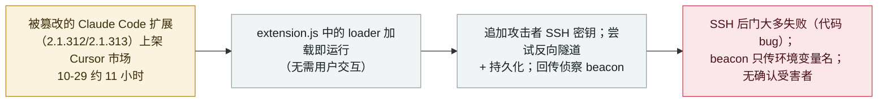

# Cursor 市场上架的恶意 Claude Code 扩展植入 SSH 后门

A malicious Claude Code extension on Cursor's marketplace planted an SSH backdoor

     

## 概要

**2026 年 10 月 29 日，Anthropic 官方 Claude Code VS Code 扩展的被篡改版本（2.1.312 与 2.1.313）在 **Cursor** 的 VS Code 扩展市场上架约 11 小时（约 2:27–13:35 PT），最多暴露约 5,000 名开发者。** 被植入 `extension.js` 开头的 JavaScript loader **在扩展加载时自动执行**（无需交互）：收集主机/用户侦察信息（主机名、OS、Git 邮箱、公网 IP，以及匹配 `KEY|TOKEN|SECRET|PASS|AWS|GCP` 的环境变量**名**），把攻击者 SSH 公钥（`svc-telemetry`）追加进 `authorized_keys`，尝试向 `134.209.82[.]225` 打开持久反向 SSH 隧道，并安装持久化（macOS LaunchAgent／Windows 计划任务）。关键在于，**SSH 后门因代码错误大多失败**（macOS 权限检查误读自身失败；Windows 路径误调 `/bin/sh`），故在多数系统上远程访问"会失败"；beacon 只回传环境变量**名、而非密钥值**。Cursor 称这些版本**并非 Anthropic 开发**；Anthropic 称自身系统未被攻破；上架市场的途径仍未解释。无确认受害者。记为 `incident` / `SUPPLY` / `high` / `real_harm: false`——一次在野、针对主流编码 agent 官方扩展的市场投毒，约 11 小时内被发现、无确认的成功入侵。

## 攻击链

## 详情

**发生了什么。** 2026 年 **10 月 29 日**，Cursor 发布安全通告：Anthropic 官方 Claude Code VS Code 扩展（`Anthropic.claude-code`）的被篡改版本 **2.1.312 与 2.1.313**，当日约 **2:27 至 13:35 PT** 期间在 **Cursor VS Code 扩展市场**可下载。BleepingComputer（10-30）报道该窗口暴露了**最多约 5,000 名开发者**。研究者 Phorion（Calum Hall）与 OpenSourceMalware 分析了载荷；三方对指标描述一致。

**载荷。** 一个恶意 JavaScript loader 被植入扩展 `extension.js` 开头，其余合法代码未改。据 Cursor 与 Phorion，它**在扩展加载时执行——无需与 Claude Code 交互**，随后：
- **侦察 beacon**：收集主机名、用户名、OS、架构、家目录/工作目录、配置的 Git 邮箱、公网 IP（经 `ifconfig.me` / `api.ipify.org`），外加最多 40 个匹配 `/KEY|TOKEN|SECRET|PASS|AWS|GCP/i` 的环境变量**名**。Phorion 明确：*"beacon 并不外传密钥值本身。"* 以 POST 发往 `134.209.82[.]225:8099/beacon`。
- **SSH 密钥 + 隧道**：把标注为 **`svc-telemetry`** 的攻击者 Ed25519 公钥追加进 `~/.ssh/authorized_keys`，启用 SSH 服务，并尝试以用户 `tunnel` 向 `134.209.82[.]225` 建立持久反向 SSH 隧道（`-R *:0:localhost:22`），约每 60 秒重试。
- **持久化**：macOS LaunchAgent（`com.apple.sysmond`）、Windows 计划任务（`SysMon`，试图以 SYSTEM 运行）加 Startup 脚本兜底，或 Linux `@reboot` cron。

**后门为何大多失败。** Cursor 与 Phorion 都强调 SSH 接管大多**未**奏效。在 **macOS** 上，代码以普通权限运行 `systemsetup -getremotelogin`，权限报错被误读，于是*"把'我没权限检查 SSH 是否关闭'当成'SSH 已开启'"*并跳过启用；而普通账户下 `sudo -n systemsetup -setremotelogin on` 本就会失败。在 **Windows** 上，服务安装命令经一个硬编码 `/bin/sh` 的辅助函数调用，而标准 Windows 并无 `/bin/sh`。Cursor：*"除非在极不寻常、Cursor 以管理员权限启动的情况下，因恶意代码的错误，此步会失败。"* 但 SSH **密钥与持久化脚本仍可能落地、侦察 beacon 仍会发出**，故 Cursor 建议无论如何都检查 `svc-telemetry` 密钥并执行补救。

**归因与未解之处。** Cursor 声明这些恶意版本**并非 Anthropic 开发**，且未发现其他扩展或官方分发受影响；它已轮换密钥、重建市场、并配合托管商下线攻击者服务器。Anthropic（据早前报道）称这**不是 Anthropic 系统或员工笔记本被攻破**。两家均未解释**被篡改的包如何以 Anthropic 名义上架** Cursor 市场。初期关于 npm / Open VSX / 微软 VS Code 市场受影响的说法**未被证实**——Cursor 是唯一分发源。

**如何分级。** `incident`——真实在野、投给真实用户的恶意包，而非 PoC 或已披露未被利用的缺陷。`SUPPLY`——软件供应链/市场投毒：一个被木马化的、广泛使用的编码 agent 官方扩展构建。`real_harm: false`：尽管在野暴露最多约 5,000 名开发者，SSH 后门因设计错误大多失败、beacon 只外传环境变量**名**（非密钥值）、且**无确认受害者**，并在约 11 小时内被发现。仍评 `high`：一个在野、加载即执行、冒充主流编码 agent 官方扩展、带可用持久化与攻击者密钥植入的木马，即便载荷有 bug 也属严重供应链事件。可信度 `A`：Cursor 自己的通告 + BleepingComputer + Phorion/OpenSourceMalware，IOC 一致。

## 来源

| # | 来源 | 链接 |
|---|---|---|
| 1 | Cursor（官方安全通告） | <https://cursor.com/blog/claude-code-extension-security-notice> |
| 2 | BleepingComputer | <https://www.bleepingcomputer.com/news/security/malicious-claude-code-extension-on-cursor-planted-ssh-backdoors/> |
| 3 | Phorion（技术通告） | <https://phorion.io/blog/offical-claude-code-vsx-compromise/> |

## 元数据

| 字段 | 值 |
|---|---|
| 日期 | `2026-10-29`（原始：2026-10-29 恶意版本上架 Cursor 市场；披露 2026-10-29→30，精度 `day`） |
| 性质 | 真实事件 `incident` |
| 类型 | [`SUPPLY`](../../../../taxonomy/types.md#supply) |
| 评级 | **高** `high` |
| 可信度 | **A**——Cursor 安全通告 + BleepingComputer + Phorion/OpenSourceMalware |
| 真实伤害 | 无——后门因代码 bug 大多失败、beacon 只传环境变量名非值、无确认受害者；约 11 小时内被发现 |
| AI 参与 | 已确认 `confirmed` |
| 地区 | [全球](../../../../regions/global.md) |
| 档案 ID | `2026-10-29-cursor-claude-code-extension-ssh-backdoor` |

**分类理由：** 一个被木马化的主流编码 agent 官方扩展构建（`Anthropic.claude-code` 2.1.312/2.1.313）在 Cursor 市场上架约 11 小时、加载即自动执行 SSH 后门 + 持久化 + 侦察载荷（`SUPPLY`）。记 `incident`（在野真实），但 `real_harm: false`，因后门因代码错误大多失败、beacon 只外传环境变量名（非值）、无确认受害者。评 `high`，因在野冒充官方扩展且带可用持久化属严重事件；上架市场途径未解释。分级标准见 [severity.md](../../../../taxonomy/severity.md) 与 [confidence.md](../../../../taxonomy/confidence.md)。

## 相关条目

**专题：** [agent 供应链](../../../../topics/agent-supply-chain.md)

**相关记录：**

- `2025-07-13` [被投毒的 Amazon Q VS Code 扩展夹带删数据的提示词](../../../2025-07/2025-07-13-amazon-q-extension-poisoned.md)   另一起 AI 编码工具官方 IDE 扩展被木马化
- `2026-10-30` ["Black October"：一场协同攻击在一个月内攻破至少九家 AI 开发平台](2026-10-30-black-october-ai-developer-platform-breaches.md)   同月针对 AI 开发工具的更大攻击浪潮
- `2026-08-04` [CHAINDROP：针对 agent 工具链的 npm 供应链投毒](../../../2026-08/2026-08-04-chaindrop-npm-ru-chong.md)   agent 生态另一起供应链木马化

---

[← English original](../../../2026-10/2026-10-29-cursor-claude-code-extension-ssh-backdoor.md) · [2026-10 index](../../../2026-10/README.md) · [All records](../../../README.md) · [Home](../../../../README.md)

本条目属于 **Orca AI Incident Archive**，按 [CC BY 4.0](../../../../LICENSE) 授权。发现事实错误或缺少来源，请[提 issue 或 PR](../../../../CONTRIBUTING.md)——更正会写进条目的修订记录，不会静默覆盖。
