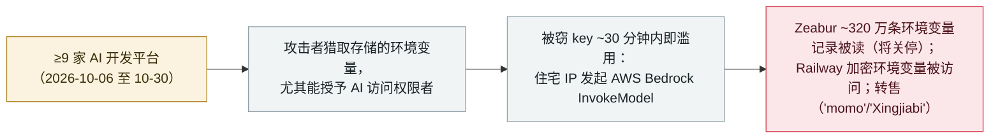

# "Black October"：一场协同攻击在一个月内攻破至少九家 AI 开发平台、收割可解锁 AI 的凭证

"Black October": a coordinated wave breached at least nine AI developer platforms to harvest AI-access credentials

      

## 概要

**2026 年 10 月 30 日，Wiz 发布《Black October》报告：记录了一个月内至少九家 AI 开发平台相继披露安全事件的协同攻击浪潮，攻击者"明确地猎取存储的环境变量，尤其是能授予 AI 访问权限的那些"。** 九家为：Fireworks AI（10-6）、Andromeda（10-9）、Zeabur（10-14）、Lightning AI（10-15）、OpenCode（10-16/17）、Railway（10-20）、Warp（10-23）、CommandCode（10-28）、Northflank（10-30）。数家受害方（Fireworks、OpenCode、Warp）报告有 **"agent 蜂群"** 攻击迹象。被窃的 key **在约 30 分钟内**即被用于从住宅 IP 发起 AWS Bedrock `InvokeModel` 调用，并观察到下游转售团伙（"momo"、"Xingjiabi"）——不过 Wiz 称无法确证转售方与最初入侵的直接关联。独立地，**Zeabur 自己的报告**确认约 **320 万条环境变量记录**被读取（且公司将关停），**Railway 自己的报告**确认加密环境变量被访问（第三方称涉最多 10 万 workspace；所称 $37.1 万加密货币被盗未经证实）。记为 `incident` / `CRED` + `INFRA` / `high` / `real_harm: true`——一场已确认、跨平台、瞄准 AI 凭证的战役；归因松散（Wiz 未归于单一 actor），多家平台的调查仍在进行。

## 攻击链

## 详情

**什么是 "Black October"。** 2026 年 **10 月 30 日**，Wiz 研究员（Benjamin Read、Rami McCarthy）发布 **《Black October for AI Developer Platforms》**，综合了一个月内 **至少九家 AI 开发平台相继披露安全事件** 的情况。Wiz 把它们定性为**以共同模式相连、而非归于单一操作者**：*"虽然没有单一漏洞或依赖把这些攻击串起来，但整体图景高度一致……"* 共同主线是：*"所有公开报告都指向定向利用、明确猎取存储的环境变量，尤其是能授予 AI 访问权限的那些。"* Axios 于 **10 月 28 日** 报道了这波浪潮（称之为 AI 开发工具的"Y2K 教训"）。

**九家平台（披露/观察日期）。**

| 平台 | 日期 | 报告内容 |
|---|---|---|
| Fireworks AI | 10-6 | 报告有 **"agent 蜂群"攻击迹象**；根因归于凭证访问 |
| Andromeda | 10-9 | 称该攻击属"全行业性攻击"的一部分 |
| **Zeabur** | 10-14 | 泄露内部凭证 → 共享集群 → 平台数据库；**~320 万条环境变量记录被读**；**公司将关停** |
| Lightning AI | 10-15 | 凭证访问（此前曾在 Mini-Shai-Hulud 供应链战役中受击） |
| **OpenCode** | 10-16/17 | **有"agent 蜂群"攻击迹象**——*本档案已单独收录* （[记录](2026-10-17-opencode-console-breach-api-keys.md)） |
| Railway | 10-20 | 构建设施权限提升；**加密环境变量被访问**（第三方：最多 10 万 workspace）；所称 $37.1 万加密货币被盗**未证实** |
| **Warp** | 10-23 | **有"agent 蜂群"攻击迹象**；第三方供应商依赖——*本档案已单独收录* （[记录](2026-10-27-warp-vendor-breach-agent-logs.md)） |
| CommandCode | 10-28 | 将事件归于一次"蒸馏（distillation）"企图 |
| Northflank | 10-30 | 已列入；细节待出 |

**"agent 蜂群"主线与下游滥用。** Fireworks、OpenCode、Warp 各自报告了 *"agent 蜂群"* 攻击迹象。Wiz 观察到：**被窃 key 的首次未授权使用发生在凭证访问后约 30 分钟内**——一次来自住宅 IP 的 `InvokeModel` 调用，在一分钟内横扫多个组织。Wiz 还记录了两个滥用 LLM token 的转售团伙（"momo"，以 `23.106.46.239` 为中心；"Xingjiabi"，位于 `xingjiabiapi.org` / `38.246.114.118`），但明确表示：*"我们没有证据把它们与 'Black October' 攻击直接关联。"* 未点名任何 CVE；Wiz 未赋任何正式威胁组织名。

**独立确认的真实伤害。** 本记录不只依赖 Wiz。**Zeabur 自己的初步报告**（及 BleepingComputer/SCWorld 报道）确认：**10 月 14–15 日**，攻击者用泄露的明文内部凭证（8 月那次事件后未轮换）进入共享集群、读取平台数据库——**约 320 万条环境变量记录**——且 Zeabur 正在**收尾关停**（服务 2026 年 12 月 31 日前终止）。**Railway 自己的初步报告**确认构建设施存在权限提升问题（10-20）、存储客户环境变量的系统出现异常访问（10-21），加密环境变量可能被访问。

**如何分级。** `incident`——一场已确认、真实、跨平台的战役（多家受害方自行发布了各自的入侵报告），而非单一已披露缺陷。`CRED`（定义性赃物是从环境变量中收割的 AI 访问凭证／API key／token）+ `INFRA`（AI 开发平台是攻击面）。`real_harm: true`：Zeabur 读取约 320 万条记录并被迫关停、Railway 环境变量被访问、已确认的 Bedrock token 滥用均属真实伤害。评 `high` 而非 critical：广度很大、一家平台关停，但归因刻意保持松散（Wiz 不归于单一 actor）、多家平台调查仍在进行、且最大金额指控（Railway 所称 $37.1 万、OpenCode 所称"数百到数千美元账单"）是未证实的社媒报告。可信度 `A`：Wiz 研究 + Zeabur 与 Railway 自己的报告 + BleepingComputer/SCWorld + Axios。

## 来源

| # | 来源 | 链接 |
|---|---|---|
| 1 | Wiz Research（《Black October》） | <https://wiz.io/blog/black-october-for-ai-developer-platforms> |
| 2 | Zeabur（初步事件报告） | <https://zeabur.com/blogs/october-2026-security-incident> |
| 3 | BleepingComputer（Zeabur 关停） | <https://www.bleepingcomputer.com/news/security/zeabur-shutting-down-after-second-security-breach-in-two-months/> |
| 4 | Railway（初步事件报告） | <https://blog.railway.com/p/preliminary-report-october-security-incident> |
| 5 | Axios | <https://www.axios.com/2026/10/28/cybersecurity-black-october-ai-hacks> |

## 元数据

| 字段 | 值 |
|---|---|
| 日期 | `2026-10-30`（原始：2026-10-30 Wiz《Black October》综合；战役活动约 2026-10-06 至 2026-10-30，精度 `day`） |
| 性质 | 真实事件 `incident` |
| 类型 | [`CRED`](../../../../taxonomy/types.md#cred) [`INFRA`](../../../../taxonomy/types.md#infra) |
| 评级 | **高** `high` |
| 可信度 | **A**——Wiz 研究 + Zeabur 与 Railway 自己的报告 + BleepingComputer/SCWorld + Axios |
| 真实伤害 | 有——Zeabur 约 320 万条环境变量记录被读并关停；Railway 加密环境变量被访问；Bedrock token 滥用已确认 |
| AI 参与 | 已确认 `confirmed` |
| 地区 | [全球](../../../../regions/global.md) |
| 档案 ID | `2026-10-30-black-october-ai-developer-platform-breaches` |

**分类理由：** 一场已确认、跨平台的战役（一个月内 ≥9 家 AI 开发平台），其定义性目标是收割能授予 AI 访问权限的环境变量（`CRED`），平台本身即攻击面（`INFRA`）。记 `incident` 且 `real_harm: true`，因多家受害方自行发布了有具体影响的入侵报告（Zeabur ~320 万条 + 关停；Railway 环境变量被访问；Bedrock 滥用）。评 `high` 非 critical：广度大但归因松散（Wiz 不归于单一 actor）、多家平台调查进行中、头部金额指控未证实。分级标准见 [severity.md](../../../../taxonomy/severity.md) 与 [confidence.md](../../../../taxonomy/confidence.md)。

## 相关条目

**专题：** [agent 基础设施暴露（INFRA）](../../../../topics/agent-infra.md)

**相关记录：**

- `2026-10-27` [Warp 披露第三方供应商被攻破，泄露了 AI agent 决策日志与用户遥测](2026-10-27-warp-vendor-breach-agent-logs.md)   "Black October" 九家平台之一，已单独收录
- `2026-10-17` [OpenCode Console 被攻破，泄露用户存储的 AI 提供方 API 密钥](2026-10-17-opencode-console-breach-api-keys.md)   九家之一，已单独收录
- `2026-10-21` [LiteLLM 1.107.0 供应链投毒](2026-10-21-litellm-1-107-supply-chain-compromise.md)   同月，针对 AI 基础设施窃取凭证

---

[← English original](../../../2026-10/2026-10-30-black-october-ai-developer-platform-breaches.md) · [2026-10 index](../../../2026-10/README.md) · [All records](../../../README.md) · [Home](../../../../README.md)

本条目属于 **Orca AI Incident Archive**，按 [CC BY 4.0](../../../../LICENSE) 授权。发现事实错误或缺少来源，请[提 issue 或 PR](../../../../CONTRIBUTING.md)——更正会写进条目的修订记录，不会静默覆盖。
