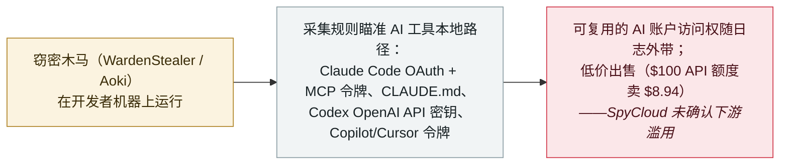

# SpyCloud：窃密软件开始收割 AI 编码工具的令牌与 API 密钥——WardenStealer 与 Aoki 盯上 Claude Code 与 Codex

SpyCloud: infostealers now harvest AI coding-tool tokens and API keys — WardenStealer and Aoki target Claude Code and Codex

      

## 概要

**2026 年 10 月 30 日，SpyCloud（Trevor Hilligoss）报告称：窃密软件如今开始从 AI 编码工具收割凭据，并点名两个家族——WardenStealer 与 Aoki——它们从本地的 Claude Code、Codex、Copilot、Cursor 及桌面 AI 应用中抽取令牌与 API 密钥。** SpyCloud 首次见到 **WardenStealer** 是在 **2026 年 8 月 3 日**,已摄入 **13 万+** 个唯一感染；**Aoki**（一款 Go 窃密木马）于 **2026 年 10 月 4 日** 出现在其回捕数据中（Symantec 于 10 月 15 日发布对 Aoki 的分析）。它们拿走的是**账户访问权与上下文**：Claude Code 的 **OAuth 访问与刷新令牌**、所连 **MCP server** 的令牌、账户配置（用户/机器 ID）与 `CLAUDE.md` 指令文件；Codex 的认证文件（含一个 **OpenAI API 密钥** 及访问/刷新令牌）；Copilot 与 Cursor 的令牌文件；以及桌面应用的 cookie。地下市场随之调整——**标价 $100 的 Codex 或 Claude API 额度只卖 $8.94**、AI 订阅低至 4–6 折、某 Telegram 机器人低至 9.1 折，以及某批发商按 Anthropic/AWS-Bedrock Claude 密钥计费额的 35% 向供货方付费。**SpyCloud 明确表示无法确认这些具体凭据被滥用**（且在售材料未必全部由这些窃密木马取得），故记为 `research` / `CRED` + `EXFIL` / `medium` / `real_harm: false`——这是 2026 年 9 月 8 日 Gen Digital 首次记录的那条趋势的升级。

## 攻击链

## 详情

**SpyCloud 报告了什么。** 2026 年 **10 月 30 日**,SpyCloud 的 Trevor Hilligoss 发表 *《Infostealers now target AI tokens and API keys》*,基于 SpyCloud 对回捕恶意软件日志的遥测，记录了窃密软件家族已把 AI 编码工具纳入采集范围。两大家族是主角：**WardenStealer**,SpyCloud 首次见到是 **2026 年 8 月 3 日**（Gen Digital 将其最早版本定在 5 月初），已摄入 **13 万+** 个唯一感染；以及 **Aoki**,一款基于 **Go** 的 Windows 窃密木马，于 **2026 年 10 月 4 日** 首次出现在 SpyCloud 的回捕数据中——它把窃得的 AI 材料分门别类放进一个专门的 `AISessions` 目录及各工具子目录（Symantec 于 **2026 年 10 月 15 日** 发布自家的 Aoki 分析）。

**被拿走的是访问权与上下文。** 被窃文件是 agent 的本地凭据与状态，而非偏好设置：

- **Claude Code**——OAuth 的**访问与刷新令牌**、所连 **MCP server** 的令牌、账户配置文件（用户与机器标识）、以及 **`CLAUDE.md`** 常驻指令文件。
- **Codex**——认证文件，内含一个 **OpenAI API 密钥** 及访问/刷新令牌（WardenStealer 日志里称为"Codex CLI"）。
- **GitHub Copilot 与 Cursor**——令牌文件（见于 Aoki 日志）。
- **Claude Desktop / ChatGPT 桌面版**——配置、套餐/用量历史、以及 Netscape 格式会话 cookie。

如 SpyCloud 所言，重置密码并不会吊销这些令牌，这正是它们值钱之处。

**市场随之调整。** SpyCloud 展示了买家一侧：一个 **标价 $100 的 Codex API 额度卖 $8.94**（$100 的 Claude API 令牌同价）、一家俄语店铺以 **低于标价 40–60%** 售卖 Claude/ChatGPT/Grok 订阅、一个 Telegram 机器人以 **低至 9.1 折** 提供 OpenAI/Anthropic 访问（$1 起充）、以及一家批发服务按 Anthropic 与 AWS-Bedrock Claude 密钥计费额的 **35%** 付给供货方（OpenAI 为 20%）。

**SpyCloud 自述的边界。** 这是一条能力与市场的趋势，而非具名受害者的泄露。SpyCloud 明确表示它**无法确认在售材料全部由窃密木马取得**,也未记录这两个家族导致的受害凭据被确认滥用（常被引用的 $46,000/天 是 2024 年 Sysdig 的估算；Storm-2139 案发生在 2024 年、涉及被窃的 Azure OpenAI 密钥）。本条保留这些边界。

**如何分级。** `research`——厂商对自身遥测与犯罪市场的分析，而非具名受害者事件。`CRED`（被收割的是**可复用凭据**——OAuth 令牌、MCP 令牌、API 密钥）+ `EXFIL`（这些凭据随窃密日志离开机器）。`real_harm: false`：收割真实且可测量（13 万+ WardenStealer 感染），但 SpyCloud 确认**无与这些家族关联的具体账户被接管**——与本档案的 Gen Digital 记录同一口径。评 `medium`：底层数据（可复用令牌与 MCP 凭据）确实敏感、且趋势单向。可信度 `A`：SpyCloud 自家回捕数据分析，并有 Symantec 的 Aoki 报告（经 Infosecurity Magazine）与 Cyber Security News 独立佐证。`ai_involvement: confirmed`：被瞄准的物证是 AI agent 的凭据与指令文件。这是 Gen Digital（2026 年 9 月 8 日）首次记录的那条趋势的**升级**——如今具体到 AI 编码工具的 OAuth/MCP 令牌与一个有标价的转售市场。

## 来源

| # | 来源 | 链接 |
|---|---|---|
| 1 | SpyCloud（《Infostealers now target AI tokens and API keys》） | <https://spycloud.com/blog/infostealers-now-target-ai-tokens-and-api-keys/> |
| 2 | Infosecurity Magazine（Aoki 窃密木马 / Symantec） | <https://www.infosecurity-magazine.com/news/aoki-infostealer-ai-coding/> |
| 3 | Cyber Security News | <https://cybersecuritynews.com/hackers-use-new-infostealer-malware/> |

## 元数据

| 字段 | 值 |
|---|---|
| 日期 | `2026-10-30`（原始：2026-10-30 SpyCloud 报告；WardenStealer 首见 2026-08-03，Aoki 2026-10-04，精度 `day`） |
| 性质 | 研究／厂商分析 `research` |
| 类型 | [`CRED`](../../../../taxonomy/types.md#cred) [`EXFIL`](../../../../taxonomy/types.md#exfil) |
| 评级 | **中** `medium` |
| 可信度 | **A**——SpyCloud 自家回捕数据分析，并有 Symantec（Aoki）与 Cyber Security News 独立佐证 |
| 真实伤害 | 无——收割真实且可测量，但 SpyCloud 确认无具体的下游账户接管 |
| AI 参与 | 已确认 `confirmed`——被瞄准的物证是 AI agent 的凭据与指令文件 |
| 地区 | [全球](../../../../regions/global.md) |
| 档案 ID | `2026-10-30-spycloud-ai-coding-tool-token-theft` |

**分类理由：** 厂商对自家回捕恶意软件日志与犯罪市场的分析（`research`），显示窃密软件在收割可复用的 AI 编码工具凭据——OAuth/MCP 令牌、API 密钥（`CRED`）——并随窃密日志离开机器（`EXFIL`）。`real_harm: false`：趋势真实且可测量，但 SpyCloud 确认无与这些家族关联的具体账户接管（与 Gen Digital 记录同一口径）。评 `medium`,因数据确实敏感。可信度 `A`——SpyCloud 自家数据加 Symantec 与 Cyber Security News 独立报道。日期取 SpyCloud 发文日（2026 年 10 月 30 日）。分级标准见 [severity.md](../../../../taxonomy/severity.md) 与 [confidence.md](../../../../taxonomy/confidence.md)。

## 相关条目

**专题：** [Agent 基础设施暴露](../../../../topics/agent-infra.md)

**相关记录：**

- `2026-09-08` [窃密软件转向 AI agent 数据：采集规则开始针对 Claude、Cursor 与 Codex](../2026-09/2026-09-08-gen-digital-infostealers-ai-agent-data.md)   同一趋势的首次记录——本条 SpyCloud 报告是其升级（具名家族、OAuth/MCP 令牌、有标价的市场）
- `2026-10-17` [OpenCode Console 被入侵、泄露存储的 AI API 密钥](2026-10-17-opencode-console-breach-api-keys.md)   被窃 AI 凭据转化为具名、计费的滥用之处
- `2026-06-24` [Operation Endgame（Europol）端掉 StealC 与 Amadey](../2026-06/2026-06-24-operation-endgame-europol-stealc.md)   这一行为所依附的商品化窃密市场

---

[← English original](../../../2026-10/2026-10-30-spycloud-ai-coding-tool-token-theft.md) · [2026-10 index](../../../2026-10/README.md) · [All records](../../../README.md) · [Home](../../../../README.md)

本条目属于 **Orca AI Incident Archive**，按 [CC BY 4.0](../../../../LICENSE) 授权。发现事实错误或缺少来源，请[提 issue 或 PR](../../../../CONTRIBUTING.md)——更正会写进条目的修订记录，不会静默覆盖。
