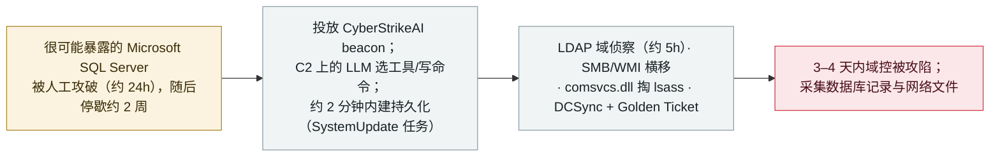

# CyberStrikeAI 实战：LLM 编排的入侵在拉美与非洲教育目标处拿下域管理员

CyberStrikeAI in the wild: an LLM-orchestrated intrusion reaches domain admin at education targets in Latin America and Africa

      

## 概要

**2026 年 11 月 2 日，Kaspersky（新闻稿 + Securelist 报告《CyberStrikeAI in the wild》）记录了拉美与非洲数国教育行业机构遭遇的真实入侵——其后利用阶段由一个 LLM 编排器驱动。** CyberStrikeAI 是一款基于 Go 的开源 AI 渗透测试框架；在这些攻击中，**LLM 跑在攻击者的 C2 服务器上**（选择工具、编写命令、解析结果），而落地主机上的**植入体不含 AI、只负责执行任务**。Kaspersky 还原了其中一例：人工操作者先在约 24 小时内攻破一台很可能暴露在外的 **Microsoft SQL Server**（`sqlservr.exe` 16.0.1000），**停歇约 2 周**，随后投放 CyberStrikeAI beacon——该 beacon 在 **约 2 分钟** 内建立**持久化**（一个名为 `SystemUpdate` 的计划任务）、做 LDAP **域侦察**（约 5 小时）、经 SMB/WMI 横向移动、转储注册表 hive 并**用 comsvcs.dll 掏 lsass**、再以改名的 Mimikatz 执行 **DCSync + Golden Ticket**。**在植入体部署后 3–4 天内域控被攻陷**；最后阶段是数据采集（从 SQL server 取库记录、从网络资源取文件）。Kaspersky **未**将该活动归于任何已知团伙，也无法确认各基础设施背后是同一操作者；脚本中的中文注释、对中文服务（DNSLog.cn）的使用、以及 UTC+8 的重启时间**暗示**是一名中文使用者。记为 `incident` / `WEAPON` + `CRED` / `high` / `real_harm: true`。

## 攻击链

## 详情

**Kaspersky 报告了什么。** 2026 年 **11 月 2 日**，Kaspersky 发布新闻稿与 Securelist 报告 *《CyberStrikeAI in the wild：AI 在针对组织的真实攻击中的使用》*，描述了 **拉美与非洲数国教育行业机构** 遭遇的入侵（未点名具体机构或国家）。**CyberStrikeAI** 是一款基于 Go（Apache-2.0）的开源 AI 渗透测试框架，其维护者称其为合法评估而建；此处却被用于真实攻击。

**架构。** 该设计让模型远离受害端：**LLM 编排器跑在攻击者的 C2 服务器上**——它选择工具、编写命令、分析返回输出——而**落地主机上的植入体不含任何 AI 功能**、只执行收到的任务。人工操作者设定目标；Kaspersky 指出在目标设定处有人工介入，但未量化持续的监督程度。

**还原的入侵过程。** 在一例还原中：

1. **初始访问（人工，约 24h）。** 最早的恶意命令由 `sqlservr.exe`（版本 16.0.1000）发起——Kaspersky 称很可能暴露的 Microsoft SQL Server 为"可能的初始访问途径"。操作者采集了基本系统数据、投放了本地工具（如 RogueWinRM、GodPotato）。
2. **停歇（约 2 周）。** 行动转入沉寂。
3. **beacon + 自主。** 操作者投放 **CyberStrikeAI beacon**,它从 C2 上的 LLM 接收任务。**约 2 分钟** 内即以名为 **`SystemUpdate`** 的计划任务建立**持久化**。
4. **域侦察（约 5h）。** LDAP 查询枚举用户账户、子网与 Azure 凭据。
5. **横移 + 凭据窃取。** 经 SMB 管理共享与 WMI；用 `reg.exe` 转储注册表 hive；经 `comsvcs.dll` 从 `lsass.exe` 提取凭据。拿到域管理员凭据后，以**改名的 Mimikatz** 执行 **DCSync** 与 **Golden Ticket** 攻击。
6. **结果。** **植入体部署后 3–4 天内域控被攻陷**,取得完全的域管理控制。**最后阶段是数据采集**——从该教育机构的 SQL server 查询数据库记录、从网络资源收集文件。（Kaspersky 描述的是*采集*；并未详述向某特定目的地的外部外传，也未给出任何学生/教职工记录数量。）

**归因——措辞谨慎。** Kaspersky 称证据**并未**把该活动与任何已知团伙关联，也不能确定相关各战役背后是同一操作者。PowerShell 脚本中的中文注释、对中文服务（如 DNSLog.cn）的使用、以及 UTC+8 工作时段的重启时间**"暗示存在联系"**,指向一名中文使用者——这是暗示，而非坐实的归因。CyberStrikeAI 此前已有被滥用记录（更早针对 FortiGate、针对日本的报道）；此次针对拉美与非洲教育行业的战役，是 Kaspersky 记录的一个不同案例。

**如何分级。** `incident`——真实、经取证还原的入侵，而非演示。`WEAPON`（一个 AI 框架端到端编排攻击行动）+ `CRED`（确认的是**凭据窃取与完全的域控接管**——lsass 转储、DCSync、Golden Ticket；报告描述了数据"采集"但未确认对具名记录的外部外传，故为 `CRED` 而非 `EXFIL`）。`real_harm: true`：真实教育机构的**域控沦陷与凭据窃取已确认**。评 `high` 而非 critical：攻陷真实，但 Kaspersky 未点名受害方、未量化数据损失、未报告关键基础设施影响。可信度 `A`：Kaspersky 自家的 Securelist 取证报告与新闻稿，辅以独立报道。`ai_involvement: confirmed`：LLM-on-C2 编排正是该技术的核心所在。

## 来源

| # | 来源 | 链接 |
|---|---|---|
| 1 | Securelist / Kaspersky（《CyberStrikeAI in the wild》） | <https://securelist.com/cyberstrikeai-attacks/121715/> |
| 2 | Kaspersky 新闻稿 | <https://www.kaspersky.com/about/press-releases/kaspersky-uncovers-ai-driven-attacks-on-educational-organizations-in-latin-america-and-africa> |
| 3 | Security Online | <https://securityonline.info/cyberstrikeai-framework-attacks> |

## 元数据

| 字段 | 值 |
|---|---|
| 日期 | `2026-11-02`（原始：2026-11-02 Kaspersky 新闻稿 / Securelist 报告；入侵观察于 2026 年 9–10 月，精度 `day`） |
| 性质 | 真实事件 `incident` |
| 类型 | [`WEAPON`](../../../../taxonomy/types.md#weapon) [`CRED`](../../../../taxonomy/types.md#cred) |
| 评级 | **高** `high` |
| 可信度 | **A**——Kaspersky 自家 Securelist 取证报告 + 新闻稿，辅以独立报道 |
| 真实伤害 | 有——真实教育机构的域控沦陷与凭据窃取已确认 |
| AI 参与 | 已确认 `confirmed`——LLM-on-C2 编排是核心技术 |
| 地区 | [全球](../../../../regions/global.md) |
| 档案 ID | `2026-11-02-cyberstrikeai-education-latam-africa` |

**分类理由：** 一场经取证还原的真实入侵，由 AI 框架（CyberStrikeAI）端到端编排（`WEAPON`）、经凭据窃取实现域控接管（`CRED`——lsass/DCSync/Golden Ticket；未确认对具名记录的外部外传，故非 `EXFIL`），故 `real_harm: true`。评 `high` 非 critical：攻陷已确认，但未点名受害方、未给数据损失数字、未报告关键基础设施影响。地区取 `GLOBAL`——目标横跨拉美与非洲且无具名国家（分类法无非洲代码）。`confirmed` 的 AI 参与来自 LLM-on-C2 设计。对中文使用者的归因是"暗示"而非坐实。分级标准见 [severity.md](../../../../taxonomy/severity.md) 与 [confidence.md](../../../../taxonomy/confidence.md)。

## 相关条目

**专题：** [攻击型 AI（被攻击者使用的 agent）](../../../../topics/offensive-ai.md)

**相关记录：**

- `2026-11-05` ["自动驾驶式黑客"：Check Point 的 ARTEX 犯罪取证](2026-11-05-artex-hacking-on-autopilot-cybercrime.md)   另一款被用于偏自主犯罪的开源 AI 渗透框架
- `2026-11-04` ["BOSSAI"：单人操作者的 12-agent AI 攻击网](2026-11-04-bossai-ai-attack-mesh-taiwan-emergency.md)   另一场 LLM 编排的真实入侵战役
- `2026-09-22` [Carbonato：一个基于 Docker 的 Hermes Agent 僵尸网络](../2026-09/2026-09-22-carbonato-docker-hermes-agent-botnet.md)   另一款被规模化运营的攻击型 AI 框架

---

[← English original](../../../2026-11/2026-11-02-cyberstrikeai-education-latam-africa.md) · [2026-11 index](../../../2026-11/README.md) · [All records](../../../README.md) · [Home](../../../../README.md)

本条目属于 **Orca AI Incident Archive**，按 [CC BY 4.0](../../../../LICENSE) 授权。发现事实错误或缺少来源，请[提 issue 或 PR](../../../../CONTRIBUTING.md)——更正会写进条目的修订记录，不会静默覆盖。
