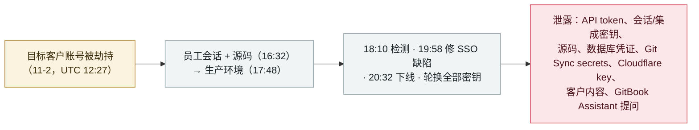

# GitBook 披露一起归因于 AI agents 的定向攻击，基础设施与客户凭证遭泄露

GitBook discloses a targeted breach it attributes to AI agents, exposing infrastructure and customer credentials

      

## 概要

**2026 年 11 月 2 日，文档平台 GitBook 遭入侵，官方称其为"一场使用 AI agents 的高度定向攻击"，并于 11 月 3 日披露。** 据 GitBook 自己的事后复盘：攻击者于 UTC 12:27 劫持了某目标客户的账号，16:32 拿到员工会话与源码，17:48 进入生产环境；GitBook 18:10 检测到、19:58 修复一处 SSO 缺陷、20:32 主动下线，轮换全部密钥后约 16 小时恢复。可能被泄露的包括：GitBook API token、集成与会话签名密钥、内部**源码**、基础设施密钥、数据库凭证、Git Sync secrets、一个 **Cloudflare API key**、客户内容、各客户授予的仓库访问权，以及**访客向 GitBook Assistant 提出的问题**；密码、账单、IP 未泄。GitBook 强制客户轮换全部 token 并**重新认证 GitBook MCP server**。PancakeSwap 把文档迁离 GitBook。"AI agents"的归因是 GitBook **从攻击者"速度与精度"推断**而来，并非取证确认——故 `ai_involvement: unverified`。记为 `incident` / `CRED` + `INFRA` / `high` / `real_harm: true`。

## 攻击链

## 详情

**发生了什么。** GitBook——一个被大量软件与加密货币项目使用的文档平台——于 **2026 年 11 月 3 日** 发布安全通告，称其"成为一场使用 AI agents 的高度定向攻击的目标"。其事后复盘给出 **11 月 2 日** 的逐分钟时间线（UTC）：**12:27** 某目标客户的账号被劫持；**16:32** 攻击者拿到员工会话、继而源码；**17:48** 进入生产环境；**18:10** 内部告警、开始调查；**19:58** 修复一处 SSO 缺陷；**20:32** 禁用被攻陷账号、GitBook 主动下线。**11 月 3 日**：**02:34** 用新密钥重新部署（作废此前的 API token）；**11:56** 完成全部密钥轮换、经约 16 小时停机后恢复上线；**22:51** 轮换 Git Sync 所用的 GitLab token。GitBook 称攻击者在 11 月 2 日晚持有生产访问约 2 小时 45 分，11 月 3 日凌晨约 40 分钟。

**泄露了什么。** 据 GitBook，可能被访问的数据包括：GitBook API token；集成 token 与密钥；会话签名密钥；使用鉴权访问的文档站点；各客户授予 GitBook 的 GitHub/GitLab 访问（仅限这些仓库）；客户内容如 docs、spaces、变更请求；内部源码、基础设施密钥、数据库凭证、Git Sync secrets，以及一个 **Cloudflare API key**；还有 **"访客向 GitBook Assistant 提出的问题"**。GitBook 表示账单信息、密码、IP 地址 **未** 被攻陷，且未发现其他客户的内容被篡改。

**关于"AI agents"的说法。** GitBook 把 AI agent 的参与定性为 **从攻击者行为做出的推断**，而非取证结论：复盘称攻击者"以一种速度与精度移动，指向一场主要由自动化和 AI 驱动的攻击"。GitBook 描述的入口是某目标客户处的 **SSO 缺陷 + 账号劫持**——不是 GitBook 自家的 AI 产品。由于 AI 归因依据的是观察到的速度而非恢复到的工具，本记录采用 `ai_involvement: unverified`（且**不**主张 GitBook 的 AI Assistant 或 MCP server 是入口——它们只作为*被暴露的面*出现：Assistant 的提问在可能被读取的数据之列，客户须重新认证 MCP server）。

**处置与客户须做。** GitBook 作废全部个人 API token，轮换所有生产与 GitBook 托管的客户密钥（含 Git Sync 与 GitLab 密钥），回收预发/生产节点，撤销被攻陷服务账号的操作，并封堵被利用路径。它要求客户：创建新 API token、轮换第三方 token 与集成密钥、重新生成鉴权访问签名密钥、**重新认证 GitBook MCP server**、重连 Git Sync/GitLab，并在环境中排查攻击者 IP `94.183.188.91`、`45.139.84.195`、`198.251.83.217`。下游方面，**PancakeSwap** 先下线文档、随后将其迁离 GitBook（称其 App 未受影响），**TradeXYZ** 在调查期间提醒用户勿点其文档中的链接。

**如何分级。** `incident`——有第一方确认的真实已披露入侵。`CRED`（定义性损失是凭证/密钥——API token、集成/会话密钥、数据库凭证、一个 Cloudflare key）+ `INFRA`（GitBook 是众多 AI/开发/加密项目的共享文档基础设施，且其 AI Assistant 与 MCP server 在波及范围内）。`real_harm: true`：源码、基础设施密钥与客户密钥被暴露，迫使全量轮换，且至少一家大客户迁走。评 `high` 而非 critical：生产访问被控制在约 3 小时、未发现内容被篡改、密码/账单/IP 未泄。`ai_involvement: unverified`：GitBook 的 AI agent 归因来自攻击速度而非恢复到的工具。可信度 `A`：详尽的第一方复盘，Decrypt 与 ForkLog 佐证。

## 来源

| # | 来源 | 链接 |
|---|---|---|
| 1 | GitBook（官方安全事件通告与复盘） | <https://www.gitbook.com/status/security-incident-2026-11-03> |
| 2 | Decrypt | <https://decrypt.co/382465/crypto-docs-gitbook-ai-agent-security-breach> |
| 3 | ForkLog | <https://forklog.com/en/hackers-breach-gitbook-using-ai-agents/> |

## 元数据

| 字段 | 值 |
|---|---|
| 日期 | `2026-11-02`（原始：2026-11-02 入侵；2026-11-03 披露，精度 `day`） |
| 性质 | 真实事件 `incident` |
| 类型 | [`CRED`](../../../../taxonomy/types.md#cred) [`INFRA`](../../../../taxonomy/types.md#infra) |
| 评级 | **高** `high` |
| 可信度 | **A**——第一方 GitBook 复盘 + Decrypt + ForkLog |
| 真实伤害 | 有——源码、基础设施密钥、一个 Cloudflare key 与客户密钥被暴露；迫使全量轮换；PancakeSwap 迁走 |
| AI 参与 | 未经证实 `unverified`——GitBook 从攻击者速度/精度推断 AI agent，而非来自恢复到的工具 |
| 地区 | [全球](../../../../regions/global.md) |
| 档案 ID | `2026-11-02-gitbook-ai-agent-breach` |

**分类理由：** 一起有第一方确认、针对共享文档基础设施的入侵，定义性损失是凭证与密钥（`CRED` + `INFRA`）。记 `real_harm: true`，因源码、基础设施密钥、一个 Cloudflare API key 与客户密钥被暴露，迫使全量轮换且至少一家客户迁走。评 `high` 非 critical：生产访问约 3 小时被控制、无内容篡改、密码/账单/IP 安全。`ai_involvement: unverified`，因 GitBook 的 AI agent 归因是从攻击速度推断、非取证结论。分级标准见 [severity.md](../../../../taxonomy/severity.md) 与 [confidence.md](../../../../taxonomy/confidence.md)。

## 相关条目

**专题：** [agent 基础设施暴露（INFRA）](../../../../topics/agent-infra.md)

**相关记录：**

- `2026-10-30` [《Black October》：一场协同攻击在一个月内攻破至少九家 AI 开发平台、收割可解锁 AI 的凭证](../2026-10/2026-10-30-black-october-ai-developer-platform-breaches.md)   同一个月针对 AI/开发平台基础设施、以窃取存储凭证为目标的模式
- `2026-10-27` [Warp 披露第三方供应商被攻破，泄露了 AI agent 决策日志与用户遥测](../2026-10/2026-10-27-warp-vendor-breach-agent-logs.md)   同一波中披露的另一起 AI 工具厂商入侵
- `2026-10-17` [OpenCode Console 被攻破，泄露用户存储的 AI 提供方 API 密钥](../2026-10/2026-10-17-opencode-console-breach-api-keys.md)   一起针对 AI 开发平台的凭证收割入侵

---

[← English original](../../../2026-11/2026-11-02-gitbook-ai-agent-breach.md) · [2026-11 index](../../../2026-11/README.md) · [All records](../../../README.md) · [Home](../../../../README.md)

本条目属于 **Orca AI Incident Archive**，按 [CC BY 4.0](../../../../LICENSE) 授权。发现事实错误或缺少来源，请[提 issue 或 PR](../../../../CONTRIBUTING.md)——更正会写进条目的修订记录，不会静默覆盖。
