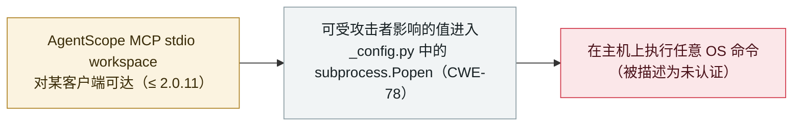

# AgentScope MCP Workspace API：未认证的 OS 命令注入（CVE-2026-123022）

AgentScope MCP Workspace API: unauthenticated OS command injection (CVE-2026-123022)

      

## 概要

**CVE-2026-123022 于 2026 年 11 月 5 日发布，是 **AgentScope**（一款开源多 agent 框架）的 MCP Workspace API 中的一个 OS 命令注入缺陷（CWE-78），各漏洞库将其描述为**未认证的进程执行**。** 该 workspace 组件把一个可受攻击者影响的值传给 `subprocess.Popen`（位于 `_config.py`），因此对暴露在外的 AgentScope MCP stdio workspace 发出的远程请求即可在主机上执行任意 OS 命令。受影响版本涵盖至 **2.0.11**（标注为 2.0.0–2.0.11；另一来源收窄为 2.0.4–2.0.11）；修复为 `agentscope-ai/agentscope` 上的 **PR #3448**。严重度评级存在分歧——**CVSS v3.1 7.3（高）**、CVSS v4.0 6.9，某厂商（Red Hat）标为 Critical——且记录时 **NVD 条目仍为"Deferred"**、**无官方 GitHub 安全公告（GHSA）**,故可信度取 `B` 而非 `A`。它不同于更早的 AgentScope 代码注入问题（CVE-2026-6603，位于 `execute_shell_command`/`execute_python_code` ≤1.0.18）与授权缺陷 CVE-2026-123023。无确认的在野利用。记为 `vulnerability` / `INFRA` + `MCP` / `high` / `real_harm: false`。

## 攻击链

## 详情

**缺陷本身。** **CVE-2026-123022**（发布于 **2026 年 11 月 5 日**）是 **AgentScope**（一款开源多 agent 框架）的 **MCP Workspace API** 中的一个 **OS 命令注入**（CWE-78；同列 CWE-77）。该 workspace 组件把攻击者可影响的值——命令参数——传入 `_config.py` 中的 **`subprocess.Popen`**,从而可在主机上执行任意 OS 命令。公开漏洞库与所引用的公告文件把该问题描述为针对暴露的 AgentScope MCP stdio workspace 的 **"未认证进程执行"**,即暴露的 workspace 面无需认证即可触达脆弱路径。

**受影响版本与修复。** 该缺陷影响至 **2.0.11** 及更早（标注为 2.0.0–2.0.11；某库将下界收窄至 2.0.4）。修复记为 `agentscope-ai/agentscope` 上的 **PR #3448**。打补丁前，运营方应**禁用或限制对 MCP Workspace API 的外部访问**,切勿将其暴露到不可信网络。

**如实记录的注意事项。** 严重度评级并不一致——**CVSS v3.1 7.3（高）**、**CVSS v4.0 6.9（中）**,而 **Red Hat 标为 Critical**。记录时 **NVD 条目标为"Deferred"**（官方 NVD 分析未完成），且**无官方 GitHub 安全公告（GHSA）**——最详尽的说明是某个人仓库里的文件，而非厂商发布的公告。正因这些缺口，本条取 **可信度 `B`** 而非 `A`——尽管该 CVE 已由 MITRE 分配、且有具体代码修复支撑。它与 AgentScope 更早的代码注入 CVE（如 **CVE-2026-6603**,位于 `execute_shell_command`/`execute_python_code`,版本 ≤1.0.18）以及单独的授权缺陷 **CVE-2026-123023**（2.0.9 修复）是**不同**的问题。

**如何分级。** `vulnerability`——一个披露的缺陷，而非已被用于实战的事件。`INFRA`（AgentScope 是 **agent 运行时基础设施**——一个多 agent 框架）与 `MCP`（脆弱面是其 **MCP Workspace API**）。`real_harm: false`：未见在野利用的报告。评 `high` 而非 critical：本档案的严重度反映"已经发生了什么",故一个无已知利用、且依赖 MCP workspace 被暴露的未认证 RCE 级缺陷在此记为 `high`（与 Loom for AWS 同一口径）。可信度 `B`：MITRE 已分配 CVE、有具体修复（PR #3448），但 NVD 分析为"Deferred"、无官方 GHSA、且严重度评分互相矛盾。`ai_involvement: confirmed`：脆弱组件是一个 AI agent 框架的 MCP workspace。

## 来源

| # | 来源 | 链接 |
|---|---|---|
| 1 | NVD — CVE-2026-123022 | <https://nvd.nist.gov/vuln/detail/CVE-2026-123022> |
| 2 | AgentScope — 修复（PR #3448） | <https://github.com/agentscope-ai/agentscope/pull/3448> |
| 3 | OpenCVE — CVE-2026-123022 | <https://app.opencve.io/cve/CVE-2026-123022> |

## 元数据

| 字段 | 值 |
|---|---|
| 日期 | `2026-11-05`（原始：2026-11-05 CVE-2026-123022 发布；NVD 分析"Deferred"；修复见 AgentScope PR #3448，精度 `day`） |
| 性质 | 漏洞披露 `vulnerability` |
| 类型 | [`INFRA`](../../../../taxonomy/types.md#infra) [`MCP`](../../../../taxonomy/types.md#mcp) |
| 评级 | **高** `high` |
| 可信度 | **B**——MITRE 已分配 CVE、有具体修复（PR #3448），但 NVD "Deferred"、无官方 GHSA、严重度评分互相矛盾 |
| 真实伤害 | 无——未见在野利用 |
| AI 参与 | 已确认 `confirmed`——脆弱组件是 AI agent 框架的 MCP workspace |
| 地区 | [全球](../../../../regions/global.md) |
| 档案 ID | `2026-11-05-agentscope-mcp-command-injection-cve-2026-123022` |

**分类理由：** AgentScope 多 agent 框架的 MCP Workspace API 中一个披露的 OS 命令注入缺陷（`INFRA`——agent 运行时基础设施；`MCP`——MCP workspace 面）。`vulnerability` 而非事件。`real_harm: false`——无已知利用。评 `high` 非 critical：严重度记录"已发生之事",一个无在野利用、且依赖暴露的未认证 RCE 级缺陷在此记为 `high`（与 Loom for AWS 相同）。可信度取 `B`（非 `A`）：NVD 分析为"Deferred"、无官方 GHSA、且严重度评级不一致（7.3 高 vs. Red Hat "Critical"）。分级标准见 [severity.md](../../../../taxonomy/severity.md) 与 [confidence.md](../../../../taxonomy/confidence.md)。

## 相关条目

**专题：** [Agent 基础设施暴露（INFRA）](../../../../topics/agent-infra.md)

**相关记录：**

- `2026-10-02` [Loom for AWS：缺失认证让任意客户端取得超级管理员（CVE-2026-103956）](../2026-10/2026-10-02-loom-aws-agent-control-plane-cve-2026-103956.md)   另一个暴露的控制面无需认证的 agent 平台缺陷
- `2026-09-14` [Bifrost AI 网关（CVE-2026-90898）](../2026-09/2026-09-14-bifrost-ai-gateway-cve-2026-90898.md)   另一处 AI agent 基础设施弱点
- `2025-06-13` [Smithery.ai MCP 服务器路径穿越](../2025-06/2025-06-13-smithery-ai-lu-jing-chuan-yue.md)   更早的一处 MCP 面漏洞

---

[← English original](../../../2026-11/2026-11-05-agentscope-mcp-command-injection-cve-2026-123022.md) · [2026-11 index](../../../2026-11/README.md) · [All records](../../../README.md) · [Home](../../../../README.md)

本条目属于 **Orca AI Incident Archive**，按 [CC BY 4.0](../../../../LICENSE) 授权。发现事实错误或缺少来源，请[提 issue 或 PR](../../../../CONTRIBUTING.md)——更正会写进条目的修订记录，不会静默覆盖。
