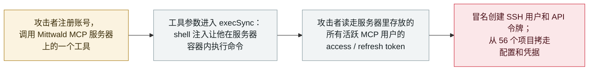

# 德国主机商 Mittwald 因自家 MCP 服务器的 shell 注入漏洞被入侵，56 个客户项目被攻陷

German host Mittwald breached through a shell-injection flaw in its own MCP server; 56 customer projects compromised

       

## 概要

**2026 年 11 月 7 日，德国主机商 Mittwald 披露：有攻击者通过其 MCP 服务器的一个漏洞侵入了平台。该 MCP 服务器用于让客户把 Claude、ChatGPT 等 AI 助手接到 mStudio 主机管理面板上。** 在 11 月 25 日发布的复盘中，Mittwald 指出漏洞是服务器某个工具里的 shell 注入：工具调用的 `comment` 和 `passphrase` 参数被直接拼进命令行，再用 `execSync` 执行，攻击者由此可在服务器容器内执行任意命令。MCP 服务器随时持有所有活跃用户的有效 access token 和 refresh token，于是攻击者读走了这些令牌（包括 Mittwald 员工的），再用它们冒名创建 SSH 用户和 API 令牌，并从项目里拷走配置文件和凭据。攻击者 10 月 21 日首次试探该漏洞，10 月 27 日起加以利用，11 月 4 日被发现；Mittwald 关停了 MCP 服务器、吊销全部令牌，并在 11 月 5 日至 7 日暂停了 mStudio 登录和 SSH 访问。它把 56 个项目定为已被攻陷，并认定其中有数据流出。凡是用过 MCP 服务器的人都受影响，他们账号能访问的项目也在内。Mittwald 表示，这个 MCP 服务器大部分是用 AI 编码 agent 写的，出问题的代码来自测试场景，未被察觉就进了生产路径。11 月 9 日起攻击者卷土重来，并在 11 月 12 日夜间利用 Neos CMS 一个此前未知的漏洞攻入了 mittwald.de。Mittwald 根据日志里步骤之间只隔几秒，推断攻击者使用了 AI 工具；The Record 指出除此之外它没有给出别的证据。

## 攻击链

## 详情

**这个 MCP 服务器是干什么的。** Mittwald 的 MCP 服务器让客户把 mStudio 面板接到 AI 助手上，然后用聊天的方式建项目、装应用、管理 SSH 访问。客户用 OAuth2 登录 MCP 服务器；服务器拿到 Mittwald API 的 access token 和 refresh token，把两者都存在会话存储里；助手调用工具时，服务器就用这个令牌以客户的名义去调 API。部分工具是对 Mittwald 命令行客户端的封装。复盘里点出的关键后果是：MCP 服务器随时持有所有活跃用户的有效令牌。

**漏洞本身。** 有一个工具用模板字符串把工具调用里的 `comment` 和 `passphrase` 参数拼成命令行，再用 `execSync` 执行，而 `execSync` 会把整串内容交给 shell。谁调用工具，谁就能随意指定这两个参数，所以写在 comment 里的命令替换会在原本要跑的 `ssh-keygen` 启动之前先被执行。复盘说，临时文件名 `mcp-eval-key` 暗示这段代码出自测试场景，后来不知不觉进了生产路径；该项目也没有配置能把“`execSync` 里拼变量”标为错误的静态分析。

**Mittwald 自己对“为什么会上线”的解释。** 公司表示，MCP 服务器大部分是用 AI 编码 agent 写的，这是有意为之，想在一个变化很快的领域尽早积累 agentic 工作流的经验。当时针对 agent 所写代码的评审做法和护栏还不如现在成熟；agent 写的代码通常看起来合理、注释干净、套路熟悉，评审时就容易只看功能，而不逐行看它在上下文里是否安全。Mittwald 同时说明，同样的错误人也会犯，认真评审本应发现它。现在公司对 agent 所写代码有强制的评审规则。

**第一阶段时间线。** 2026 年 10 月 21 日首次试探，当晚业界大多在忙 PHP2Shell 漏洞。10 月 23 日起，攻击者以普通用户身份在平台上活动，注册测试账号、做简单的注入尝试。10 月 27 日 14:58，攻击者又注册了一个账号，15:03 利用了 MCP 漏洞。11 月 4 日上午 Mittwald 发现异常行为，11:11 封禁攻击者的第一个账号，确认 MCP 服务器是入口并将其关停。11 月 5 日先停了新用户注册，随后停了 mStudio 登录和客户项目的 SSH 访问；两者于 11 月 7 日恢复。公司请了外部取证专家，并通报了主管部门。

**拿走了什么、谁受影响。** 攻击者用这些令牌在 mStudio 里冒名创建 SSH 用户和 API 令牌，并从项目里拷走配置文件和凭据。Mittwald 说，凡是用过 MCP 服务器的人都受影响，他们账号能访问的项目也在内，哪怕项目所有者自己从没用过 MCP 服务器。其中 56 个项目有攻击者实际操作的证据；Mittwald 把它们定为已被攻陷，认定有数据流出，已封锁并做了取证。第一阶段里攻击者还想通过扩展 webhook 的另一个漏洞进入 Mittwald 内部系统，没有成功。

**第二阶段。** 11 月 9 日起，攻击者寻找新的入口，包括 mStudio 里的一次性账号、通过旧版客户中心管理的主机账号，以及客户网站里有漏洞的插件。11 月 12 日夜间，攻击者利用了 mittwald.de 所用 Neos 内容管理系统的一个零日：底层 Flow 框架在检查请求方是否登录之前就处理了文件上传，而扩展名黑名单又放过了 `.phar` 文件，于是可以上传 webshell。攻击者读走了网站的配置和数据库。Mittwald 在 webshell 第一次被调用后不久就发现了，11 月 12 日至 13 日再次暂停登录，并称 Neos 自 11 月 13 日起已有安全更新。MCP 服务器目前仍然下线。

**“攻击者用了 AI”只是推断。** Mittwald 写道，各步骤之间有时只隔几秒，许多操作并行进行，因此它认为攻击者使用了 AI 工具。The Record 报道说，Mittwald 没有给出 AI 参与的其他证据，被问到如何区分 AI 工具和传统脚本时也没有回应。本条记录的 `ai_involvement: confirmed` 指的是攻击面，即 Mittwald 自己确认的 MCP 服务器；它不依赖关于攻击者工具的那个说法。

**如何定级。** `incident`：当事公司披露并确认的入侵，客户项目被攻陷。`MCP`：漏洞就在 MCP 服务器自己的工具里；`CRED`：攻击者从服务器拿走的是用户令牌；`EXFIL`：配置文件和凭据被拷出项目，Mittwald 认定 56 个被攻陷项目有数据流出。评 `high`：一家主机商经由面向 agent 的接口被攻破，客户环境确认受损，但项目数量有限，且没有证据表明内部系统被触及。

## 来源

| # | 来源 | 链接 |
|---|---|---|
| 1 | Mittwald 事件通报（Robert Meyer，2026-11-07，德文） | <https://www.mittwald.de/blog/mittwald/sicherheitsvorfall-am-mcp-server> |
| 2 | Mittwald 复盘报告（Martin Helmich，2026-11-25，德文） | <https://www.mittwald.de/blog/mittwald/postmortem-wie-ein-angreifer-ueber-unseren-mcp-server-und-neos-eindrang> |
| 3 | The Record | <https://therecord.media/cyberattack-germany-ai-mittwald> |
| 4 | webhosting.today | <https://webhosting.today/2026/11/09/mittwald-traces-a-breach-of-56-customer-projects-to-its-mcp-server/> |

## 元数据

| 字段 | 值 |
|---|---|
| 日期 | `2026-11-07`（原始：2026-11-07 Mittwald 事件通报；漏洞于 2026-10-21 首次被试探，2026-10-27 起被利用，2026-11-04 被发现；复盘报告发布于 2026-11-25，精度 `day`） |
| 性质 | 真实事件 `incident` |
| 类型 | [`MCP`](../../../../taxonomy/types.md#mcp) [`CRED`](../../../../taxonomy/types.md#cred) [`EXFIL`](../../../../taxonomy/types.md#exfil) |
| 评级 | **高** `high` |
| 可信度 | **A**——Mittwald 自己的事件通报和详细复盘；The Record 与 webhosting.today 据此报道 |
| 真实伤害 | 有——56 个客户项目被定为已攻陷；用户令牌被读取并滥用；配置文件和凭据被拷走 |
| AI 参与 | 已确认 `confirmed`——入口是 Mittwald 自己确认的 MCP 服务器；“攻击者使用 AI 工具”是 Mittwald 根据操作速度做的推断，未获证实 |
| 地区 | [欧洲](../../../../regions/eu.md) |
| 档案 ID | `2026-11-07-mittwald-mcp-server-breach` |

**分类理由：** 当事公司确认的入侵：入口是自家 MCP 服务器某个工具的漏洞（`MCP`），服务器替用户保管的令牌被读取并滥用（`CRED`），项目数据被拷走（`EXFIL`），故为 `incident`、`real_harm: true`。评 `high`：主机商的客户环境经由面向 agent 的接口被攻陷，范围限定在 56 个项目。`confidence: A`：当事方一手披露并附技术复盘。“攻击者使用 AI”已标为推断，定级不依赖它。 分级标准见 [severity.md](../../../../taxonomy/severity.md) 与 [confidence.md](../../../../taxonomy/confidence.md)。

## 相关条目

**专题：** [agent 供应链投毒（SUPPLY + MCP）](../../../../topics/agent-supply-chain.md) · [agent 基础设施暴露（INFRA）](../../../../topics/agent-infra.md)

**相关记录：**

- `2026-11-10` [Chainstack：ARTEX 驱动的入侵利用了一台未设认证、拥有集群管理员权限的内部 MCP 工具服务器](2026-11-10-chainstack-artex-unauthenticated-mcp-server.md)   同一时期、同一教训：权限过大的 MCP 服务器成了攻击者的抓手
- `2026-10-19` [OpenCode：恶意 MCP 服务器可在 OAuth 登录时于开发者机器上执行代码](../2026-10/2026-10-19-opencode-mcp-oauth-rce.md)   另一个出在 OAuth 与令牌路径上的 MCP 漏洞，发生在客户端一侧
- `2026-11-05` [AgentScope：MCP stdio 命令注入（CVE-2026-123022）](2026-11-05-agentscope-mcp-command-injection-cve-2026-123022.md)   同一类缺陷：经 MCP 路径的命令注入，早两天以 CVE 形式披露

---

[← English original](../../../2026-11/2026-11-07-mittwald-mcp-server-breach.md) · [2026-11 index](../../../2026-11/README.md) · [All records](../../../README.md) · [Home](../../../../README.md)

本条目属于 **Orca AI Incident Archive**，按 [CC BY 4.0](../../../../LICENSE) 授权。发现事实错误或缺少来源，请[提 issue 或 PR](../../../../CONTRIBUTING.md)——更正会写进条目的修订记录，不会静默覆盖。
