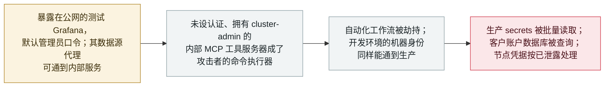

# Chainstack：ARTEX 驱动的入侵借一台未设认证、拥有集群管理员权限的内部 MCP 工具服务器打进生产环境

Chainstack: an ARTEX-driven intrusion used an unauthenticated internal MCP tool server with cluster-admin rights to reach production

        

## 概要

**2026 年 11 月 10 日，区块链基础设施服务商 Chainstack 为其 11 月 3 日首发的事件报告补充了技术细节，描述了一起入侵；它以高置信度判断攻击者用的是 ARTEX，一款编排 LLM agent、把入侵自动化的开源框架。** 攻击者 10 月 26 日从开发 Kubernetes 集群里一个暴露在公网、仍是默认管理员口令的测试 Grafana 实例进入，再借 Grafana 的数据源代理访问内部服务。其中一个是内部的 MCP 工具服务器，它把 Kubernetes 操作开放给 AI agent 使用：不需要任何认证，且以绑定了 cluster-admin 的服务账号运行；Chainstack 说它成了攻击者的命令执行器。攻击者在开发环境拿到了同样能通到生产的机器凭据，10 月 29 日列出并读取了一个生产集群的 secrets，10 月 31 日又从生产云密钥管理服务里批量读取 secrets，用一把被盗的 VPN 密钥接入数据库网络，并查询了生产数据库。一个存有客户账户信息的数据库被访问：机构名称、账户持有人姓名、成员邮箱和密码哈希可能已泄露；存放节点凭据的系统也在其可达范围内，因此 Chainstack 要求客户修改密码、轮换节点凭据和 API 密钥。Chainstack 于 10 月 31 日发现入侵并在当天切断了访问路径。它没有发现任何软件漏洞被利用的证据：整条链靠的是默认口令、暴露的管理功能、缺失的认证、过宽的权限和长期有效的凭据。Chainstack 归因的是工具，不是攻击者身份。

## 攻击链

## 详情

**初始入口。** 2026 年 7 月，一个测试用 Grafana 实例被部署到开发 Kubernetes 集群。它可以从公网访问，前面没有单点登录或基础认证，默认管理员口令也从未改过。10 月 26 日 19:26（UTC）起，攻击者登录后新建指向内部地址的数据源，把 Grafana 的数据源代理当跳板，在约两小时内连上了数十个内部服务，包括身份、数据库、自动化和监控端点。代理没有目的地址白名单，也没有网络策略限制 Grafana 能连到哪里。

**MCP 工具服务器。** 21:01，攻击者连到一台内部 MCP 工具服务器，它把 Kubernetes 操作开放给 AI agent 使用。这台服务器不需要认证，且以绑定了 cluster-admin 的服务账号运行。Chainstack 说，从网络流量、这些权限和之后发生的变更来看，它充当了攻击者的命令执行器；具体的每次工具调用已无法还原。接下来一个半小时里，攻击者测试了对内部工作流引擎的写权限，在开发环境的身份提供方里创建了管理员用户，并通过 ConfigMap 卷把自己提供的文件挂载覆盖到原文件上，替换了一个开发 Web 应用对外提供的 JavaScript。10 月 27 日，同样的手法被用到预发 Web 应用和开发 Grafana 上；注入的加载器指向一个二阶段脚本，Chainstack 没有取到该脚本。

**从开发到生产。** 10 月 29 日，攻击者直接在工作流自动化平台的数据库里改写了一个工作流，让它执行 shell 命令，用一个有效的 webhook 令牌触发，然后恢复原样。这次运行返回了自动化 pod 的环境变量、它的 Kubernetes 服务账号令牌，以及基础设施访问网关的一个机器身份。随后这个身份和另一个属于部署自动化的身份被用来列出某生产 Kubernetes 集群的 secrets，并读取了其中几项，包括云和基础设施凭据。10 月 31 日，攻击者用基础设施即代码自动化所用云服务账号的一把密钥，在 01:40 到 08:31 之间从生产云密钥管理服务批量读取 secrets，又新建了密钥和一个 Kubernetes 服务账号作为独立的回连通道，在生产环境运行短命 pod 和特权 pod，并向访问网关注册了伪造实例。

**数据库访问与发现。** 被读走的 secrets 里有数据库网络上一个 VPN 对端的私钥。攻击者使用它时，两个客户端出示了同一个对端身份，隧道端点在两者之间来回切换，一条数据库复制管线因此失败；调查就是从这次失败开始的。约 07:30 起，攻击者从自己创建的 pod 里以管理员用户连上一个生产数据库，把查询结果分成 base64 小块经 pod 命令输出带走，并在一个实例上查询了存放角色密码哈希的视图。另外，攻击者还用 BI 工具的 API key 跑 SQL 查询，读取了其中保存的连接信息。Chainstack 于 10 月 31 日切断了访问路径；部分被拷走的外部服务凭据在轮换前仍然有效，最后一次被观察到使用是 11 月 2 日 06:28。

**泄露了什么。** 一个存有客户账户信息的数据库：机构名称、账户持有人姓名、机构成员的邮箱地址和密码哈希可能已泄露。存放节点凭据的系统在攻击者可达范围内；Chainstack 没有证据显示它们被读取，但按已泄露处理。客户节点、控制台和 API 没有被改动；公司不保存支付卡信息。客户被要求修改密码、轮换节点凭据、重新生成平台 API 密钥，并提防钓鱼。

**Chainstack 为什么点名 ARTEX。** 攻击者创建的资源一律带 `artx` / `artex` 前缀，常跟数字后缀，出现在工作流名、身份、pod、服务账号、一个 systemd 定时器和 DNS 验证记录里。Chainstack 以高置信度判断攻击者用了 ARTEX，并说明这个结论针对的是工具：它的指标没有出现在已知使用该框架的具名团伙各自公布的指标里，所以它归因的是工具，而不是攻击者身份。它还表示，调查结果显示这起事件属于 10 月下旬被报道的一波更大规模的 AI 驱动攻击。没有外部机构独立核实过这份叙述；GovInfoSecurity 和 EconoTimes 是根据 Chainstack 的页面报道的，Wiz 把 Chainstack“默认口令的 Grafana”列为该波攻击的入口之一。

**如何定级。** `incident`：当事公司确认的入侵，客户数据被访问。`WEAPON`：攻击者用的工具是 agent 框架；`MCP`：关键一步是一台未设认证却带 cluster-admin 权限的 MCP 工具服务器；`CRED`：入侵靠一路收割机器身份、密钥和 secrets 推进；`EXFIL`：数据库查询结果离开了环境。评 `high`：一家基础设施服务商的生产 secrets 被批量读取、客户账户数据被访问，但没有证据显示面向客户的服务被改动。

## 来源

| # | 来源 | 链接 |
|---|---|---|
| 1 | Chainstack 事件报告（2026-11-03 创建，2026-11-10 补充技术细节） | <https://chainstack.com/security-incident-nov-2026/> |
| 2 | GovInfoSecurity | <https://www.govinfosecurity.com/cryptohack-roundup-chainstack-luxors-ai-breaches-a-33445> |
| 3 | EconoTimes | <https://econotimes.com/Chainstack-Breach-May-Have-Exposed-Customer-Account-Data-1776115> |
| 4 | Wiz Research（把 Chainstack 列为该波攻击的受害方之一） | <https://www.wiz.io/blog/agentic-attacks-artex-offensive-ai-frameworks> |

## 元数据

| 字段 | 值 |
|---|---|
| 日期 | `2026-11-10`（原始：2026-11-10 Chainstack 为其 2026-11-03 首发的事件报告补充技术细节；入侵发生于 2026-10-26 至 2026-10-31，被拷走的凭据最后一次使用是 2026-11-02，精度 `day`） |
| 性质 | 真实事件 `incident` |
| 类型 | [`WEAPON`](../../../../taxonomy/types.md#weapon) [`MCP`](../../../../taxonomy/types.md#mcp) [`CRED`](../../../../taxonomy/types.md#cred) [`EXFIL`](../../../../taxonomy/types.md#exfil) |
| 评级 | **高** `high` |
| 可信度 | **A**——Chainstack 自己的事件报告，含详细技术时间线和指标；GovInfoSecurity 与 EconoTimes 据此报道；Wiz 把它列入该波攻击的受害方 |
| 真实伤害 | 有——客户账户数据库被查询；生产 secrets 被批量读取；节点凭据按已泄露处理并轮换 |
| AI 参与 | 已确认 `confirmed`——Chainstack 依据攻击者痕迹中遍布的 `artx` / `artex` 标记，以高置信度判断使用了 ARTEX；这是它自己对工具的判断，不涉及攻击者身份 |
| 地区 | [全球](../../../../regions/global.md) |
| 档案 ID | `2026-11-10-chainstack-artex-unauthenticated-mcp-server` |

**分类理由：** 当事公司确认的入侵：攻击者的工具是 agent 框架（`WEAPON`），关键一步是一台未设认证、带 cluster-admin 权限的 MCP 工具服务器（`MCP`），入侵靠收割身份和 secrets 推进（`CRED`），数据库结果被带走（`EXFIL`），故为 `incident`、`real_harm: true`。评 `high`：基础设施服务商的生产 secrets 和客户账户数据受影响，面向客户的服务未被改动。`confidence: A`：当事方一手报告并附技术时间线；ARTEX 这一判断是公司自己的高置信度评估，已如实标注。 分级标准见 [severity.md](../../../../taxonomy/severity.md) 与 [confidence.md](../../../../taxonomy/confidence.md)。

## 相关条目

**专题：** [攻击方 AI 能力演进（WEAPON）](../../../../topics/offensive-ai.md) · [agent 供应链投毒（SUPPLY + MCP）](../../../../topics/agent-supply-chain.md)

**相关记录：**

- `2026-11-07` [德国主机商 Mittwald 因自家 MCP 服务器的 shell 注入漏洞被入侵](2026-11-07-mittwald-mcp-server-breach.md)   同一时期：另一家服务商，同样是自家 MCP 服务器成了入口
- `2026-10-30` [Black October：一场协同攻击攻破至少九家 AI 开发平台](../2026-10/2026-10-30-black-october-ai-developer-platform-breaches.md)   Chainstack 称其事件所属的 10 月下旬那波攻击
- `2026-11-06` [WorkOS 将一起客户数据泄露追溯到某安全研究者逃逸的 ARTEX AI agent](2026-11-06-workos-escaped-artex-agent-breach.md)   同一周另一家靠自家日志里的标记识别出 ARTEX 的公司

---

[← English original](../../../2026-11/2026-11-10-chainstack-artex-unauthenticated-mcp-server.md) · [2026-11 index](../../../2026-11/README.md) · [All records](../../../README.md) · [Home](../../../../README.md)

本条目属于 **Orca AI Incident Archive**，按 [CC BY 4.0](../../../../LICENSE) 授权。发现事实错误或缺少来源，请[提 issue 或 PR](../../../../CONTRIBUTING.md)——更正会写进条目的修订记录，不会静默覆盖。
