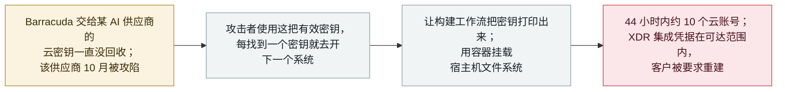

# Barracuda：一起与 ARTEX 特征吻合的入侵，靠留在某 AI 供应商处的过期未回收密钥，44 小时内横穿约 10 个云账号

Barracuda: an ARTEX-matched intrusion crossed about 10 cloud accounts in 44 hours through a stale key left with an AI vendor

      

## 概要

**2026 年 11 月 11 日，安全厂商 Barracuda 公布了自家部分云环境被入侵的经过，称攻击者的探测名称、各项指标、行动顺序以及内置的凭据和钱包搜寻例程全都与 ARTEX 吻合。ARTEX 是一款开源的 AI 驱动渗透测试框架。** 攻击者没有利用漏洞：它用的是一把有效的云访问密钥，这把密钥是 Barracuda 以前为某个项目交给一家第三方供应商（一家做 AI 的公司）的，项目结束后一直没有回收。该供应商自己的开发环境在 10 月被攻陷，密钥看来就是在那里被找到的。11 月 1 日 04:33（UTC），攻击者用这把密钥发出第一次调用；之后 24 小时里，它每找到一个密钥就拿去打开下一个系统：从云账号到一个数据分析系统，再到一个源码访问令牌，再到 Kubernetes 集群。11 月 2 日凌晨，它向少数几个仓库推送短命分支，触发一个专门把构建系统密钥打印到任务日志里的构建工作流，并对密钥做了编码以绕过日志脱敏。最后一次有记录的活动是 11 月 2 日 23:31（UTC）：约 44 小时内碰了约 10 个云账号。它还部署了一个挂载宿主机文件系统的容器来收割凭据，并试图给自己新建一个云管理员身份，这一步被拦下。11 月 4 日，一名工程师注意到异常活动，此时攻击者早已收工。它触及的系统之一存放着 Barracuda XDR 用来从客户系统采集数据的凭据；Barracuda 没有发现这些凭据被查看的直接证据，但也无法排除，于是请可能受影响的客户重建凭据。Barracuda 归因的是攻击者的作业方式，不是其身份。

## 攻击链

## 详情

**事情怎么开始的。** Barracuda 说，攻击者不是破门而入，而是用了一把有效的云访问密钥。在以前的一个项目里，公司把一把云访问密钥交给了一家第三方供应商（一家做 AI 的公司），项目结束后没有回收；博文直言这是 Barracuda 自己的责任。10 月，这家供应商自己的开发环境被攻陷，攻击者看来就是在那里找到了这把密钥。供应商名字没有公布。

**Barracuda 观察到了什么。** 以下均为 UTC 时间。11 月 1 日 04:33，攻击者用该密钥发出第一次调用，几分钟内就在摸清这把密钥能到哪里，并读取存放的密钥，例如 AWS access key 和 Azure 服务主体密钥。之后 24 小时，它每拿到一个密钥就去开下一个系统：从云账号到一个数据分析系统，从那里到一个源码访问令牌，再到 Kubernetes 集群。11 月 2 日凌晨，它用不到四小时向少数几个仓库推送短命分支，触发一个专门把构建系统密钥打印进任务日志的构建工作流，密钥经过编码，日志原有的脱敏因此失效。最后一次有记录的活动在 11 月 2 日 23:31。攻击者总共在约 44 小时内碰了约 10 个云账号。

**Barracuda 为什么说是 ARTEX。** 攻击者用机器风格的标签指代资源：字母 i 后面跟数字。Barracuda 说，探测名称、它收集到的其他指标、攻击者在各系统间推进的顺序，以及其内置的凭据和钱包搜寻例程，全部与 ARTEX 吻合。ARTEX 是 2026 年 7 月发布的开源 AI 驱动渗透测试框架，由一个 planner agent 决定下一步，由 worker agent 运行常用工具。由于很多团伙都在用 ARTEX，Barracuda 表示这种吻合只说明攻击者怎么作业，不说明它是谁。这一识别是 Barracuda 自己做出的，没有经过独立核实。

**攻击者想要什么。** 到处找凭据和密钥：读密钥存储，解密基础设施即代码的状态文件，从服务器元数据服务和 Kubernetes 服务账号里取凭据。在拿到 shell 的服务器上，它的命令会搜索名为 WALLET、MNEMONIC、SEED、PRIV 的环境变量，以及以太坊 keystore 文件、扩展私钥和助记词文件；那些机器上并没有钱包材料。Barracuda 还提到，攻击者够得着的密钥里有一部分是 AI 服务的凭据，它借道的那家供应商本身就是 AI 公司，因此不能排除 AI 凭据和算力也是目标之一。它把这条攻击链与 10 月 Railway 遭遇的入侵相比较。

**持久化、发现与客户。** 攻击者利用对某个 Kubernetes 集群的访问权限，部署了一个以只读方式挂载底层服务器文件系统的容器，这已足够收割该服务器的凭据；它还试图新建一个云管理员身份，被拦下。11 月 4 日，一名工程师注意到自己账号上有异常活动；同一天，那家供应商也就自身事件联系了 Barracuda。当晚容器被移除，所有涉及系统的凭据随后全部轮换。攻击者到过的系统之一，存放着 Barracuda XDR 用于从客户已接入系统采集数据的凭据。Barracuda 没有发现这些凭据被查看的直接证据，但那里的日志不够细，无法排除，所以它把攻击者可达范围内的所有凭据都按可能泄露处理，并联系了 Managed XDR Cloud 或 Monitored Endpoint 集成凭据可能受影响的客户，请他们吊销并重建。

**如何定级。** `incident`：当事公司披露的入侵，附时间线和客户公告。`WEAPON`：按 Barracuda 的说法，攻击者的工具是 agent 框架；`CRED`：整起入侵靠的是一把没回收的密钥和由它一路收割来的密钥，受到威胁的也是客户的集成凭据。`real_harm: true`：约 10 个云账号、源码仓库、构建系统和 Kubernetes 集群被访问，密钥被读取。评 `high`：一家安全厂商的云环境被攻陷、客户凭据落入可达范围，但没有证据显示这些凭据被使用。

## 来源

| # | 来源 | 链接 |
|---|---|---|
| 1 | Barracuda 博客（CISO Arve Kjoelen）：Forty-four hours | <https://blog.barracuda.com/2026/11/11/anatomy-of-a-machine-speed-intrusion> |
| 2 | BleepingComputer | <https://www.bleepingcomputer.com/news/security/barracuda-links-cloud-breach-to-artex-ai-powered-cyberattack/> |
| 3 | SecurityWeek | <https://www.securityweek.com/barracuda-hacked-amid-surge-in-artex-powered-cyberattacks/> |

## 元数据

| 字段 | 值 |
|---|---|
| 日期 | `2026-11-11`（原始：2026-11-11 Barracuda 博文；Trust Center 公告发布于 2026-11-10；入侵从 2026-11-01 04:33 UTC 持续到 2026-11-02 23:31 UTC，2026-11-04 被发现，精度 `day`） |
| 性质 | 真实事件 `incident` |
| 类型 | [`WEAPON`](../../../../taxonomy/types.md#weapon) [`CRED`](../../../../taxonomy/types.md#cred) |
| 评级 | **高** `high` |
| 可信度 | **A**——Barracuda 自己的说明，由其 CISO 署名，附时间线和客户公告；BleepingComputer 与 SecurityWeek 据此报道；供应商未具名，ARTEX 吻合一说未经独立核实 |
| 真实伤害 | 有——约 10 个云账号、源码仓库、构建系统和 Kubernetes 集群被访问，密钥被读取；客户的 XDR 集成凭据落入可达范围，已作为预防措施轮换 |
| AI 参与 | 已确认 `confirmed`——Barracuda 称攻击者的探测名称、指标、行动顺序以及凭据和钱包搜寻例程全都与 ARTEX 吻合；这是它自己对工具的识别，不涉及攻击者身份 |
| 地区 | [美国](../../../../regions/us.md) |
| 档案 ID | `2026-11-11-barracuda-artex-stale-ai-vendor-key` |

**分类理由：** 当事公司披露的入侵：按其自述，攻击者的工具是 agent 框架（`WEAPON`），每一步靠的都是一把没回收的第三方密钥和由它串起来的密钥（`CRED`），故为 `incident`、`real_harm: true`。评 `high`：一家安全厂商的云环境在不到两天内被横穿，客户集成凭据落入可达范围，但没有证据显示它们被使用。`confidence: A`：当事方一手披露；ARTEX 这一识别是 Barracuda 自己做出的，已如实标注。 分级标准见 [severity.md](../../../../taxonomy/severity.md) 与 [confidence.md](../../../../taxonomy/confidence.md)。

## 相关条目

**专题：** [攻击方 AI 能力演进（WEAPON）](../../../../topics/offensive-ai.md) · [agent 基础设施暴露（INFRA）](../../../../topics/agent-infra.md)

**相关记录：**

- `2026-10-30` [Black October：一场协同攻击攻破至少九家 AI 开发平台](../2026-10/2026-10-30-black-october-ai-developer-platform-breaches.md)   Barracuda 博文所指的 10 月那波攻击，其中包括它拿来对比的 Railway 入侵
- `2026-11-10` [Chainstack：ARTEX 驱动的入侵借未设认证的 MCP 工具服务器打进生产环境](2026-11-10-chainstack-artex-unauthenticated-mcp-server.md)   同一时期另一起由当事公司披露的 ARTEX 入侵，同样靠串联凭据而非利用漏洞
- `2026-10-21` [微软将 ConnectWise 供应链入侵归因于用 ARTEX 驱动攻击的 Storm-0940](../2026-10/2026-10-21-storm-0940-artex-connectwise-supply-chain.md)   更早的一起 ARTEX 入侵，同样经由供应商关系进入

---

[← English original](../../../2026-11/2026-11-11-barracuda-artex-stale-ai-vendor-key.md) · [2026-11 index](../../../2026-11/README.md) · [All records](../../../README.md) · [Home](../../../../README.md)

本条目属于 **Orca AI Incident Archive**，按 [CC BY 4.0](../../../../LICENSE) 授权。发现事实错误或缺少来源，请[提 issue 或 PR](../../../../CONTRIBUTING.md)——更正会写进条目的修订记录，不会静默覆盖。
