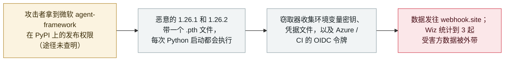

# 微软 agent-framework 的 PyPI 包被劫持，植入针对 Azure 和 CI 流水线的凭据窃取器

Microsoft's agent-framework PyPI package is hijacked to ship a credential stealer aimed at Azure and CI pipelines

      

## 概要

**2026 年 11 月 17 日，微软官方用于构建 AI agent 的 Python 包 `agent-framework` 有两个恶意版本被发布到 PyPI，其中加入了凭据窃取器。** 1.26.1 于 20:35 UTC 出现，1.26.2 约 21:08 UTC 出现；约 21:30 UTC 两者均已下架，最后一个安全版本是 1.26.0。该包月下载量约 19 万到 20 万。两个版本都会在 site-packages 里放一个 `.pth` 文件，因此只要 Python 解释器启动，窃取器就会运行，哪怕从未导入这个包。它收集名字像密钥的环境变量（含 Azure、AWS、GitHub、OpenAI、Hugging Face 等字样），收集 Azure CLI 状态、`.npmrc`、`.git-credentials`、Docker 配置等凭据文件，读取其他进程环境里的密钥，并尝试签发 Azure 托管身份、Azure DevOps 和 GitHub Actions 的 OIDC 令牌；全部内容发往同一个 webhook.site 地址。Wiz 能读到攻击者那个免费档 webhook，统计到 50 条留存请求，其中 17 条对应 3 起互不相同、成功外带受害方数据的案例。Wiz 报告称，攻击者似乎拿到了微软内部发布流水线（ESRP）的客户端证书和私钥，且攻击者的工具自称 Cairn（一款开源 AI 渗透测试框架）。StepSecurity 指出，当天项目新增了一个维护者账号，第二个恶意版本是在 PyPI 隔离第一个之后上传的。微软没有发布公告；其发言人对 The Register 表示，调查恶意内容期间已把部分仓库设为私有。发布凭据是如何被拿到的，目前不清楚。

## 攻击链

## 详情

**发布了什么、什么时候。** `agent-framework` 是微软用于构建 AI agent 并把它们编排进工作流的 Python 框架。正常的 1.26.0 发布于 2026 年 11 月 12 日。11 月 17 日 20:35 UTC，恶意的 1.26.1 被上传；约 21:08 UTC，第二个恶意版本 1.26.2 被上传；到约 21:30 UTC，两者在 PyPI 上都已不可获取。StepSecurity 记录到：11 月 17 日有一个名为 `vibiret` 的维护者账号被创建并加入项目；1.26.1 只上传了 wheel、没有来源证明；第二个版本是在第一个被隔离之后上传的。下载量方面，OX Security 给的是每月 192,534 次，Wiz 给的是每周约 4.1 万次，BleepingComputer 给的是每月约 20 万次。

**载荷怎么跑起来。** 1.26.1 会把 `agent_framework_meta.pth` 放进 site-packages 根目录。Python 每次解释器启动都会执行 `.pth` 文件里的 import 行，所以无论是否导入这个包，该环境里每个 Python 进程都会运行窃取器。由于该版本依赖的是真正的 `agent-framework-core` 1.26.0，框架本身照常工作。代码会 fork 到独立会话，设一个标记环境变量保证每棵进程树只触发一次，文件名和函数名都伪装成 SDK 遥测。1.26.2 是重新打包的版本，触发方式不同（`af_runtime_diag.pth` 加一个新的顶层模块），所以只按 1.26.1 的文件名去搜会漏掉它。

**它收集什么。** 名字里含 TOKEN、SECRET、PASSWORD、KEY、AZURE、AWS、GITHUB、OPENAI、HF_、FOUNDRY 等字样的环境变量；最多 300 个其他进程环境里像密钥的值；最多 60 个凭据文件（Azure CLI 状态、`.npmrc`、`pip.conf`、`.netrc`、`.git-credentials`、Docker 配置、Hugging Face 令牌、Azure DevOps agent 凭据，以及 `/app`、`/workspace` 下的 `.env` 和 JSON 文件）；流水线变量存在时的 Azure DevOps OIDC 令牌；以及面向 ARM、Graph、Key Vault、Storage 等十来种资源的 Azure 托管身份令牌。1.26.2 又加上了在带 `id-token: write` 的工作流里窃取 GitHub Actions OIDC 令牌、更多变量名和 GitHub 托管 runner 的路径。所有内容压缩、编码后，用一次 HTTPS POST 发到写死的 webhook.site 地址，没有备用通道，也不重试。

**是什么限制了损害。** 攻击者用的是未绑定账号的免费档 webhook.site 地址，这种地址最多接收 100 条请求，7 天后过期。Wiz 确认该令牌属于免费档，最多被记录了 50 条请求。其中 4 条来自攻击者自己的机器，29 条看上去来自沙箱、厂商扫描器和测试，剩下 17 条对应 3 起互不相同、成功外带受害方数据的案例。这些请求里仍可能含有可用的云、CI 和制品库凭据。

**攻击者如何拿到发布权限，说法不一。** Wiz 报告称，攻击者似乎拿到了微软 ESRP（用于签名和发布该包的内部服务）的客户端证书和私钥；第一次从 AWS 发起的发布被 ESRP 的 IP 过滤拒绝，第二次从微软自有 IP 段发起则成功。The Register 的报道指向微软 GitHub 组织里一个被攻陷的管理员账号，OX Security 的说法是攻击者似乎找到了劫持 wheel 构建流程的办法。微软没有发布公告或复盘；它给 The Register 的声明只说调查恶意内容期间已把部分仓库设为私有。凭据是怎么被拿到的，目前不清楚。

**攻击者用的工具。** Wiz 之所以能看到部分操作过程，是因为攻击者的工具把自己的进度也上报到了用于外带数据的那个公开 webhook。该工具自称 Cairn：它把包暂存在 `/tmp/cairn_pkg`，并发送了一个名为 `CAIRN_ESRP_PROBE2` 的连通性探测。发布之前，攻击者在自己机器上跑过一次窃取器，那次运行抓到了一份 AI 编码 agent 的配置，看上去是开源 Pi harness 搭配一个 GLM 系列模型。这只是 Wiz 一家的观察，微软没有确认。

**如何定级。** `incident`：恶意代码经由大厂的官方包分发，并在真实主机上运行。`SUPPLY`：攻击落在 agent 开发者的依赖链上；`CRED`：载荷取走的是密钥和令牌。`real_harm: true`：依据 Wiz 统计的 3 起成功外带。评 `high`：官方 agent 框架被植入木马、可用凭据离开了受害环境，但暴露窗口不到一小时，已确认的受害数量很少。

## 来源

| # | 来源 | 链接 |
|---|---|---|
| 1 | Wiz Research（时间线、根因、外带数据分析） | <https://www.wiz.io/blog/malicious-version-of-microsofts-agent-framework-published-to-pypi> |
| 2 | OX Security（载荷分析） | <https://www.ox.security/blog/breaking-hijacked-releases-of-microsofts-official-agent-framework-steals-azure-and-ci-credentials/> |
| 3 | StepSecurity（发布与维护者时间线） | <https://www.stepsecurity.io/blog/microsoft-agent-framework-pypi-package-compromised> |
| 4 | The Register（含微软声明） | <https://www.theregister.com/security/2026/11/18/microsofts-official-python-agent-framework-hijacked-to-distribute-malware/5310858> |
| 5 | BleepingComputer | <https://www.bleepingcomputer.com/news/security/microsofts-agent-framework-pypi-package-compromised-to-steal-credentials/> |

## 元数据

| 字段 | 值 |
|---|---|
| 日期 | `2026-11-17`（原始：2026-11-17 恶意版本 agent-framework 1.26.1 于 20:35 UTC 发布，1.26.2 约 21:08 UTC 发布；约 21:30 UTC 两者均已下架；Wiz 于 2026-11-18 更新根因，精度 `day`） |
| 性质 | 真实事件 `incident` |
| 类型 | [`SUPPLY`](../../../../taxonomy/types.md#supply) [`CRED`](../../../../taxonomy/types.md#cred) |
| 评级 | **高** `high` |
| 可信度 | **A**——对已发布制品的多份独立技术分析（Wiz、OX Security、StepSecurity，另有 BleepingComputer 报道），以及微软给 The Register 的声明；微软未发公告 |
| 真实伤害 | 有——Wiz 从攻击者的 webhook 中统计到 3 起互不相同、成功外带受害方数据的案例 |
| AI 参与 | 已确认 `confirmed`——被植入木马的是微软官方的 AI agent 构建框架；Wiz 另报告攻击者的工具自称 Cairn agent 框架 |
| 地区 | [全球](../../../../regions/global.md) |
| 档案 ID | `2026-11-17-microsoft-agent-framework-pypi-hijack` |

**分类理由：** 官方 agent 框架的恶意版本在真实主机上运行（`incident`）：攻击落在 agent 开发者的依赖链上（`SUPPLY`），取走的是密钥和令牌（`CRED`），已统计到 3 起成功外带，故 `real_harm: true`。评 `high`：大厂的 agent 包被植入木马，但窗口不到一小时、webhook 有容量上限。`confidence: A`：多份独立分析针对同一批公开制品，在载荷和时间线上一致；拿到发布权限的途径各家说法不同，已按“未定”记录。 分级标准见 [severity.md](../../../../taxonomy/severity.md) 与 [confidence.md](../../../../taxonomy/confidence.md)。

## 相关条目

**专题：** [agent 供应链投毒（SUPPLY + MCP）](../../../../topics/agent-supply-chain.md)

**相关记录：**

- `2026-10-21` [LiteLLM 1.107.0 被投毒：恶意 PyPI/Docker 构建植入凭据窃取器](../2026-10/2026-10-21-litellm-1-107-supply-chain-compromise.md)   上个月 PyPI 上另一起 AI 工具包被植入木马，目的同样是收割凭据
- `2026-10-08` [Tensorlake 的 npm SDK 被投毒：专门收割 agent 凭据与配置](../2026-10/2026-10-08-tensorlake-npm-sdk-compromise.md)   npm 侧的同类事件：借 agent SDK 收集 agent 凭据
- `2026-11-20` [Amazon：某中国关联攻击者的 Cairn AI agent 自行发现并利用 MONAI Label 零日漏洞](2026-11-20-cairn-agents-monai-label-zero-day.md)   11 月另一份报告，攻击者的工具同样是 Cairn 框架

---

[← English original](../../../2026-11/2026-11-17-microsoft-agent-framework-pypi-hijack.md) · [2026-11 index](../../../2026-11/README.md) · [All records](../../../README.md) · [Home](../../../../README.md)

本条目属于 **Orca AI Incident Archive**，按 [CC BY 4.0](../../../../LICENSE) 授权。发现事实错误或缺少来源，请[提 issue 或 PR](../../../../CONTRIBUTING.md)——更正会写进条目的修订记录，不会静默覆盖。
