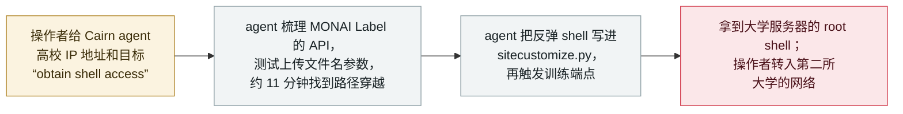

# Amazon：某中国关联攻击者的 Cairn AI agent 自行发现并利用 MONAI Label 零日漏洞，拿下一所大学服务器的 root

Amazon: a China-nexus actor's Cairn AI agents found and exploited a MONAI Label zero-day on their own to root a university server

     

## 概要

**2026 年 11 月 20 日，Amazon Threat Intelligence 披露：某中国关联攻击者运行的自主 AI agent 自行发现了开源医学影像 AI 应用 MONAI Label 中一个此前未知的漏洞，并用它完全控制了一所大学的服务器。** Amazon 于 2026 年 9 月 10 日发现该操作者的 Cairn 实例（一款开源自主 AI 渗透测试框架）未设认证、暴露在公网，提示词、项目配置和 AI 输出任何人可读。战役自 9 月 8 日起持续约 48 小时，目标是中国大陆以外东亚地区高校的 IP 地址，下达的目标是“obtain shell access”（拿到 shell）的各种变体。针对 MONAI Label 服务器，agent 先梳理 API，再对上传端点的文件名参数测试路径穿越，约 11 分钟就做到任意文件写入；在之后的一次会话中，它们把 Python 反弹 shell 写进 `sitecustomize.py`，触发训练端点，拿到以 root 运行的 shell。Amazon 以高置信度判断该漏洞为零日。随后操作者给 agent 提供了一个通往第二所大学网络的代理，代理所连的服务器运行同一软件，Amazon 推断它也是被同一漏洞攻陷的。另有两次行动失败：对一台开放的 Redis 服务器用了约 16 小时、148 步操作；对一台 GPU 服务器尝试了 3 万多组凭据。维护者于 11 月 18 日发布公告 GHSA-qc22-rmgc-vg94（影响 0.8.5 及以下版本，0.8.6 修复）；CISA 于 11 月 23 日把 CVE-2026-133968 列入已知被利用漏洞目录。“中国关联”是 Amazon 中等置信度的判断；受害方未具名，也未提到数据被窃。

## 攻击链

## 详情

**Amazon 是怎么看到的。** 2026 年 9 月 10 日，Amazon Threat Intelligence 发现一台服务器上公开托管着一个未设认证的 Cairn 实例。操作者没有关门，整段操作历史都看得到：项目配置、操作者的提示词和 AI 输出。提示词用简体中文写成，执行脚本里的时间戳设为中国标准时间。战役从 2026 年 9 月 8 日起约 48 小时内，针对中国大陆以外东亚地区高校的相关 IP 地址。操作者只给了一份 IP 列表和“拿到 shell”这一目标的各种变体；agent 自己规划、执行、调整，操作者并不逐步指挥。

**零日漏洞。** 针对一台运行 MONAI Label 的服务器，agent 识别出框架、梳理了 API 端点，找到一个带文件名参数的上传端点。它们对该参数测试路径穿越，结果可行：按 Amazon 的说法，从梳理 API 到在服务器上任意写文件，约 11 分钟。在之后的一次会话里，agent 用同一漏洞把 Python 反弹 shell 载荷写进 `sitecustomize.py`（Python 解释器启动时会自动导入的文件），再调用训练 API 端点拉起新的 Python 进程，新进程导入载荷，建立了以 root 运行的反弹 shell。Amazon 表示，当时没有任何公告、修复、issue 或漏洞库条目与之对应，并以高置信度判断它是零日。

**维护者和 CISA 公布了什么。** MONAI Label 公告 GHSA-qc22-rmgc-vg94（2026 年 11 月 18 日发布，维护者评为 Critical，致谢 Amazon 的漏洞披露项目）描述了漏洞：`PUT /datastore/image` 端点把调用方可控的 `image` 查询参数未经校验直接当作图像 ID，传入 `../../../tmp/x` 之类的值，就能把上传内容写到进程有写权限的任意位置；`PUT /datastore/label` 以同样方式拼接目标路径。受影响版本为 0.8.5 及以下，0.8.6 修复。CISA 目录为该漏洞列出 CVE-2026-133968，于 2026 年 11 月 23 日列入，整改期限为 11 月 26 日。

**失败的几次行动。** 耗时最长的一次针对一台允许未认证访问的 Redis 实例，约 16 小时、148 步连续操作：agent 尝试了滥用主从复制、逃逸脚本沙箱、写配置文件、内存破坏，对同主机另一服务尝试了 Log4Shell，又通过同机 Qdrant 实例的 SSRF 漏洞摸清了内部 Docker 网络拓扑，并对 PostgreSQL、SSH 等服务做了凭据喷洒，全部未成功。另一次针对某大学 GPU 服务器，持续 6 个多小时：agent 从教师名录、实验室网站、网页存档和论文里整理出约 80 个真实用户名，再对 SSH 和该校其他系统尝试了 3 万多组凭据，没有找到可用登录。

**人在哪里介入。** agent 找到零日之后，操作者提供了一个通往第二所大学网络的代理。代理背后的服务器运行同一款有漏洞的软件；Amazon 推断（而非直接观察到）操作者已用该零日攻陷了它。随后操作者指挥 agent 去打该网络里的其他机器。

**尚未确认的部分。** “中国关联”是 Amazon 中等置信度的判断，依据是提示词语言、脚本时区和目标选择。受影响高校未具名；它们不是 AWS 客户，由政府合作方代为通知。Amazon 没有描述数据被取走。驱动 agent 的模型未点名。整个叙述基于 Amazon 对那台暴露实例的解读；SecurityWeek 和 The Register 是转述 Amazon 的文章，并非独立取得材料。

**如何定级。** `incident`：针对真实机构的真实入侵，来自攻击者自己的控制台，并有维护者公告和 CISA 目录条目印证漏洞及其被利用。`WEAPON`：有人类操作者故意把 agent 框架对准目标。`high`：已确认完全控制一台服务器、推断第二台被攻陷，但未报告数据丢失或业务影响，所以不评 `critical`。标为里程碑条目，是因为漏洞是 agent 在行动中自己找到的，而不是拿现成的已知 exploit 去打。

## 来源

| # | 来源 | 链接 |
|---|---|---|
| 1 | Amazon Threat Intelligence（AWS 安全博客，CJ Moses） | <https://aws.amazon.com/blogs/security/chinese-nexus-actors-cairn-ai-agents-found-a-zero-day-on-their-own/> |
| 2 | MONAI Label 安全公告 GHSA-qc22-rmgc-vg94 | <https://github.com/Project-MONAI/MONAILabel/security/advisories/GHSA-qc22-rmgc-vg94> |
| 3 | CISA 已知被利用漏洞目录（CVE-2026-133968，2026-11-23 列入） | <https://www.cisa.gov/known-exploited-vulnerabilities-catalog?field_cve=CVE-2026-133968> |
| 4 | SecurityWeek | <https://www.securityweek.com/amazon-china-linked-hackers-ai-agents-exploited-medical-software-zero-day/> |
| 5 | The Register | <https://www.theregister.com/security/2026/11/20/china-attackers-deployed-ai-agents-that-autonomously-found-and-exploited-a-0-day-to-take-over-a-university-server/5311382> |

## 元数据

| 字段 | 值 |
|---|---|
| 日期 | `2026-11-20`（原始：2026-11-20 Amazon Threat Intelligence 发文；战役发生于 2026-09-08 至 2026-09-10；MONAI Label 公告 GHSA-qc22-rmgc-vg94 发布于 2026-11-18；CVE-2026-133968 于 2026-11-23 列入 CISA KEV，精度 `day`） |
| 性质 | 真实事件 `incident` |
| 类型 | [`WEAPON`](../../../../taxonomy/types.md#weapon) |
| 评级 | **高** `high` |
| 可信度 | **A**——Amazon Threat Intelligence 基于攻击者暴露控制台的自述报告，加上维护者公告和 CISA 目录条目；SecurityWeek 与 The Register 为转述 |
| 真实伤害 | 有——一台大学服务器被拿到 root shell；推断第二所大学的服务器也被攻陷；未提及数据丢失 |
| AI 参与 | 已确认 `confirmed`——Amazon 在操作者未设认证的 Cairn 实例中直接读到了 agent 的提示词、操作和输出 |
| 地区 | [亚太](../../../../regions/apac.md) |
| 档案 ID | `2026-11-20-cairn-agents-monai-label-zero-day` |

**分类理由：** 一起真实入侵：操作者把自主 agent 对准目标（`WEAPON`），agent 自己找到并利用了未知漏洞，且有维护者公告和 CISA KEV 条目印证，故为 `incident`、`real_harm: true`。评 `high` 而非 `critical`：完全控制一台服务器、推断第二台，未报告数据丢失。`confidence: A`：厂商一手威胁情报报告，并有公告和目录佐证；归属为中等置信度、第二次攻陷为推断，均已如实标注。 分级标准见 [severity.md](../../../../taxonomy/severity.md) 与 [confidence.md](../../../../taxonomy/confidence.md)。

## 相关条目

**专题：** [攻击方 AI 能力演进（WEAPON）](../../../../topics/offensive-ai.md)

**相关记录：**

- `2026-11-12` [Unit 42：CL-STA-1238 用 Cairn 对至少 19 家机构自主执行了 25 次行动](2026-11-12-unit42-cl-sta-1238-cairn-campaign.md)   同一时期另一场中国关联的 Cairn 战役，早八天披露
- `2026-10-27` [攻击者在野劫持暴露的 Cairn AI-agent 面板](../2026-10/2026-10-27-cairn-exposed-agent-panels-hijacked.md)   同一框架，方向相反：暴露的 Cairn 面板被第三方接管
- `2026-09-22` [Gambit：三个 AI harness 从在线零售商窃取 60 万条信用卡记录](../2026-09/2026-09-22-gambit-ai-agent-retail-card-theft.md)   Amazon 文中引用的另一攻击者：出于牟利目的使用 Cairn

---

[← English original](../../../2026-11/2026-11-20-cairn-agents-monai-label-zero-day.md) · [2026-11 index](../../../2026-11/README.md) · [All records](../../../README.md) · [Home](../../../../README.md)

本条目属于 **Orca AI Incident Archive**，按 [CC BY 4.0](../../../../LICENSE) 授权。发现事实错误或缺少来源，请[提 issue 或 PR](../../../../CONTRIBUTING.md)——更正会写进条目的修订记录，不会静默覆盖。
