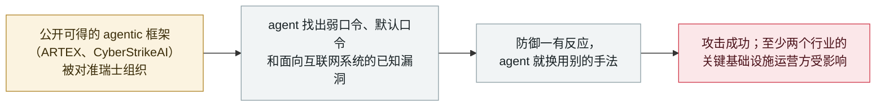

# 瑞士 NCSC 确认首批成功的 AI agent 网络攻击，包括针对关键基础设施运营方的攻击

Switzerland's NCSC confirms its first successful AI-agent cyberattacks, including on critical-infrastructure operators

     

## 概要

**2026 年 11 月 24 日，瑞士国家网络安全中心（NCSC）表示，已首次收到针对瑞士组织的、有 AI agent 协助实施的网络攻击报告，受影响的有组织以及至少两个行业的关键基础设施运营方。** NCSC 称，在它已知的所有此类攻击中，使用 AI agent 都导致受害方 IT 系统被成功攻陷；攻击者使用的是所谓“agentic 攻击框架”，这类工具能自行搜寻漏洞、选择攻击工具、评估结果并规划下一步。它点名 ARTEX 和 CyberStrikeAI 作为公开可得 agent 的例子，并称这类 agent 的数量自 2026 年 10 月以来几乎翻了一倍。攻击利用的是容易猜到的口令或默认口令，以及面向互联网系统的已知漏洞；防御方一有反应，agent 就换用别的手法。11 月 26 日接受电台采访时，NCSC 主任 Florian Schütz 说，目前已知有 5 起确认案例，其中 3 起针对关键基础设施，没有报告重大中断，背后是谁仍不清楚；Keystone-SDA 据该采访报道，针对关键基础设施的攻击中有两起成功，这与通报的措辞不一致。通报没有点名受害方和行业，也没有公布技术指标。BleepingComputer 报道称，意大利 CSIRT 同一周就大规模 AI agent 攻击战役发出了平行警告。

## 攻击链

## 详情

**NCSC 说了什么。** 在 2026 年 11 月 24 日发布的通报中，NCSC 表示，最近几天它首次收到针对瑞士组织的、借助 AI agent 实施的网络攻击报告。受影响的有各类组织以及至少两个行业的关键基础设施运营方，在 NCSC 已知的所有攻击中，使用 AI agent 都导致受害方 IT 系统被成功攻陷。它称这是威胁格局的转变，预计快速且成功的攻击会增多。

**它如何描述攻击者的工具。** 攻击者用的是所谓“agentic 攻击框架”：这类 AI agent 能自行搜寻漏洞、选择合适的攻击工具、评估结果，并规划和执行下一步。这类 agent 既能用于渗透测试，也能被攻击者利用。它们利用标准口令或容易猜到的口令，以及联网系统里的已知漏洞，所需时间只是人的一小部分，防御一有反应就改用其他已知手法。NCSC 点名 ARTEX 和 CyberStrikeAI 作为可经互联网获取的 agent 的例子，并称其数量自 2026 年 10 月以来几乎翻了一倍。

**后续的采访。** 11 月 26 日，NCSC 主任 Florian Schütz 对瑞士广播电视台表示，已知有 5 起确认案例，其中 3 起针对关键基础设施。Keystone-SDA 据该采访报道，针对关键基础设施的攻击中有两起成功，没有提到重大中断，攻击背后是谁仍不清楚。这与通报中“已知的每起攻击都成功攻陷”的说法不一致；此处两种说法都照实记录，来源并未消除这一差异。

**没有公布的部分。** 通报没有点名受影响的组织或行业，没有说明被访问或被取走了什么，也没有解释 NCSC 如何得出“使用了 AI agent”的结论，或这些活动的自主程度如何。它称 NCSC 会向关键基础设施运营方共享技术指标，公开文本中没有这些指标。攻击者归属尚无定论。

**意大利的警告。** 在 11 月 25 日报道瑞士通报的 BleepingComputer 称，意大利国家 CSIRT 同一周发出了平行警告，涉及针对暴露端点的大规模自主 AI agent 战役，其中一例是由一个协调者指挥五个 agent；两家机构共同列出了四个框架：ARTEX、CyberStrikeAI、DeepSeek Harness - Red Team 和 PentAGI。本条记录没有读过意大利方面的原页面，这一部分只依据 BleepingComputer。

**如何定级。** `incident`：政府机构确认真实、成功的攻击，目标是真实组织，包括关键基础设施运营方。`WEAPON`：攻击者故意把 agent 框架当作工具。`real_harm: true`：该机构称受害方系统被攻陷。评 `medium` 而非 `high`：公开信息只是没有点名受害方、没有说明影响、没有指标的汇总性陈述，也没有报告重大中断。`confidence: A` 针对的是 NCSC 通报本身作为该说法的一手来源；“AI 归因”缺乏公开依据、成功攻击数量的说法不一致，均如上所述照实写明，没有强行消解。

## 来源

| # | 来源 | 链接 |
|---|---|---|
| 1 | 瑞士国家网络安全中心（NCSC）：AI agent：瑞士首批确认案例（2026-11-24） | <https://www.bacs.admin.ch/en/26-ki-agenten-1-en> |
| 2 | BleepingComputer（同时报道意大利 CSIRT 的警告） | <https://www.bleepingcomputer.com/news/security/italy-and-switzerland-warn-of-autonomous-ai-driven-cyberattacks/> |
| 3 | Nau.ch / Keystone-SDA（2026-11-26，德文） | <https://www.nau.ch/politik/bundeshaus/erste-cyberangriffe-auf-kritische-infrastruktur-mit-ki-agenten-67207328> |

## 元数据

| 字段 | 值 |
|---|---|
| 日期 | `2026-11-24`（原始：2026-11-24 瑞士 NCSC 通报；攻击发生于“最近几天”；NCSC 主任 2026-11-26 接受电台采访，精度 `day`） |
| 性质 | 真实事件 `incident` |
| 类型 | [`WEAPON`](../../../../taxonomy/types.md#weapon) |
| 评级 | **中** `medium` |
| 可信度 | **A**——NCSC 自己的通报是一手来源；BleepingComputer 与 Keystone-SDA 据此及主任采访报道；公开文本没有点名受害方，也没有指标 |
| 真实伤害 | 有——该机构称受害方的 IT 系统被成功攻陷，包括至少两个行业的关键基础设施运营方；未报告重大中断 |
| AI 参与 | 已确认 `confirmed`——由 NCSC 断言，它没有解释如何判断使用了 AI agent，也没有说明这些活动的自主程度 |
| 地区 | [欧洲](../../../../regions/eu.md) |
| 档案 ID | `2026-11-24-swiss-ncsc-first-ai-agent-attacks` |

**分类理由：** 政府机构确认真实、成功的攻击，攻击者故意使用 agent 框架（`WEAPON`），故为 `incident`、`real_harm: true`。评 `medium`：尽管涉及关键基础设施，但这是没有点名受害方、没有说明影响和指标的汇总性陈述，也没有报告重大中断。`confidence: A` 针对该机构的通报本身；AI 归因缺乏公开依据、成功攻击数量说法不一，均已标注而未强行消解。 分级标准见 [severity.md](../../../../taxonomy/severity.md) 与 [confidence.md](../../../../taxonomy/confidence.md)。

## 相关条目

**专题：** [攻击方 AI 能力演进（WEAPON）](../../../../topics/offensive-ai.md)

**相关记录：**

- `2026-10-15` [印度 CERT-In 发布关键通报：AI agent 触达印度组织的生产系统](../2026-10/2026-10-15-cert-in-ai-agents-attack-vectors.md)   更早的一份国家级 CERT 通报：AI agent 触达生产系统
- `2026-09-14` [西班牙 AEPD 收到首例 AI agent 自主实施的数据泄露申报](../2026-09/2026-09-14-spain-aepd-agent-breach.md)   欧洲另一起监管机构可见、由 agent 完成入侵的案例
- `2026-11-05` [“自动驾驶式黑客”：Check Point 还原 ARTEX 网络犯罪战役](2026-11-05-artex-hacking-on-autopilot-cybercrime.md)   NCSC 点名的两个框架之一背后的研究

---

[← English original](../../../2026-11/2026-11-24-swiss-ncsc-first-ai-agent-attacks.md) · [2026-11 index](../../../2026-11/README.md) · [All records](../../../README.md) · [Home](../../../../README.md)

本条目属于 **Orca AI Incident Archive**，按 [CC BY 4.0](../../../../LICENSE) 授权。发现事实错误或缺少来源，请[提 issue 或 PR](../../../../CONTRIBUTING.md)——更正会写进条目的修订记录，不会静默覆盖。
